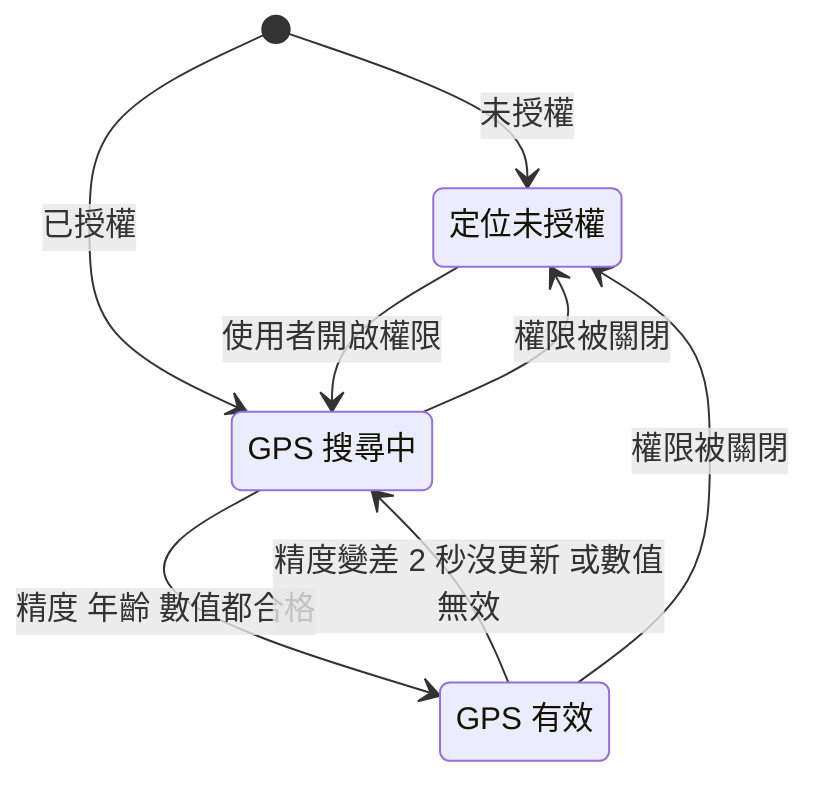
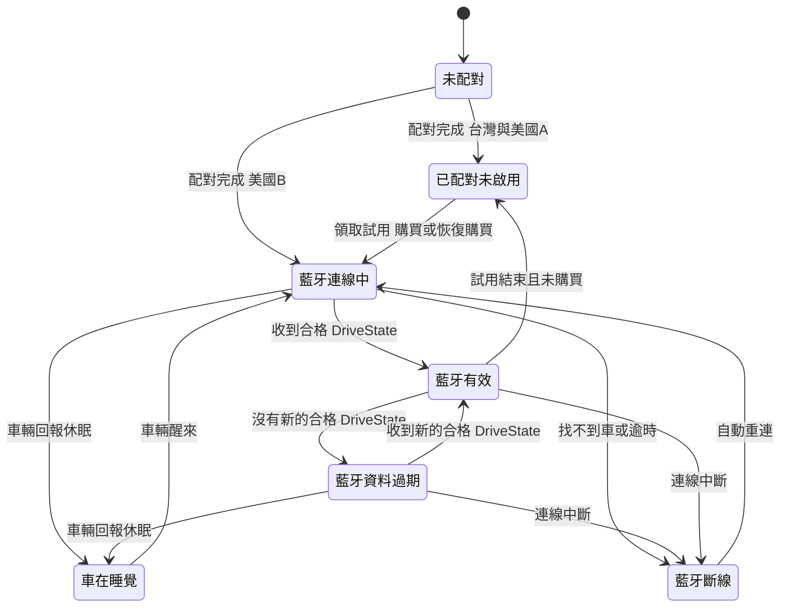
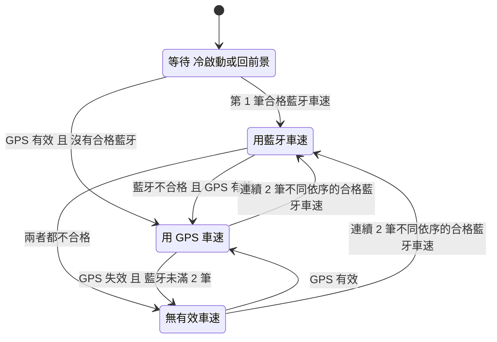
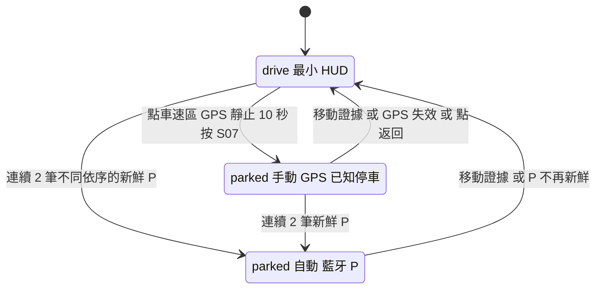

# 01 — 流程與畫面清單(ux)

> 2026-10-18。依據:`[10 §drive]`、`[10 §parked]`、`[10 §免費版]`、`[06 C01–C10]`、`[06 B 測速]`(Part B「固定點測速照相提醒」)、`[04 §S3 §T3 H9]`、`[09]`、`DESIGN.md`、`lib/`(main)、`origin/feature/goal-2-ble`(`tesla_ble_client.dart`、`ble_transport.dart`、`spike_screen.dart`)。
> 〔推論〕= ux 的設計判斷,沒有外部證據;門檻數字都是起測值,要實車或使用者測試確認(見「假設」「待確認問題」)。

> **修訂紀錄**
>
> **第八輪修訂(2026-10-20,老闆選定:L49–L53)**:
>
> | 段落 | 改了什麼 | 依據 |
> |---|---|---|
> | §2.1 S04-e、§5.1、§5.2、§6.1、§6.3 S03、§7.4、§11 Q13 測速提醒用字 | 改成唯一一種:相機圖示 +「此路段限速 60 公里」/「Speed limit 60 km/h」;mph「此路段限速 37 英里」/「Speed limit 37 mph」;讀屏「此路段限速每小時 60 公里」。第七輪的三種用字和 §5.2 舊底線標「已被 L53 取代」,留作紀錄 | L53 |
> | §5.2、§7.4 提醒樣式 | 定為「側光條」:沒有底卡,左邊一條細青色光條 + 相機圖示 + 一行字;相機圖示不能拿掉(測速的意思靠它);一行放不下時只在「此路段限速」和「60 公里」之間換行 | L52、L53 |
> | §2 S04、§5.4、§7.4、§9 A25、§10 Q28、§11 Q38 速度表 | 只寫 C「扇形」:拿掉「四個版本」「等老闆選定」和只跟 A 有關的寫法;主要設計稿照 C 重畫。其他規格不動 | L49、L51 |
> | §2 S04、§7.4 電量 / 續航 | 左下角「電量 / 續航」確定 | L50 |
> | §9 A31 | 06 C06 的例外和風險:寫成路段速限,資料錯或舊時會誤導;使用者已接受;列出還在的護欄。前方模式(v1 不開)的用字 L53 沒改 | L53 |
> | §2 S21 / S25、§6 開頭、§6.2、§6.4、§6.6 胎壓說明補稿 | 照 visual 的 R8-01 補稿和 L57:① S20 說明句照原句,06 C03 通過時也不提胎壓(胎壓只在功能清單第 5 項和小字);② S21「你會失去」清單在 06 C03 通過時列胎壓(同功能清單第 5 項 + 小字);③ S25 胎壓一段的小標題「胎壓 / Tire pressure」,放在「測速資料來源與授權」下面;④ S25「隱私說明」英文「Privacy」。胎壓三段文案(S06 一次性說明、功能清單第 5 項小字、S25 胎壓說明)改成畫面實際用的全形標點「，」「；」,字不變 | L57、03 R8-01 |
>
> **第七輪修訂(2026-10-20,老闆看過比較頁:L42–L45)**:
>
> | 段落 | 改了什麼 | 依據 |
> |---|---|---|
> | §2.3、§3.2、§6.2、§7.4 胎壓 | 每輪只顯示整數 `42 psi` 或「—」;不寫位置名稱、每輪時間、畫面上的「尚無讀值」;舊值改成車圖下方**共用一行**(15 分鐘內不顯示,以最舊一輪為準,「時間未知」優先),中英文 6 種情況;單位固定 psi;清單版換版規則照短標籤改寫(刪掉免責 42 pt 條件,清單版要寫位置名稱);讀屏每輪一句,舊的那一輪自己唸時間 | L42、R6-08、R6-09、R6-11 |
> | §6.2、§6.4、§6.6、§9 A30 | 免責說明移出胎壓面板:S06 左欄一次性說明列(按「知道了」收起)、S20–S22 功能清單小字、S25 固定說明 | L42、06 C03 |
> | 取消的舊寫法 | 第六輪補的 165 寬英文「Time / unknown」「No reading / yet」、畫面上的「尚無讀值」、「最後量測 18 分鐘前」、`2.9 bar`、A14 的 bar、A20 的 60 分鐘、清單版免責放標題下方:全部被 L42 取代,不是漏改 | L42 |
> | §2、§2.1、§2.2、§3.5、§6.1、§6.2、§7.2、§7.4、§8、§9 A26、§10 Q28 檔位 | `P R N D` 一排放數字正上方、量表區內(844 中心約 (422, 112)、667 約 (333, 106));目前檔位亮、粗、加形狀記號;只在藍牙檔位新鮮且版面 = 車速 + 車況時顯示,否則整排不顯示、不寫「—」,原因由來源標示或停車車況狀態行說(取代 L18 Q9 的檔位框部分);R、N 照同一規則;讀屏順序和讀屏句拆開檔位與電量 | L43 |
> | §5.4、§6.1、§7.4、§8、§11 Q38 ▲ | ▲ 改放數字正下方、空出來的檔位格(844 (422, 318)、667 (333, 302));不放數字左側、不靠著檔位排。**L18 Q7、L39 Q38 寫的是「數字上方」,要主持人改裁定、safety 審** | L43、L39 Q38 |
> | §5.1、§5.2、§6.1、§7.4 測速提醒 | 附近模式三種用字:① 完整「附近有測速點 / 點位資料速限 60 km/h」、② 精簡「附近測速點 / 資料速限 60 km/h」、③ 最短「相機圖示 + 附近 / 資料速限 60 km/h」(英文 listed limit);§5.2 加「提醒卡的底線」(一定要有、可以拿掉、不能加);§7.4 提醒卡改成只定框和底線,排法交給 visual | L45、L8、03 S04、03 Q13 |
> | §9、§10 | 加 A29(只有檔位過期時不加字)、A30(免責位置);加 Q29(倒車時車速正負)、Q30(胎壓 15 分鐘門檻) | — |
> | L46 補充(safety 代審 R7-01–R7-18 照單全收) | ① **▲**:L46 已把 L18 Q7、L39 Q38 的「數字上方」改成數字正下方;§2.1 S04-f、§5.4、§6.1、§7.4、§8、§11 Q38 對齊 R7-08(只有一個、≥24 × 20、離單位、數字、A 的速度條 ≥12、和琥珀同進同出),Q38 的退路撤回。② **測速提醒**:三種用字都保留完整的「點位資料速限」、第一行都用文字寫「測速點」、英文都有 camera;上一列 ②③ 的「資料速限」、③ 用相機圖示代替「測速點」、③「放得下排成一行」全部撤回。字只剩「有」和英文第二行(Listed limit 只在第一行是 Camera nearby 時)可以變,**簡約改靠排法**;§5.2 底線補上 R7-09、R7-11–R7-13 的數字。③ **檔位排**:新鮮 P 但有移動證據(例如任一有效來源 ≥5 km/h)也不顯示;收起後要 2 筆新鮮檔位才回來;離數字 ≥12、離量表圖形 ≥6、離日期膠囊 ≥12,中心改約 (422, 108) / (333, 102);字高、對比、淡入淡出照 R7-04–R7-06;倒車時藍牙負車速在 Q29 spike 前當無效(§3.3)。④ **胎壓**:四輪都是「—」時共用時間行寫「尚無讀值 / No readings yet」;只有收到時間的讀值算「時間未知」;舊值只暗舊的那幾輪、亮度比 ≥2:1;一次性說明照 R7-16 六個最低條件(左欄捲動區第一項,沒按「知道了」下次再出現);S25 補「—」的意思和「app 不判斷胎壓是否正常」 | L46、03 R7-03–R7-18 |
>
> **第六輪修訂補充 3(2026-10-20,胎壓圖示審查 L40:R6-08、R6-09、R6-11)**:① §2.3 把「這台車不支援」和「四輪都沒有讀值」拆成兩列,加判斷順序;「這台車沒有提供胎壓資料」只給確認不支援的車(不畫車圖),支援的車四輪都沒值時每輪各自「—」+「尚無讀值」;§2.2 S06-c 的胎壓欄改指這個畫法;加 A28。② §7.4 胎壓區換清單版改成實際量高度:任一輪讀值區超過 68 pt 或免責說明超過 42 pt 就換;清單版的免責說明放在標題正下方;註明實色字底板不能拿掉;Q27 同步。這也回答了 flutter 提的「四象限只在預設字級成立」落差。③ §6.2 補「尚無讀值 / No reading yet」、165 寬英文「Time / unknown」「No reading / yet」(分兩行,讀屏仍唸完整句)、輪位名稱,以及胎壓讀屏句(缺值唸「右後,尚無讀值」,不唸「—」)。
>
> **第六輪修訂補充 2(2026-10-18,02 Q38、Q39)**:§11 回答 Q38、Q39。§7.4:選 A 時 ▲ 改放量表區最上緣(仍在數字上方),新增「沒資料時的量表」列(保留虛線空軌道,形狀要和 0 km/h 不同);§2 S05、§3.4 的「弧形和紅色標記隱藏」改成同一條規則。
>
> **第六輪修訂補充(2026-10-18,safety R6-03、L38)**:§7.4 和 §7.2 確認框:① S07 面板改成右欄從頂端到底部安全線、按鈕上下排固定在底部、放不下時說明捲動,不往左擴;② 附近提醒卡和 S02 / S05 說明不用左右兩欄,第二行用滿卡片寬,只在「點位資料速限 / 60 km/h」之間換行;③ 停車畫面來源標示只寫短字、最寬 160 / 150,日期膠囊和它至少隔 16,放不下時改只顯示時間或移到左欄;④ 左下電量 / 續航字級 16–18 pt、等寬數字,固定保留兩行(停車三行)的空間,大字或 `100% / 520 km` 時換兩行不跳版;⑤ 胎壓區改四象限(尺寸不變),大字時讀值放不下兩行才改清單版。§6 補對應文案;Q27 標已處理。
>
> **第六輪修訂(2026-10-18,老闆改速度表和版面)**:照 `00-rulings.md` L31(速度表置中,取代 L25)、L33(電量 / 續航放左下角,用「/」分隔)、L34(停車胎壓改成車子俯視圖)。
>
> | 段落 | 改了什麼 | 依據 |
> |---|---|---|
> | §7.4(新) | 置中版面的區塊與座標:844 × 390 和 667 × 375 的內容區、量表區、左右欄;行車畫面每個元素(來源標示、齒輪、提醒卡、檔位、▲、S02 / S05 說明與按鈕、電量 / 續航、只有 GPS 時左下角留空)的位置;停車畫面左欄(車況狀態行、捲動區、電量 / 續航)和右欄胎壓區的確切尺寸;大字和三位數的處理 | L31、L33、L34、L24、L26 |
> | §7.1、§7.2 | 「量表永遠在左」改成「永遠在正中間」,註明 L25 已被 L31 取代;行車、停車兩列改寫;S07 確認框改成右欄面板 | L31 |
> | §2、§2.1、§2.2、§2.3、§6.1、§6.2 | 電量 / 續航分隔符號從「·」改成「/」(中英文);狀態列拆成「檔位在量表底部缺口」和「電量 / 續航在左下角」;§2.3 註明胎壓改用俯視圖、逐輪狀態不變 | L33、L34 |
> | §8、§9、§10 | 補「速度表位置」「停車胎壓」差異列;改「drive 狀態列位置」;加 A25–A27、Q27–Q28 | L31–L34 |
>
> **2026-10-18 第五輪補充 2**:§6.5 補 S14 鍵盤上方的「收起鍵盤 / Hide keyboard」和「‹ 返回 / ‹ Back」(L30、02 Q33)。
>
> **2026-10-18 第五輪補充**:回答 02 Q29–Q31(§11)。§7.2 停車畫面的來源標示改回左上、右欄最上方改放車況狀態行;設定兩欄的單欄條件;§6.6 補 S24 按鈕(完成 / 重試 ・ 關閉 / 關閉)。
>
> **2026-10-18 第五輪(使用者改範圍)**:照 L28 只做橫式(左右兩個方向都支援)、L29 拿掉鏡像。
>
> | 段落 | 改了什麼 | 依據 |
> |---|---|---|
> | §2、§6.4 | 刪除 S11 鏡像預覽、S08 的「鏡像 HUD 模式」列和 S11 文案;S21「仍免費」拿掉鏡像模式;畫面數 28 → 27 | L29 |
> | §7(重寫) | 改成「橫式版面」:共通規則(方向、翻轉、畫面座標、兩側安全區、手勢區、最小尺寸、捲動),以及行車、停車、表單 / 列表、長文案、首次開啟、配對、鍵盤(S14 VIN)、確認框、購買、購買結果的橫式版面規則;刪除原 §7.2 鏡像注意事項 | L28、L29、L24、L25、L26 |
> | §1、§2 S04/S06、§5.4、§6.3、§8、§11 | 直式位置描述改成橫式:狀態列在右欄下半、觸發區在右欄上半、▲ 在量表內數字上方、S03 文案「車速下方」改「車速旁邊」、S19-b 改置中確認框;§8 補「畫面方向」「鏡像」兩列,DESIGN.md / PRODUCT.md 寫成建議改法 | L28、L29 |
> | §10 | Q10(鏡像可讀性)標已刪除 | L29 |
>
> **2026-10-18 最後同步**:§6.4 補 S10-b「前往 App Store / Google Play 更新」入口(02 Q26);S09 沒連車提示改用 safety R4-09 文案,§4.4 同步(02 Q27)。
>
> **2026-10-18 第四階段補充**:§7.1 橫式量表固定在左(L25);文案表寫入 S07(L20)、舊值對比 ≥4.5:1(L21)、S10 過期條件式恢復(L22);§2.2 S06-d 和 §11 Q15、Q20 同步。
>
> **2026-10-18 第四階段**:照 `00-rulings.md` L13–L18 補文案,回答 visual 在 02 的 Q13–Q18、Q20、Q21(新增 §11)。沒有改結構。
>
> | 段落 | 改了什麼 | 依據 |
> |---|---|---|
> | §2 S20、§4.3、§6.4、§6.6、§9 A24、§10 Q26 | 試用文案照平台分開:iOS「領取」、從 App Store 原始交易日期起算、恢復不重新開始;Android「在此安裝中開始」、本機紀錄說明、拿不到價格時的離線文案;刪掉所有〔L11 待定〕和「已用過」的 Android 變體;價格改從商店取得 `{價格}` | L14;04 第三階段 |
> | §6.3、§6.4 | 定位被拒、沒配對藍牙時,S05 只放一行 +「前往系統設定」;完整說明移到 S08「定位權限」列 | L13;§11 Q14 |
> | §5.2、§6.1、§6.4、§10 Q22 | 測速資料過期或點位已知錯誤:整張卡片不出現,只在 S10 寫「已過期」和「更新 app 後會取得新資料」;刪掉「只寫附近有測速點」的變體 | L16 |
> | §6.1、§6.5、§10 Q25 | 地下室沒有 GPS 又還沒配對:閘門提示「到收得到 GPS 的地方停好車,再設定或配對」;S13 準備清單加一條 GPS;列為已知限制、待使用者決定 | L17 |
> | §5.4、§6.1、§2.2、§6.2 | 琥珀時 ▲ 只放在數字上方,卡片文字不再加 ▲;「—」旁邊加失效文字;檔位框沒有新鮮 P 時可以留「—」但要有文字 | L18 Q7、Q9 |
> | §6.3、§6.5、§11(新) | S07 依據改成「GPS 顯示已靜止 10 秒,但無法確認是否安全停車」;S18-h 按鈕;S19 改配對沒完成的文案;S04-i 展開「P 檔資料已過期」;S10「最後驗證」說明 | 02 Q15–Q17、Q20、Q21 |
>
> **2026-10-18 第三階段**:照 `00-rulings.md` L6–L12 改;L11 試用文案先標〔L11 待定〕,等 `flutter` 寫出機制。這一階段改了結構:§3 和 §5 整段重寫,§4.1 首次開啟改順序。
>
> | 段落 | 改了什麼 | 依據 |
> |---|---|---|
> | §3.5、§3.6、§4.1、§4.4 | 新增「移動證據」和「已知停車」兩個共用定義。所有非 HUD 頁面(含對話框、鍵盤、手動 parked)只在已知停車時打開:藍牙要 2 筆不同、依序的新鮮 P;只有 GPS 要靜止 10 秒 + S07。移動證據優先於 P 和 S07。**完全沒有資料時沒有 S07**,只留最小 HUD;首次開啟只直接跳系統定位對話框(S02),選版面、測速說明、安裝提醒延後到使用者點齒輪且已知停車時。開著的頁面一出現移動證據或失去已知停車就關,**刪掉 10 km/h 退出門檻**,關了不自動重開;所有非 HUD 頁共用同一個操作狀態,回前景、授權返回、配對回應、商店回呼、試用到期都重新檢查 | L6;03 R2-01–R2-03;04 R1、R2 |
> | §3.5、§2.2 | 刪除「<10 km/h 直接進 parked」;手動 parked 也要已知停車;自動 parked 在 P 不再新鮮時回 drive,不在 S06 顯示過期 P | L6 第 5 點 |
> | §3.1–§3.3 | 新增「合格讀值」:要有來源時間,只有接收時間的藍牙資料在實車證明年齡上限前不能顯示成可信車速、算 P、觸發琥珀或解鎖操作;重複、亂序、只有 ChargeState 的回應不算新的一筆;GPS 的 NaN、負數、時間倒退或在未來一律當沒有車速;冷啟動第 1 筆合格藍牙就顯示,從 GPS 切回藍牙要 2 筆,中間沒有有效來源顯示「—」;**刪除**「60 秒失效 3 次冷卻 30 秒」和「藍牙不穩」狀態,交給實車測試 | L7;03 R2-04;04 R3 |
> | §5(重寫)、§2.1、§6.1、§6.3、§6.4 | 測速提醒分**附近模式**(v1 預設也是唯一上線的模式:無距離、無琥珀)和**前方模式**(設計好,等道路匹配和資料有效期限實地驗證才開);資料記錄版本和最後驗證日期,過期或已知錯誤就停止琥珀和肯定速限,重新下載同版不算更新;內部用 km/h 比較,卡片速限換算成使用者單位,切單位重新計時;琥珀用單調時間,換點位 / 速限 / 來源 / 資格中斷都重新計時,降到速限以下馬上撤;冷卻依點位 × 方向 × 這一次接近 | L8;03 R2-05–R2-08;04 R4 |
> | §3.1、§3.4、§2.1、§2.2、§6.1–§6.3 | 沒有定位權限只讓 GPS 車速和測速不能用,不抹掉藍牙車速;來源標示文案「GPS 不可用」;parked 的來源標示永遠寫目前車速來源,電量、胎壓各自標時間;P 只在新鮮有效時顯示;補 4 張狀態稿:S04-h(藍牙有效 + 拒絕定位)、S06-d(GPS 備援 + 舊電量)、S05(兩個來源都無效)、S04-i(P 過期) | L9;03 R2-09;04 R2 |
> | §4.2、§6.5 | 配對中斷依實際狀態恢復(表),金鑰已加入就不再感應卡片;S18-h 改用 safety 文案;登記後重新取得 infotainment session;「休眠」只在車輛明確回報時才寫 | L10;03 R2-10;04 R6 |
> | §4.2、§2、§6.5 | v1 只支援一台車:S19 只顯示一台,「新增車輛」改「改配對另一台車」+ 取代確認;新車到 S17 成功前保留舊車 | L12 |
> | §4.5(新)、§9 A6 | 地區規則:測速相關畫面只在最後一筆有效定位位於台灣時出現;語系只用在第一次的單位預設,商店國家只決定價格 | L12;04 R7 |
> | §4.3、§2、§6.6 | 試用資格、「每個帳號一次」等說法全部改成〔L11 待定〕 | L11;04 R5 |
> | §4.3.2、§2、§6.7 | S26、S27 只畫草稿,不架站、不收資料 | L12 |
> | §8、§9、§10 | 補差異列(附近模式、地區、一台車);A1–A4、A6、A9、A13 改寫,刪 A19,加 A21–A24;Q11、Q14、Q19 標已裁定,加 Q22–Q26 | L6–L12 |
>
> **2026-10-18 第二階段**:對照 `03-safety-review.md` 第一階段的 P0 S01–S04、P1 S05–S13 補漏;並照 team-board 11:36 主持人裁定更新試用上限和美國雙版本。沒有改結構;第三階段審查意見出來後再改。
>
> | 段落 | 改了什麼 | 依據 |
> |---|---|---|
> | §2、§2.2、§2.3、§6.2 | parked 分成「有效車速」「新鮮 P + 車速缺值(數字隱藏,標『P 檔』)」「P 過期」三種,不共用一張 0 畫面;變暗時來源標示和「最後更新」不跟著變暗;新增胎壓逐輪狀態表(量測時間未知、歷史值、缺值、不支援、單位不明) | 03 S01、S03、S06、S09 |
> | §3.6、§4.3、§6.3 | 操作閘門:P 和停車都**不會自動打開**任何操作頁,只在使用者自己點時才開;藍牙有效時沒有 S07 這條路;S07 加 GPS 靜止 ≥10 秒的條件;沒有任何有效車速時 S07 多一行「無法確認車輛狀態」;補中斷與恢復表;試用結束(S21)不再自動跳出,購買結果(S24)在行駛中不顯示 | 03 S02、D03 |
> | §3.2、§3.3、§3.4、§6.1 | 補 app 回前景 / 冷啟動一律先「—」;補來源時間、接收時間、量測時間的區分;來源切換時數字**直接換,不做補間**;反覆掉線的穩定規則 | 03 S03、F02、F03 |
> | §5、§6.1 | 提醒卡加「前方 / 附近」字樣和 km/h;琥珀文字改「超過點位資料速限」;補免費 GPS / 付費藍牙 / 美國的同條件矩陣 | 03 S04、S05 |
> | §2.1、§4.4、§6.3、§6.4 | 補「版面 × 固定測速提醒」四種組合;設定名稱改「固定測速照相提醒」;「純車速」說明加「提醒開啟時也會顯示提醒」;預覽依提醒開關顯示;首次開啟每步有返回、即時保存 | 03 S08、C01 |
> | §2、§4.1、§6.4、§7.1 | 新增 S28 安裝提醒(氣囊、視線、操控);首次開啟加這一步;S08 加入口 | 03 S12;00-summary P0 #3 |
> | §6.1、§7.3(新) | 補無障礙:讀屏標籤與順序、觸控區、iOS/Android 減少動態、三位數車速與系統大字;S08 預留「大字與高對比」(美國上架前) | 03 S10、S11、A02–A05 |
> | §4.3、§8、§10 | 試用上限:主持人已裁定照 06 Part B 不設上限,列待使用者決定;美國雙版本放產品外網頁:主持人同意 | team-board 11:36 |
>
> 沒改的:英文來源標示維持 "Car Bluetooth"(03 S07 建議 "Vehicle Bluetooth"),因為來源標示是 10–12 px 小字,短一點比較好讀;繁中照 03 用「車輛藍牙」。

## 1. 重點結論

1. 共 27 個畫面:現有 D/D2/E/F 改出 4 個,新增 23 個(首次開啟 3、停車確認 1、設定子頁 2、說明 3、配對與車輛管理 7、付費 5、美國測試網頁 2)。**app 只做橫式**(左右兩個方向都支援),**沒有鏡像**(L28、L29)。drive 只多兩樣:觸發區(v1 只有台灣測速)和藍牙狀態列 `[10 §drive]`。
2. 車速來源:藍牙**合格**(有來源時間、新的一筆)就用藍牙,否則 GPS 有效就用 GPS,都失效就顯示「—」。來源切換和失效**只在左上來源標示提示**,不占觸發區,任何版面都不能關掉;沒有定位權限只停 GPS 和測速,不影響藍牙車速 `[06 C01][L7][L9]`。
3. 操作閘門:非 HUD 頁面只在「已知停車」時打開(藍牙 2 筆不同、依序的新鮮 P;或只有 GPS 時靜止 10 秒 + S07);**移動證據優先於一切**;完全沒有資料時沒有 S07,只留最小 HUD;一出現移動證據就關回 HUD,不自動重開 `[L6]`。
4. 測速提醒 v1 只上**附近模式**(無距離、無琥珀);前方模式和琥珀等實地驗證後才開 `[L8]`。只在手機位於台灣時出現 `[L12]`。
5. 配對免費、v1 只配一台車;試用照 L14 分平台:iOS 從 App Store 原始交易日期起算,Android 是這次安裝的本機試用,都要主動開始、不自動扣款。最大未知:卡片感應等待時間、金鑰角色能否只讀、來源時間是不是車端時間。

## 2. 畫面清單

「付費」= BLE 車輛資料(台灣、美國 A);美國 B 時這些都免費。「對應 .pen」寫「新」的由 `visual` 畫。

| ID | 名稱 | 什麼時候出現 | 元素 | 資料來源 | 免費/付費 | 對應 .pen |
|---|---|---|---|---|---|---|
| S01 | 首次開啟:選行車畫面 | 第一次開啟後,使用者**自己點齒輪**且已知停車時(§4.1);不自動跳出 | 標題;兩張預覽卡(純車速 / 車速 + 車況,標「示範」);每張卡寫 GPS 與藍牙的差異;「測速提醒另外設定」(手機位於台灣時);「之後可在設定改」;主按鈕;「略過」;「為什麼沒有方向燈和盲點」連結 → S12;選了車速 + 車況後多一個次要按鈕「現在連接車輛」→ S13 | 本機 | 免費 | 新 |
| S02 | 最小定位授權入口 | 第一次開啟時直接跳出系統定位對話框;拒絕或只給大約位置時,在 S05 的觸發區位置放一行說明 + 按鈕 | 系統定位對話框;被拒狀態:一行說明 +「前往系統設定」(打開作業系統設定)。**L6 唯一可以在沒有資料時出現的非 HUD 元素**,不放長文 | 本機 | 免費 | 新 `[L6]` |
| S03 | 測速提醒說明(台灣) | 手機位於台灣(§4.5),首次設定流程的 S01 之後;之後可從 S10 再看 | 功能說明(v1 附近模式版,不提琥珀;前方模式版另備);資料限制聲明;開關(預設開);「繼續」 | 本機(內建點位資料) | 免費 | 新 |
| S04 | 行車畫面 drive | 預設畫面;不在 parked 時 | 橫式:**速度表在畫面正中間**(C「扇形」錶 + 紅色指針 + 車速 + 單位,固定不動,L31、L49);左上來源標示;右上齒輪;右欄上半觸發區(平常空白,保留位置);`P R N D` 一排在車速數字正上方(只有藍牙檔位新鮮時,L43);電量 / 續航在左下角(L33、L50)(§7.4) | GPS / 車輛藍牙;測速點位用手機定位 | 免費(GPS 車速、測速);付費(藍牙車速、檔位、電量) | D2(改) |
| S05 | 無有效車速 | GPS 搜尋中、沒有定位權限**且藍牙不合格**,或所有來源都失效(藍牙合格 + 拒絕定位是 S04-h) | 車速「—」;量表的填色、目前值標記、端點、刻度數字和檔位都隱藏;可以留一條虛線 / 點線的空軌道保持位置,但形狀要和 0 km/h 時的軌道不同(§7.4);來源標示寫原因;觸發區不出現;狀態列依 §3.4 | — | 免費 | F(改) |
| S06 | 停車畫面 parked | 自動:藍牙已知停車(2 筆不同、依序的新鮮 P);手動:點 S04 車速區且只有 GPS 的已知停車(靜止 10 秒 + S07),§3.5 | 來源標示(**永遠寫目前車速來源**);齒輪;車速環(三種情況,§2.2);`P R N D` 一排、P 亮(只在新鮮有效 P 時,L43);電量 + 續航(標自己的更新時間);本趟行程(GPS);時間膠囊;胎壓四輪 psi + 舊了才出現的共用時間行(06 C03 通過才有,§2.3,L42);第一次看到胎壓時左欄的一次性說明列;未配對 / 未解鎖時的車況佔位;試用結束通知列(不自動跳 S21)。**只放摘要**,裡面的入口照 §3.6 閘門 | GPS + 車輛藍牙 | 免費(行程、時間、GPS 車速);付費(檔位、電量、胎壓)。橫式:速度表在正中間、和行車同位置;左欄行程與電量、右欄胎壓俯視圖(§7.4) | D(改) |
| S07 | 停車確認 | **只有 GPS** 的已知停車:有效 GPS ≤1 km/h 已持續 10 秒,使用者點了非 HUD 入口時。藍牙有效、有移動證據、完全沒有資料時都不會出現 | 一句說明;「我已安全停車」;「取消」 | 本機 | 免費 | 新 `[L6]` |
| S08 | 設定 | 從 S04/S05/S06 齒輪,過了閘門(§3.6) | 群組:顯示(單位、行車畫面 → S09、車況顯示、亮度、強調色、大字與高對比〔美國上架前加入,免費〕);提醒(固定測速照相提醒 → S10,只在台灣顯示);車輛(車輛藍牙 → S19、車輛資料或支持開發者 → S20/S21/S22/S23、恢復購買);行為(螢幕恆亮);說明(安裝提醒 → S28、S12、S25)。**刪除**「行駛自動切換極簡」和「鏡像 HUD 模式」(L29) | 本機 | 免費 | E(改) |
| S09 | 行車畫面設定 | S08 → 行車畫面 | 同 S01 的兩張預覽卡,目前選擇打勾;沒連車時的提示;「測速提醒:開啟中」→ S10;P 檔自動切換說明 | 本機 | 免費 | 新(重用 S01 元件) |
| S10 | 測速提醒設定 | S08 → 固定測速照相提醒(只在手機位於台灣時,§4.5) | 開關;功能說明(附近模式版);資料限制聲明;資料來源、**資料版本、最後驗證日期、狀態**(有效 / 已過期 / 部分點位停用);授權;更新失敗狀態 | 本機 | 免費 | 新 |
| S12 | 本版本不提供 | S01、S08、S22 的連結 | C02 文案;獨立開發聲明 | 本機 | 免費 | 新 |
| S13 | 配對:開始前 | S19 空狀態或「改配對另一台車」、S01 次要按鈕、S06 未配對佔位(都要過 §3.6 閘門) | 準備清單(在車內、車醒著、鑰匙卡、P 檔);會用到什麼(VIN、新增手機鑰匙與權限、可在車上刪除);「開始」;藍牙權限請求 | 本機 | 免費 | 新 |
| S14 | 配對:輸入 VIN | S13 之後 | VIN 欄(17 碼);「在哪裡找到 VIN」;即時格式錯誤;「下一步」 | 本機 | 免費 | 新 |
| S15 | 配對:尋找並連線 | S14 之後 | 步驟 2/4;進度;「請留在車內」;取消 | 車輛藍牙 | 免費 | 新 |
| S16 | 配對:感應鑰匙卡 | 新增金鑰請求送出後 | 步驟 3/4;插圖(鑰匙卡放中控感應區);等待狀態;感應區位置說明;取消 | 車輛藍牙 | 免費 | 新 |
| S17 | 配對:讀取驗證 / 完成 | 卡片感應後 | 步驟 4/4;「正在讀取車輛資料…」;成功:即時讀值預覽(車速、檔位、電量)+「完成」 | 車輛藍牙 | 免費 | 新 |
| S18 | 配對失敗 | S13–S17 任一步失敗 | 原因標題;使用者能做的事;「重試」;「稍後再說」;依原因有 8 種變體(§6) | 本機 | 免費 | 新 |
| S19 | 車輛藍牙管理 | S08 → 車輛藍牙 | **只有一台車**(L12):已配對車輛(VIN 末 6 碼)、狀態、最後連線時間;「重新連線」;「移除這台車」+ 確認(含車上刪除鑰匙說明);「改配對另一台車」+ 取代確認;空狀態 | 本機 + 車輛藍牙 | 免費 | 新 |
| S20 | 試用開始 | S17 成功後,使用者主動開始(台灣、美國 A);iOS 和 Android 文案分開(L14) | 試用內容(只列已交付);期間與不自動扣款;結束後的價格(從商店取得);「開始免費試用」(iOS 寫「領取」);「稍後」;Android 另有一行試用紀錄說明 | 本機 + 商店 | 付費(試用) | 新 |
| S21 | 試用結束 | 試用到期後,使用者點 S06 的「試用已結束」通知列或 S08「車輛資料」時;**不自動跳出** `[03 S02]` | 「試用已結束」;你會失去哪些(只列已交付;06 C03 通過時含胎壓,L57);仍免費的項目;價格按鈕;「恢復購買」;「先不用」 | 本機 + 商店 | 付費 | 新 |
| S22 | 解鎖(台灣 NT$290 / 美國 A US$9.99) | S21;S08「付費版」;S06 車況佔位 | 付費文案(06 C07 版,實車通過後才用);功能清單(只列已交付);價格與「一次付費」;「本版本不提供」連結 → S12;支援車型與限制;退款與權益;「購買」;「恢復購買」 | 商店 | 付費 | 新 |
| S23 | 支持開發者(美國 B) | 只在 S08「支持開發者」;不主動跳出 | 資料全免費;支持者拿到什麼;「以 US$9.99 支持」;「恢復購買」 | 商店 | 免費(自願付款) | 新 |
| S24 | 購買結果 | 商店回傳後(覆蓋在 S20–S23 上的訊息);行駛中不顯示,停車後再顯示 | 成功 / 取消 / 失敗 / 無法連線 / 等待核准 / 恢復成功 / 沒有可恢復的購買 / 試用已開始 | 商店 | — | 新 |
| S25 | 關於與聲明 | S08 → 關於 | 版本;獨立開發聲明;測速資料出處與授權;胎壓一段(小標題「胎壓」+ 說明,06 C03 通過才有,L42、L57);隱私說明;聯絡方式 | 本機 | 免費 | 新 |
| S26 | 美國方案測試頁 A / B(產品外網頁) | 美國上架前的 H9 研究期間。**這一輪只畫草稿,不架站、不收資料**(L12) | 頂部「方案測試」標示;A 或 B 方案說明;意向按鈕;B 另有「我會免費使用」 | 網頁 | — | 新(草稿) |
| S27 | 方案測試:確認與告知(網頁) | S26 按下意向按鈕後(草稿) | 再確認一次;如實告知「尚未販售、沒有扣款」;選填 email 與用途說明(只畫出來,不能送出) | 網頁 | — | 新(草稿) |
| S28 | 安裝提醒 | 首次設定流程 S03 之後(可略過);S08 → 安裝提醒 | 3 條短提醒(避開氣囊展開路徑、不擋視線、不妨礙方向盤和操控);「依車主手冊確認氣囊位置」;「知道了」 | 本機 | 免費 | 新 `[03 S12][00-summary P0 #3]` |

### 2.1 S04 行車畫面的狀態變體

| 變體 | 條件 | 車速 | 來源標示 | 觸發區 | 狀態列 |
|---|---|---|---|---|---|
| S04-a GPS | 未配對 / 未解鎖 / 藍牙不合格,GPS 有效 | GPS 值,白色 | ● GPS(藍牙相關狀態見 §3.4) | 依 §5 | 隱藏 |
| S04-b 藍牙 | 藍牙合格,版面 = 車速 + 車況 | 藍牙值 | ● 車輛藍牙 | 依 §5 | `P R N D`(D 亮,數字正上方;新鮮 P 但有移動證據時整排不顯示,§7.4)+ 左下角 `72% / 315 km` |
| S04-c 藍牙 + 純車速 | 藍牙合格,版面 = 純車速 | 藍牙值 | ● 車輛藍牙 | 依 §5(測速開關獨立) | 隱藏 |
| S04-d 來源剛切換 | 藍牙 ↔ GPS | 直接換成新來源的值 | 展開 4 秒「已改用 GPS 車速」/「已改用車輛資料」,之後留短版 | 不受影響 | 依 §3.4 |
| S04-e 附近模式提醒(v1) | §5.2 附近模式條件成立 | 白色 | 不變 | 側光條:相機圖示 +「此路段限速 60 公里」(L52、L53);無距離、無琥珀 | 不變 |
| S04-e2 前方模式提醒(v1 不開) | §5.2 前方模式條件成立 | 白色 | 不變 | 「前方 300 m ・ 點位資料速限 60 km/h」 | 不變 |
| S04-f 超過點位速限(只有前方模式,v1 不開) | §5.4 琥珀條件成立 | **琥珀色** + 數字正下方一個 ▲(L46) | 不變 | 警示圖示 +「超過點位資料速限 60 km/h」(卡片文字不加 ▲) | 不變 |
| S04-g 回前景 / 冷啟動 | app 剛啟動或從背景回來,還沒收到合格讀值 | 「—」 | ◌ 等待車速訊號 | 不出現 | 隱藏 |
| **S04-h 藍牙有效 + 拒絕定位**(L9 狀態稿 1) | 藍牙合格,沒有定位權限 | 藍牙值 | ● 車輛藍牙 · GPS 不可用 | **不出現**(測速需要定位) | 照常 |
| **S04-i P 檔過期,剛離開 parked**(L9 狀態稿 4) | 原本在自動 parked,P 不再新鮮 | 有合格來源就顯示;沒有就「—」 | 目前車速來源(例如 ◐ GPS · 藍牙資料過期,或 ▲ 車速暫不可用) | 依 §5 | **整排檔位不顯示**;電量照 §3.2 |

- **S05 兩個來源都無效**是 L9 狀態稿 3:車速「—」、量表只留虛線空軌道(§7.4)、「▲ 車速暫不可用」(或「▲ GPS 不可用」),觸發區不出現。
- L9 狀態稿 2「GPS 備援 + 舊電量」是 S06-d(§2.2)。

**版面 × 固定測速提醒的四種組合**(S01、S09 的預覽依目前的提醒開關顯示,提醒開著時預覽裡畫一張附近模式的示範提醒卡)`[06 C01][03 S08]`:

| 版面 | 固定測速提醒 | 只有 GPS 時的 drive | 藍牙有效時的 drive | 一定保留 |
|---|---|---|---|---|
| 純車速 | 開 | 車速 + 提醒卡 | 車速 + 提醒卡(沒有狀態列) | 來源標示、失效提示、P 檔自動切 parked |
| 純車速 | 關 | 車速 | 車速 | 同上 |
| 車速 + 車況 | 開 | 車速 + 提醒卡(和純車速相同) | 車速 + 提醒卡 + 狀態列 | 同上 |
| 車速 + 車況 | 關 | 車速(和純車速相同) | 車速 + 狀態列 | 同上 |

- 手機不在台灣時沒有提醒開關,只有上表「關」的兩列(§4.5)。
- 「純車速」不承諾畫面永遠只有車速:提醒開著時會出現提醒卡,文案照 §6.3 寫明。

### 2.2 S06 停車畫面的狀態變體

來源標示**永遠寫目前車速的來源**(● 車輛藍牙 / ● GPS / ▲ 沒有車速),不寫成整個畫面的「最後更新」;電量、續航、胎壓各自標自己的更新時間(胎壓是整個胎壓面板共用一行,L42);檔位 **只在新鮮有效時**顯示 `[L9][03 R2-09]`。**沒有新鮮檔位時整排 `P R N D` 不顯示**,不畫四個都暗的字,也不畫「—」`[L43]`(取代 L18 Q9 裡「檔位框留『—』加失效文字」的部分;車速的「—」+ 失效文字不變)。為什麼不見了由別的地方說:行車時是左上來源標示(「◐ GPS · 藍牙中斷」「◐ GPS · 藍牙資料過期」「◐ GPS · 車輛休眠」,§3.4);停車時是左欄車況狀態行(「◐ 藍牙中斷」「◐ 藍牙資料過期」)或佔位列(「連接車輛後可顯示檔位與電量」)。

| 變體 | 條件 | 車速環 | 檔位 / 電量 | 行程、時間 | 胎壓 | 來源標示 |
|---|---|---|---|---|---|---|
| S06-a GPS(手動) | 只有 GPS 的已知停車,沒有藍牙資料 | GPS 有效值,**不寫死 0** `[06 C09]` | 不顯示檔位;未配對:佔位「連接車輛後可顯示檔位與電量」;未解鎖:佔位「車況需要解鎖」 | 有 | 不顯示 | ● GPS |
| S06-b 藍牙 P(自動) | 藍牙已知停車 | 藍牙車速(新鮮的 0 才顯示 0);藍牙沒有車速但 GPS 有效時用 GPS | `P R N D`(P 亮,數字正上方);左下角 `72% / 315 km` | 有 | 06 C03 通過才有 | ● 車輛藍牙(或 ● GPS) |
| S06-c 等待車輛(手動) | 只有 GPS 的已知停車;已配對、連線中、還沒有第一筆合格資料 | GPS 有效值 | 不顯示檔位;車況區寫「◌ 等待車輛…」,`—%` `— km` | 有 | 06 C03 通過才有:車圖 + 四輪各自「—」,車圖下方共用一行「尚無讀值」(§2.3「支援胎壓,但四輪都沒有讀值」,R7-18);**不寫**「這台車沒有提供胎壓資料」`[R6-08]` | ● GPS |
| **S06-d GPS 備援 + 舊電量(手動)**(L9 狀態稿 2) | 只有 GPS 的已知停車;藍牙過期、斷線或車睡著 | GPS 有效值;**弧形、紅色標記跟著車速走,不淡化保留舊車速** `[03 S03]` | 不顯示檔位;電量、續航顯示最後讀值,**數值變暗但對比仍 ≥4.5:1**,旁邊一定標自己的時間「12 分鐘前」(時間文字不變暗;「舊」靠時間表達,不只靠變暗 `[L21]`);車況區另一行「◐ 藍牙中斷」或「◐ 車輛休眠」(只有車輛明確回報時)`[DESIGN.md Hardened states][03 S06]` | 有 | 舊的輪子數值變暗 + 車圖下方共用一行「N 分鐘前」,見 §2.3 | ● GPS |
| S06-e 未解鎖 | 已配對未啟用(§3.2;台灣、美國 A) | 有效車速 | 佔位「車況需要解鎖」;符合試用資格 → 「開始免費試用」→ S20,否則「查看解鎖方式」→ S22(資格照 L14:iOS 看商店交易,Android 看本機紀錄);試用剛結束時多一行通知「車輛資料試用已結束 →」(點了才開 S21) | 有 | 不顯示 | 目前車速來源 |
| S06-f 新鮮 P,沒有車速 | 藍牙已知停車,但**所有來源**都沒有有效車速 `[04 R2]` | **隱藏數字和弧形,中央標「P 檔」**;不顯示 0 | 檔位排不顯示(中央已寫「P 檔」,不重複 P);電量依 §3.2 | 有 | 依 §2.3 | ▲ 車速暫不可用 |

- 自動 parked 在 P 不再新鮮時回 drive(S04-i);**不在 S06 裡顯示過期 P**。藍牙失效後還想看停車摘要,要走只有 GPS 的已知停車(S06-d)`[L6 第 5 點][L9]`。
- 只有 GPS 的手動 parked 在 GPS 失效時也回 drive,所以 S06 不會出現「—」的車速環。

車速環的情況要分開畫,不能共用一張 0 畫面 `[03 S01][06 C09]`:

| 情況 | 車速環中央 | 弧形、紅色標記 |
|---|---|---|
| 有效車速(含新鮮的 0) | 數字(0 也照實顯示) | 依數值 |
| 新鮮 P + 所有來源都沒有車速(S06-f) | 「P 檔」 | 隱藏 |
| 沒有有效車速、也沒有新鮮 P | 不會停在 S06,回 S04/S05 顯示「—」 | 隱藏 |

### 2.3 停車畫面的胎壓狀態(06 C03 通過才有)

第七輪照 L42 簡化:每個輪子旁**只顯示整數 psi**(例如 `42 psi`)或「—」;不寫「左前」等位置名稱(位置由車圖表達)、不寫每輪的量測時間、輪子旁不寫「尚無讀值」(四輪都是「—」時只在共用時間行寫一次,R7-18),也不放免責說明(移出面板,見 A30、§6.2、§6.4、§6.6)。每一輪仍各自判斷新舊,不給「正常」顏色或打勾 `[06 C03][03 S09]`。車圖和尺寸見 §7.4;tire 第七輪定為四角、無引線(05;safety R7-14 通過)。

**判斷順序** `[R6-08][L40]`:① 06 C03 沒通過或單位不明 → 整個胎壓區不顯示;② **確認**這台車 / 韌體不提供胎壓欄位 → 只留標題和一行「這台車沒有提供胎壓資料」;③ 其他情況(包括四輪都沒有讀值)→ 畫車圖,每輪照下表。「不支援」只能由車型 / 韌體或 06 C03 的驗證結果判斷,**不能從「四輪目前沒值」推定**(A28)。

**單位**:固定 psi、整數,不跟車速單位(km/h / mph)換 `[L42]`。車子給的值怎麼換成 psi 由 `flutter` 確認;先換算再取整數,不能先把來源值取整。

| 情況 | 該輪顯示 | 備註 |
|---|---|---|
| 有值,量測時間 15 分鐘內(新鮮) | `42 psi` | 時間用 `tpmsLastSeenPressureTime*`,不用查詢或連線時間;15 分鐘是起測值(A20);只有收到時間、沒有車子的量測時間時,一律算「時間未知」`[R7-15][L7]` |
| 有值,量測時間超過 15 分鐘(舊) | `42 psi`,數值變暗(對比仍 ≥4.5:1,L21;和新鮮值的亮度比 ≥2:1,R7-15);只暗這一輪 | 車圖下方出現共用時間行(下表) |
| 有值,沒有量測時間 | `42 psi`,數值變暗 | 不當成現在值;共用時間行寫「時間未知」類(下表) |
| 沒有值 | `—`(不帶單位) | 輪子旁不寫「尚無讀值」;讀屏唸「右後,尚無讀值」,不唸「—」`[L42][R6-11]`;其他輪照常、不補 0;不算進共用時間行 |
| 單位不明 | 整個胎壓區不顯示 | 單位確認不了就不交付這項 `[06 C03]` |
| 支援胎壓,但四輪都沒有讀值(剛連上還沒收到第一筆、S06-c 等待車輛、四輪剛好都沒值) | 車圖 + 四輪各自「—」;共用時間行寫「尚無讀值」,只寫一次,不放在每個輪子旁 `[R7-18][L46]` | `[R6-08]`;不能因此改說成不支援 |
| 確認這台車 / 韌體不提供胎壓欄位 | 不畫車圖和「—」;只留標題「胎壓」和一行「這台車沒有提供胎壓資料」 | 只給**確認不支援**的車 `[R6-08][L42]`;不推定車輛或感測器有故障 |

**共用時間行**(整個面板一行,放在車圖下方,確切位置由 tire 定)`[L42]`:只算有值的輪子,用**最舊的一輪**的量測時間;「時間未知」比「N 分鐘前」優先,因為不知道的時間可能比任何已知的都舊。

| 有值的輪子 | 繁中 | 英文 |
|---|---|---|
| 都在 15 分鐘內 | (不顯示) | (hidden) |
| 都超過 15 分鐘 | 18 分鐘前 | 18 min ago |
| 有的新鮮、有的超過 15 分鐘 | 部分讀值 5 小時前 | Some readings 5 hr ago |
| 全部沒有量測時間 | 時間未知 | Time unknown |
| 有的沒有量測時間 | 部分讀值時間未知 | Some readings: time unknown |
| 四輪都是「—」 | 尚無讀值 | No readings yet |

- 時間格式:60 分鐘內寫「N 分鐘前」,24 小時內寫「N 小時前」,再久寫「N 天前」;每分鐘更新一次。
- 這一行的字不變暗,≥12 pt、≥4.5:1,底下有實色字底板,預設字級下不用捲動就看得到,最多兩行 `[R7-15]`。
- 「舊」靠這一行的文字表達(L21);**哪幾輪舊**靠那幾輪的數值變暗,只暗舊的那幾輪,不整個面板一起變暗。safety 有條件通過(R7-15):新鮮值和變暗值的亮度比 ≥2:1(B 剛好 2.0,不能再淡)、變暗值仍 ≥4.5:1、有新有舊時這一行寫「部分讀值…」、讀屏時舊的那一輪自己唸時間(§6.2);T06 有人分不出哪一輪舊時,再加形狀記號。

## 3. 狀態圖

### 3.1 定位(GPS)

- **GPS 有效** = 水平精度 ≤50 m(沿用 `SpeedProcessor.accuracyThresholdM`),定位本身的時間在 2 秒內,而且車速是有限、非負的數〔推論,起測值〕。
- **無效值一律當沒有車速**:NaN、無限大、負數、時間倒退(比上一筆早)、時間在未來,都丟掉,畫面顯示「—」`[L7]`。現有程式在精度變差時沿用舊值、沒有過期機制,要改 `[00-summary P0]`。
- **沒有定位權限只影響 GPS 車速和測速提醒**,不會抹掉有效的藍牙車速 `[L9]`。
- 測速提醒對定位的要求更嚴,見 §5。

### 3.2 車輛藍牙

| 狀態 | 定義〔推論,待實車〕 | 備註 |
|---|---|---|
| 藍牙連線中 | 掃描 VIN 推得的廣播名稱 → 連線 → SessionInfo,逾時值照分支程式(20、20、10 秒) | 首次和斷線後都走這裡 |
| 藍牙有效 | 最後一筆**合格**的 DriveState(定義見下)在有效期內 | 有效期起測 2 秒;spike 目標 P95 ≤1 秒 `[10 spike #2]`,但 P95 不能推出最大年齡安全 |
| 藍牙資料過期 | 連線還在,但沒有在有效期內的合格 DriveState | 車速改用 GPS 或「—」;檔位不顯示 |
| 藍牙斷線 | 連線中斷或重連失敗 | 自動重連,只在 app 前景;重連頻率由實車測試決定 `[L7]` |
| 車在睡覺 | 車輛的 VCSEC 狀態**明確回報**休眠 | 只是逾時、讀不到時不能寫「休眠」,要寫「藍牙中斷」`[04 R6]`;**不為背景儀表喚醒車** `[09 §喚醒]` |
| 已配對未啟用 | 台灣、美國 A:配對完成但**還沒領試用**、試用已用過、或試用結束未購買 | 不連線,省車輛電量;S04 等同未配對;S06 顯示「車況需要解鎖」佔位;美國 B 沒有這個狀態。配對過程(S15–S17)的連線和讀值只用來驗證,不算啟用 |
| 任何狀態 → 未配對 | S19「移除這台車」,或配對另一台車成功(v1 只支援一台,§4.2) | 圖上省略 |

**合格讀值**(藍牙資料要全部符合,才能顯示成可信車速、算 P、觸發琥珀、解鎖操作)`[L7][03 R2-04]`:

1. 解密成功,而且能對上這次的請求。
2. **有來源時間**(DriveState、ChargeState 的 `timestamp`,實車確認是車端時間),且「現在 − 來源時間」在有效期內;**或者**只有接收時間,但實車測試已證明「請求 → 回應」的資料年齡有上限,用那個上限判斷。兩者都不成立就**不合格**,畫面照「藍牙資料過期」處理。
3. 是**新的**一筆:來源時間比上一筆晚。重複的回應、同一個來源時間、亂序(比上一筆早)、只有 ChargeState 的回應,都不算新的一筆 `[04 flutter 11:43]`。
4. 各欄位分開判斷:車速欄位有效,這筆才能提供車速;檔位欄位有效,這筆才能提供檔位。車速缺值時檔位仍可以是新鮮的 P(S06-f)`[04 R2]`。

各欄位的有效期〔推論,起測值〕:

| 資料 | 有效期 | 失效時 |
|---|---|---|
| 藍牙車速、檔位(DriveState,1–2 Hz) | 來源時間 2 秒內 | 車速改用 GPS 或「—」;檔位不顯示;**unknown 檔位永遠不當成 P** |
| P 檔計數 | 連續 2 筆**不同、依序**的合格 P;壞包或斷線就歸零 | 未滿 2 筆不算新鮮 P |
| 電量、續航(ChargeState,每 5–15 秒 `[10 §輪詢預算]`) | 來源時間 60 秒內 | drive:`—%`、`— km`;parked:變暗 + 自己的更新時間 |
| 胎壓(parked,06 C03) | 量測時間 15 分鐘內算新鮮〔起測值,A20〕;不判斷「正常」;舊了才在車圖下方顯示共用一行「N 分鐘前」(以最舊一輪為準)`[L42]` | 見 §2.3 |
| GPS 車速 | §3.1 | 「—」 |

- **drive** 一律用「—」,不留舊值。**parked** 的電量、續航、胎壓可以顯示最後讀值,但要**變暗**,而且**各自標自己的更新時間**(不是整個畫面共用一個「最後更新」;胎壓是整個胎壓面板共用一行,和電量的時間分開)`[L9][L42]`;**車速和檔位在任何畫面都不用舊值**。
- **三種時間分開** `[03 F02]`:
  - **接收時間**:手機收到並解密的時間。分支 mapper 目前只有這個(`DateTime.now()`)。只有接收時間的資料,照上面第 2 點,沒有實車證明前不合格。
  - **來源時間**:DriveState、ChargeState 的 `timestamp`;要實車確認是車端時間(Q20)。
  - **量測時間**:只有胎壓有(`tpmsLastSeenPressureTime*`),畫面上胎壓的「N 分鐘前」只能用它。
  - 畫面上的「N 分鐘前」用來源時間,不寫成「量測」。
- **回前景 / 冷啟動**:背景期間的讀值一律作廢;回到前景後車速「—」、來源標示「◌ 等待車速訊號」。**第一筆合格的藍牙讀值就可以顯示**,GPS 照 §3.1 `[L7]`。

### 3.3 顯示用的車速來源

- **藍牙合格優先**,不合格才用 GPS(06 C07 建議文案「僅在有有效 GPS 讀值時提供速度備援」)。藍牙一不合格就立刻切 GPS。
- **冷啟動 / 回前景**:第一筆合格藍牙車速就顯示 `[L7]`。
- **從 GPS 備援切回藍牙**:要連續 2 筆不同、依序的合格藍牙車速;還沒滿 2 筆時 GPS 也失效了,就顯示「—」,不提早用那 1 筆藍牙 `[L7][04 flutter 11:43]`。
- 反覆掉線時要不要冷卻、冷卻多久,交給實車測試決定,不放進設計 `[L7]`。
- **切換時數字直接換成新來源的值,不做補間動畫**,避免把兩個來源的差距藏起來 `[03 F03]`;弧形可以照平常的 250 ms 緩動,但判斷移動、超速時只用未經動畫的數值 `[04 R1]`;減少動態開啟時弧形也直接跳。
- 其他欄位(檔位、電量、續航、胎壓)只來自藍牙,沒有 GPS 備援 `[DESIGN.md Data-source reality]`。
- **倒車時藍牙回報負車速**:Q29 實車 spike 之前當作**不合格**(GPS 有效時用 GPS,否則「—」),不先取絕對值;spike 確認負值只是倒車時的正常車速後,flutter 才改成取絕對值。畫面永遠不出現負號;GPS 的負值照 L7 一律無效 `[R7-07][L46]`。
- 測速提醒的位置**永遠用手機定位**,和車速來源無關;沒有定位權限時測速提醒不能用,藍牙車速照常 `[L9]`。

### 3.4 切換時畫面怎麼提示

來源標示不只靠顏色:**形狀 + 文字**一起變。● 實心 = 來源有效;◐ 半實心 = 備援中或連線中;◌ 空心 = 等待;▲ = 沒有有效車速。切換只展開一次(4 秒),不閃爍、不發聲;減少動態設定開啟時直接換,不做動畫 `[06 C05][DESIGN.md Reduced-motion]`。來源標示**永遠寫目前車速的來源**,在 drive 和 parked 都一樣 `[L9]`。

| 轉換 | 車速數字 | 來源標示(左上) | 狀態列 | 觸發區 |
|---|---|---|---|---|
| 未配對,GPS 有效 | GPS 值 | ● GPS | 隱藏 | 依 §5 |
| 藍牙連線中(GPS 有效) | GPS 值 | ◐ GPS · 藍牙連線中… | 隱藏 | 不受影響 |
| → 用藍牙車速 | 直接換成藍牙值,不做補間 | ● 車輛藍牙;展開「已改用車輛資料」4 秒 | 出現(版面 = 車速 + 車況) | 不受影響 |
| 藍牙 → 資料過期,GPS 有效 | 立刻換成 GPS 值 | ◐ GPS · 藍牙資料過期;展開「已改用 GPS 車速」4 秒 | 檔位不顯示;電量撐到自己的 60 秒有效期後「—」 | 不受影響 |
| 藍牙 → 斷線 / 睡覺,GPS 有效 | GPS 值 | ◐ GPS · 藍牙中斷 / ◐ GPS · 車輛休眠(只有車輛明確回報時) | 斷線 >10 秒就整列收起〔推論〕 | 不受影響 |
| GPS 備援中藍牙恢復,只收到 1 筆 | GPS 值 | ◐ GPS · 藍牙連線中… | 隱藏 | 不受影響 |
| 同上,但 GPS 也失效 | 「—」 | ▲ 車速暫不可用 | 隱藏 | 立刻撤除 |
| 任何來源 → 無有效車速 | 「—」;量表的填色、目前值標記、端點、刻度數字和檔位都隱藏;可以留一條虛線 / 點線的空軌道保持位置,但形狀要和 0 km/h 時的軌道不同(§7.4);**不凍結舊數字,不畫成 0** | ▲ 車速暫不可用 | 同上 | **立刻撤除**(定位失效不給提醒)`[06 B 測速]` |
| 無有效車速 → GPS 有效 | GPS 值,弧形回來 | ● GPS | 隱藏 | 條件成立才出現 |
| 藍牙有效 + 拒絕定位(S04-h) | 藍牙值 | ● 車輛藍牙 · GPS 不可用 | 照常 | 不出現(測速需要定位) |
| 藍牙無效 + 拒絕定位 | 「—」 | ▲ GPS 不可用 | 隱藏 | 不出現 |
| app 回前景 / 冷啟動 | 「—」,直到第一筆合格讀值 | ◌ 等待車速訊號 | 隱藏 | 不出現 |

- 純車速版面也照這張表提示,來源標示**不能被任何設定關掉** `[06 C01]`。
- 「GPS 不可用」只用短字;為什麼不可用、怎麼開權限,只寫在設定和 S02 `[L9][03 R2-09]`。
- parked 的同類狀態見 §2.2:來源標示照樣寫目前車速來源,電量、胎壓各自標時間。

### 3.5 版面:drive ↔ parked

先定義兩個詞,§3.5 和 §3.6 共用 `[L6]`:

- **移動證據**(出現任一項就算):① 任一有效來源的車速 ≥5 km/h;② 新鮮檔位不是 P;③ 來源矛盾:新鮮 P,但車輛自己回報的車速 >1 km/h〔推論〕。移動證據**優先於一切**,這時 P 和 S07 的確認都無效。
- **已知停車**(二選一,而且沒有移動證據):
  - **藍牙**:連續 2 筆不同、依序、合格的新鮮 P。
  - **只有 GPS**(沒有合格的藍牙檔位):有效 GPS 車速 ≤1 km/h 持續 10 秒(用單調時間計),**加上**使用者主動按 S07「我已安全停車」。
- 完全沒有有效資料(沒有合格藍牙、沒有有效 GPS)**永遠不算已知停車**,也沒有 S07 可按。
- 所有門檻都用 km/h 定義、內部比較,不隨顯示單位改數字 `[L8]`。

| 規則 | 內容 | 依據 |
|---|---|---|
| 啟動預設 | **drive**(現有 `ModeController` 預設 parked,要改) | `[06 B GPS 切 parked]` |
| 自動進 parked | 只看藍牙的**已知停車**。GPS 零速、過期 P、unknown 檔位、只有插槍訊號都不算 | `[06 C09][L6]` |
| P 的意義 | 只是**版面切換條件**,不代表車已安全停好 | `[06 C09]` |
| 手動進 parked | 點 S04 車速區,**也要已知停車**:只有 GPS 時要靜止 10 秒 + S07;完全沒有資料時不能進;**刪除「<10 km/h 直接進」** | `[L6 第 5 點][03 R2-03]` |
| 離開 parked | 一出現移動證據就立刻回 drive,不等 10 km/h;自動 parked 在 P 不再新鮮時回 drive;手動 parked 在 GPS 失效時回 drive | `[L6]`;資料不明時退回最小 HUD |
| 回到 drive 之後 | 不自動回 parked;要重新符合已知停車(手動要再按一次 S07) | `[L6 第 4 點]` |
| parked 的內容 | S06 只放摘要(車速、行程、電量、胎壓、時間);裡面的配對、購買、設定入口照 §3.6 閘門,**不主動跳出付費** | `[L6 第 5 點]` |
| 純車速版面 | 一樣會在已知停車時自動切 parked;純車速只管 drive 的內容 | 〔推論〕 |
| 只有 GPS | 停下來仍留在 drive(等紅燈也是零速) | `[10 §parked]` |
| parked 的車速 | 有效車速 → 數字(新鮮的 0 照實顯示 0);新鮮 P 但**所有來源**都沒有有效車速 → 隱藏數字標「P 檔」;其他 → 「—」。三種分開畫(§2.2) | `[06 C09][03 S01][04 R2]` |
| 檔位排顯示 | 只在新鮮有效檔位時顯示 `P R N D`(目前檔位亮);手動 parked 或 P 過期時整排不顯示;**新鮮 P 但有移動證據 ① 或 ③**(任一有效來源 ≥5 km/h,或車輛自己回報 >1 km/h)時也不顯示,不讓和移動矛盾的 P 亮著;收起之後要 2 筆不同、依序的新鮮檔位才再出現(冷啟動第一筆即可,和 §3.3 從 GPS 切回藍牙同一規則)。細節見 §7.4 | `[L9][L43][L46][R7-03][R7-07]` |

### 3.6 操作閘門(所有非 HUD 頁面)

**涵蓋哪些頁面** `[L6 第 1 點]`:設定(S08–S10、S19、S25、S28)、配對(S13–S18)、試用與購買(S20–S24)、首次選版面與說明(S01、S03)、本版本不提供(S12)、手動 parked(S06 手動)、app 內所有對話框和鍵盤(例如 S14 的 VIN 鍵盤)。**唯一例外**:S02 最小定位授權入口(§4.1)。

**版面切換和操作權限是兩件事** `[03 S02]`:非 HUD 頁面**只在使用者自己點齒輪或按鈕時才打開**。P、停車、試用到期、購買結果、配對回應都**不會自動打開**任何頁面。

**判斷順序**(由上往下,第一個符合的就決定結果)`[L6 第 2、3 點][04 R2]`:

| # | 狀態(使用者點了入口時) | 結果 |
|---|---|---|
| 1 | 有移動證據(§3.5) | 不打開。P 和 S07 都無效。來源標示旁顯示 3 秒「停車後再設定」 |
| 2 | 完全沒有有效資料 | 不打開,**沒有 S07**,留在最小 HUD;顯示 3 秒「需要車速資料才能設定」 |
| 3 | 藍牙已知停車(2 筆不同、依序的新鮮 P) | 打開,不用 S07 |
| 4 | 沒有合格的藍牙檔位;有效 GPS ≤1 km/h 已持續 10 秒 | 顯示 S07,按「我已安全停車」才打開 |
| 5 | 其他(例如 GPS 靜止未滿 10 秒) | 不打開;「停車後再設定」 |

S07 的確認**不是**安全停車的證明;它只在只有 GPS、已靜止 10 秒、使用者自己點了入口時才出現,沒有「不再詢問」。

**打開之後**(所有非 HUD 頁面共用**同一個操作狀態**)`[L6 第 4 點][03 R2-02]`:

- 每收到一筆讀值、每次換頁或彈出對話框、回到前景、從系統權限頁返回、收到配對回應、收到商店回呼、試用到期時,都**重新檢查**。
- **一出現移動證據就立刻關回 HUD**,不等 10 km/h。
- **失去已知停車也關回 HUD**:用藍牙打開的,P 不再新鮮就關;用 GPS 打開的,GPS 失效就關。資料不明時退回最小 HUD。
- 關回之後,車速降下來也**不自動重開**;要重新過閘門,只有 GPS 時要再按一次 S07。
- 資料更新不等於可以換頁:延遲到的配對回應、商店結果、錯誤和重試,都先記下來,不自己跳出畫面。

**中斷與恢復** `[03 D03][L10]`:

| 進行中 | 怎麼處理 | 下次怎麼恢復 |
|---|---|---|
| 設定(S08–S10、S12、S19、S25、S28) | 立刻回 HUD;選項是即時套用,不會遺失 | 下次過閘門後回到 S08 首頁 |
| 首次選版面(S01、S03) | 回 HUD,沒選的用預設值 | 下次使用者點齒輪並過閘門時,從沒完成的那一步繼續 |
| 配對(S13–S18) | 中止,回 HUD;記下實際進度 | 依實際狀態恢復(§4.2);下次進 S13 時先顯示 S18-h |
| 試用 / 購買(S20–S23) | 回 HUD;系統付款框由作業系統處理,app 不關它 | 結果在行駛中**不顯示**,權益照常生效;下次使用者在已知停車時打開 S06 或 S08,才顯示一次結果 |
| 手動 parked | 回 drive | 要重新過閘門 |
| 任何流程 | drive 中不跳任何要使用者處理的訊息 | — |

## 4. 流程

共同規則:除了 S02 最小定位授權入口,所有流程都在 S04/S06 以外的畫面進行,先過 §3.6 閘門;drive 中不出現任何購買、配對或說明長文 `[brief 安全原則][10 §drive][L6]`。

### 4.1 第一次開啟

照 L6:沒有資料、還不知道是否停車時,只做最小定位授權;選版面、測速說明、安裝提醒都延後到「有資料且已知停車」時 `[L6 第 3 點][03 R2-01]`。

| # | 畫面 | 使用者做什麼 | 可能失敗 / 處理 |
|---|---|---|---|
| 1 | S02 最小定位授權入口 → 系統對話框 | 第一次開啟就直接出現作業系統的定位對話框,按「允許」 | 這是 L6 唯一允許在「沒有資料」時出現的非 HUD 元素;前面不放說明頁、不放 S07 |
| 1a | 拒絕定位 | — | 回到 S05:車速「—」、來源標示「▲ GPS 不可用」;觸發區位置放 S02 的一行說明 +「前往系統設定」按鈕(打開作業系統設定,不是 app 內頁)。之後配對了藍牙,藍牙車速照常顯示 `[L9]` |
| 1b | 只給大約位置 | — | 同 1a,說明改成「需要精確位置才能計算車速」 |
| 2 | S04 | 開始使用,先用預設值:版面「車速 + 車況」(A5);手機位於台灣時固定測速照相提醒開(附近模式,§5) | 齒輪旁顯示一個「待完成設定」小圓點(形狀,不只顏色) |
| 3 | 使用者點齒輪 → §3.6 閘門 | 已知停車才打開;只有 GPS 時要靜止 10 秒 + S07 | 移動中、沒有資料 → 不打開;**不會自己跳出** S01 |
| 4 | S01 | 看兩張預覽,選一個版面 | 預覽**不顯示假車況值**,只寫「連接車輛後顯示」`[06 C01]`;「略過」→ 保留預設,直接到 S08 |
| 4b | S01(選了車速 + 車況) | 主按鈕「繼續」;次要按鈕「現在連接車輛」→ §4.2 | 不強迫配對或付費,主按鈕一定是「繼續」`[06 C01]` |
| 5 | S03(只在手機位於台灣時,§4.5) | 看說明,開關預設開,按「繼續」 | — |
| 6 | S28 安裝提醒 | 讀 3 條提醒,按「知道了」;可略過 | 略過 → 之後可從 S08「安裝提醒」再看 `[03 S12]` |
| 7 | 回 HUD | 小圓點消失 | 任一步出現移動證據或失去已知停車 → 照 §3.6 關回 HUD,下次從沒完成的那一步繼續 |

- 每一步都有「返回」回上一步;每一步的選擇**按下就保存** `[03 S08]`。
- 中途關掉 app、回前景、從系統設定返回:**先回 HUD**,舊的確認和頁面都不保留;要再過一次閘門 `[03 R2-02]`。
- 不配對也能走完全程:沒有任何一步要求配對或付費 `[06 C01]`。
- 選了「車速 + 車況」但沒配對:S04 和純車速一樣(狀態列需要藍牙),只在 S06 佔位提示一次「連接車輛後可顯示檔位與電量」。
- 地下室等完全沒有資料的地方:只能看最小 HUD,要等有 GPS 或藍牙 P 才能設定(Q25)。

### 4.2 藍牙配對(含鑰匙卡感應)

前提:人在車內、車子醒著、手邊有這台車的鑰匙卡、停在 P。配對免費;試用從 S17 成功後才能領 `[04 §S3]`。程式步驟照 `origin/feature/goal-2-ble`。還沒配對時沒有藍牙 P,所以配對要走「只有 GPS」的已知停車(靜止 10 秒 + S07);完全沒有 GPS 的地方(例如地下室)不能開始配對(Q25)。

**v1 只支援一台車** `[L12]`:已經有配對的車時,S19 的入口是「改配對另一台車」;新車走到 S17 成功之前,舊車的配對都保留;S17 成功後才刪掉舊車在手機上的資料,並提醒到舊車的鑰匙清單刪除手機鑰匙。

| # | 畫面 | 程式步驟 | 使用者做什麼 | 可能失敗 | 處理 |
|---|---|---|---|---|---|
| 1 | §3.6 → S13 | — | 讀準備清單和「會用到什麼」,按「開始」 | 移動中;沒有資料 | 閘門擋下 |
| 2 | 系統對話框 | 藍牙權限 | 允許 | 拒絕;手機藍牙關閉 | S18-a「需要藍牙權限」→ 前往設定;S18-b「藍牙已關閉」 |
| 3 | S14 | 本機檢查 VIN | 輸入 17 碼 | 長度不對;含 I/O/Q | 欄位下方即時錯誤,不能按下一步 |
| 4 | S15 | `connectToVin`:掃描 VIN 推得的廣播名稱,20 秒 | 留在車內 | 找不到車(車睡著、距離太遠、VIN 打錯) | S18-c「找不到你的車」:開車門或踩煞車喚醒車、靠近中控、檢查 VIN;「重試」回到步驟 4 |
| 5 | S15 | `device.connect` 20 秒 → VCSEC `SessionInfo` 10 秒 | 等待 | 連線逾時;車輛可靠連線數已滿(最多 3 個,和手機鑰匙共用)`[09 §喚醒]` | S18-d「連不上車輛」:關閉其他會連到車的 app 或裝置後重試 |
| 6 | S16 | `enrollKey`:新增金鑰請求(角色見 Q2) | 把鑰匙卡放在中控台感應區,直到車上確認 | 沒感應或逾時(等待時間未知,Q1);卡片不屬於這台車;車上拒絕或鑰匙已滿 | S18-e「沒有收到鑰匙卡感應」→「重試」重新送出請求;S18-f「車輛沒有接受這把鑰匙」;同一步失敗 3 次 → 多顯示「查看說明」 |
| 7 | S17 | 登記後**重新取得** Infotainment `SessionInfo` `[04 R6]` → 第一筆 `GetVehicleData` → 合格讀值(§3.2) | 等待 | 金鑰已加入但讀不到或解不開(分支目前**預期會失敗**,`readVehicleData()` 送出後回傳 null `[10 spike #1]`);車睡著 | S18-g「鑰匙已加入,但還讀不到車輛資料」→「重試讀取」(不用再感應);繼續用 GPS;S19 顯示「已加入鑰匙,尚未讀到資料」 |
| 8 | S17 成功 | 合格讀值 | 看即時預覽,按「完成」 | — | 預覽只在 S17 上顯示,按「完成」就結束,**不算啟用**。台灣、美國 A:試用依 L11 機制(待定)→ S20 或 S22;進入「已配對未啟用」。美國 B → 直接啟用,回 S06 |

- **「連上了」不算成功**,要讀到一筆合格讀值才算 `[10 spike #1]`。
- 任一步按「取消」:回 S19 或 S08,保留實際進度。已經被車子接受的登記,取消也撤不回 `[04 R6]`。
- 移除:S19「移除這台車」只刪手機上的連線資料;車上的手機鑰匙要使用者在車上的鑰匙清單刪除(分支沒有刪除金鑰的程式,Q6)。
- S13 必須照實說明會用到 VIN 和新增一把有權限的手機鑰匙,不寫「唯讀」「零風險」,除非角色真的是只讀 `[06 C10]`。

**中斷後依實際狀態恢復** `[L10][03 R2-10]`:中斷(移動證據、失去已知停車、app 被關)後,下次使用者點齒輪或 S19 並過閘門,先顯示 S18-h,再依下表決定回到哪一步。每次恢復都先回 S13 讓使用者重新檢查準備事項。

| 中斷時的實際狀態 | 恢復到哪一步 | 要不要再感應鑰匙卡 |
|---|---|---|
| 還沒送出新增金鑰請求(S13–S15) | S13 → S14(VIN 已填好)→ S15 | 之後照常到 S16 |
| 已送出請求,但不確定車子有沒有接受 | S13 → S15 重新連線 → 檢查這把金鑰是否已被車子接受 → 已接受就跳到 S17,沒有才到 S16 | 只有確認沒被接受時才要 |
| 金鑰已確認加入(S16 之後) | S13 → S15 重新連線 → S17 重試讀取 | **不用**再感應 |
| S17 讀取中 | 同上 | **不用** |

### 4.3 付費解鎖

共同規則:
- 入口只在 S06、S08,以及使用者自己走的配對流程(S17 之後接 S20),全部過 §3.6 閘門;**不在 drive 跳出,P 和試用到期也不會自動打開付費畫面**,只在 S06 留一行通知,點了才開 `[10 §drive][03 S02][L6]`。
- 購買結果在行駛中不顯示,停車後使用者自己打開 S06 或 S08 時再顯示(§3.6 中斷與恢復)。
- 功能清單**只列已交付、已驗收的項目**;v1.x 項目(充電、導航摘要、車況摘要、功率條)不列。胎壓只有 06 C03 通過才列 `[06 C03 C07]`。
- 每個付費畫面都有「恢復購買」`[00-summary P1 #6]`。
- **試用機制(L14,照 04 第三階段)**:兩個平台都要使用者**主動開始**,不自動扣款,不自動轉成購買 `[L14]`。
  - **iOS**:零元非消耗型「7 天試用」商品;從 App Store **原始交易日期**起算 7 天(連續 168 小時);恢復購買只恢復原本的期限,不會重新開始。
  - **Android**:**這次安裝**的本機 7 天試用,紀錄存在手機的 app 裡;清除資料、重新安裝或換手機後不保證能恢復剩餘期間。**不能寫**「每帳號一次」「重裝不會重來」`[L14][04 R5]`。
  - 結束後的價格從商店取得;拿不到價格時不寫死 NT$290 / US$9.99,改用「價格以商店顯示為準」`[04 第三階段]`。
- 試用時間:從**領取**時起算 7 天,而領取只開放在 S17 成功之後。**不設「安裝後 14 天」上限**:主持人裁定照 06 Part B,列為待使用者決定(L1、Q16)。

#### 4.3.1 台灣 NT$290 一次買斷

| # | 畫面 | 使用者做什麼 | 可能失敗 | 處理 |
|---|---|---|---|---|
| 1 | S17 → S20 | 按「開始免費試用」(iOS:「領取 7 天免費試用」) | iOS:這個 App Store 帳號已領過 → 恢復原試用(還在期限內就續用剩下的,已結束就顯示結束日);Android:本機有確定的到期紀錄才顯示已結束,不知道時**不能**假裝成已用過 | S24 對應訊息;已結束 → 前往 S22 `[L14]` |
| 1b | S20「稍後」 | 先不領試用 | — | 維持「已配對未啟用」:不連車、不顯示車輛資料;S06 佔位「車況需要解鎖」+「開始免費試用」;S08 車輛資料列顯示「開始試用」。之後隨時可從這兩處領取 |
| 2 | iOS:App Store 確認對話框;Android:app 內開始(不呼叫 Google Play 付款)→ S24 | 確認 | iOS 取消、領取未完成、網路失敗;Android 試用紀錄寫入失敗;手機時間異常 | S24「購買已取消,沒有扣款」/「尚未完成 App Store 試用領取」/「無法連線到商店」/「暫時無法確認試用期限」;維持「已配對未啟用」,GPS 照常 |
| 3 | 試用中 | 正常使用;S08 顯示「免費試用至 {到期時間}」;剩 1 天時 S06 顯示一次小提示 | — | drive 不顯示任何試用訊息 |
| 4 | 到期 → S06 通知 → S21 | 停車時 S06 出現一行「車輛資料試用已結束 →」,點了才開 S21 看「你會失去」清單;S08 車輛資料列也能進 | 一直不停車;不點通知 | 在 drive 什麼都不顯示;車輛資料停用,狀態列消失,來源標示回 GPS(§3.4 照常提示);通知一直留在 S06,不反覆跳出 |
| 5 | S21 → S22 → 商店 | 按「以 {價格} 解鎖」(台灣 NT$290,從商店取得) | 取消;付款失敗;等待家長核准(Ask to Buy) | S24 對應訊息;等待核准時維持「已配對未啟用」,核准後自動解鎖 |
| 6 | S24「已解鎖」 | 回 S06 | 退款後商店撤銷權益 | 回到「已配對未啟用」 |
| — | S22「恢復購買」 | 換手機或重裝 | 找不到購買 | S24「這個帳號沒有可恢復的購買」 |

#### 4.3.2 美國:H9 雙版本(先在產品外測,再上線一組)

主持人 2026-10-18 已同意:雙版本放產品外網頁,app 只上線勝出的一組(team-board 11:36)。

**階段 1:上架前,產品外網頁(S26、S27)** `[04 H9][06 C08]`

| # | 畫面 | A 組 | B 組 | 記錄 |
|---|---|---|---|---|
| 1 | S26 | 「規劃中:US$9.99 一次解鎖車輛藍牙資料;GPS 車速免費」 | 「規劃中:車輛藍牙資料免費;可自願 US$9.99 一次支持」 | 頂部固定標示「方案測試,尚未販售,不會扣款」 |
| 2 | S26 按鈕 | 「我願意以 US$9.99 購買」 | 「我願意以 US$9.99 支持」;另一顆「我會免費使用」 | 點擊(次要) |
| 3 | S27 確認 | 「如果正式推出,你願意付 US$9.99 嗎?」→「確認」 | 同左 | **主要指標:US$9.99 付款意向確認**,兩組相同 |
| 4 | S27 告知 | 立刻如實告知「這是方案測試,沒有扣款」;選填 email | 同左;「我會免費使用」也走這頁 | email、免費意向分開記錄,不和付款意向混算 |

- **這一輪只畫草稿,不架站、不收任何資料**(email 欄位只畫出來,不能送出)`[L12]`。真的要上線測試時,另外照 06 C08 驗收。
- 兩組的流量來源、資格、觀察期、去重口徑相同;不拿 A 的購買點擊比 B 的留 email。
- 禁止:假的付款成功、倒數、稀缺字眼 `[06 C08]`。

**階段 2:app 內,只上線 H9 勝出的一組**

| 勝出 | app 內流程 |
|---|---|
| A | 同 §4.3.1,價格 US$9.99;單位 mph、mi |
| B | 沒有試用、沒有鎖:S17 成功後直接 S06;S08 有「支持開發者」→ S23 → 商店 → S24「謝謝支持」。支持不解鎖任何功能,也**不能再鎖住已宣稱免費的資料** `[06 C08]`;支持者拿到什麼見假設 A11 |

- 美國的測試和結果**不改台灣權益** `[06 C08]`。

### 4.4 從設定改版面

| # | 畫面 | 使用者做什麼 | 可能失敗 | 處理 |
|---|---|---|---|---|
| 1 | S04/S06 齒輪 → §3.6 | 藍牙已知停車直接進;沒有藍牙檔位時 GPS 靜止 10 秒 + S07 確認 | 移動證據;完全沒有資料 | 「停車後再設定」/「需要車速資料才能設定」 |
| 2 | S08 → S09 | 點「行車畫面」 | — | — |
| 3 | S09 | 點另一張卡 | — | **即時套用**,打勾移到新選項 |
| 3a | S09(選車速 + 車況但沒連車) | — | — | 卡片下提示「目前未連接車輛,車況資料暫不顯示;提醒依開關顯示。」+「連接車輛」連結(不強迫)`[03 R4-09]` |
| 3b | S09(選純車速) | — | — | 提示「固定測速照相提醒另外設定:開啟中 →」,說明純車速不等於沒有提醒 `[06 C01]`;預覽依提醒開關顯示(§2.1 四種組合) |
| 4 | 返回 → S08 → HUD | — | 偏好寫入失敗 | 本次仍用新版面;S08 顯示「無法儲存設定」,下次啟動重試 |
| — | 過程中出現移動證據或失去已知停車 | — | — | 立刻回 HUD;已套用的選擇保留;不自動重開 |

- 兩種版面都保留:來源標示、失效提示、P 檔自動切換 `[06 C01 C09]`。
- 測速提醒開關在 S10,和版面分開 `[06 C01]`。

### 4.5 地區判斷(測速提醒相關畫面)

照 L12:測速提醒相關的畫面和設定,**只在手機定位位於台灣時出現** `[L12][04 R7]`。

| 項目 | 規則 |
|---|---|
| 「位於台灣」 | 最後一筆**有效 GPS 定位**(§3.1)落在內建的台灣邊界內(台灣本島、澎湖、金門、馬祖,邊界向外加 20 km 緩衝,避免海邊定位誤差)〔推論〕 |
| 沒有現在的定位 | 用最後一筆有效定位的地區(只存在手機上);**從來沒有有效定位**(例如拒絕定位)→ 地區「未知」,不顯示測速相關畫面 |
| 離開台灣 | 收到一筆落在邊界外的有效定位,就隱藏測速相關畫面;開關狀態保留,回到台灣再出現 |
| 受影響的畫面 | 觸發區提醒、S03、S10、S08 的「固定測速照相提醒」列、S01 和 S09 的台灣版說明、S21「仍然免費」裡的測速提醒 |
| 第一次進入台灣 | 開關預設開(附近模式);S03 等使用者下次過閘門打開設定時才顯示,不自動跳出 |
| 不用來判斷地區的 | 手機語系、商店國家。語系只用在**第一次的單位預設**(美國地區 → mph,其他 → km/h),之後以使用者在 S08 的選擇為準;商店國家只決定商店顯示的價格,由商店處理 `[04 R7]` |
| 提醒本身 | 觸發提醒還要**當下**有合格定位(§5),不能用最後一筆定位 |

## 5. 觸發區規則

v1 觸發區**只有台灣固定測速提醒**;手機不在台灣時永遠空白(§4.5)`[10 §drive][04 §T3][L12]`。觸發區的位置平常保留但不畫任何東西(不畫空框),提醒出現時車速數字不移動〔推論〕。

### 5.1 兩種模式 `[L8 第 1 點]`

官方資料只有測速點的位置、方向和速限,沒有道路形狀,現在證明不了「這個點在你這條路的前方」。所以分兩種模式:

| | **附近模式**(v1 預設,也是 v1 唯一上線的模式) | **前方模式**(設計好,v1 不開) |
|---|---|---|
| 卡片 | 側光條:相機圖示 +「此路段限速 60 公里」(L52、L53;第七輪的三種用字已被 L53 取代,§6.1) | 「前方 300 m ・ 點位資料速限 60 km/h」(L53 沒改,開啟前再定,A31) |
| 距離 | **不顯示** | 顯示,用道路匹配算出的沿路距離;只有直線距離時不能用前方模式 |
| 琥珀色 | **沒有** | 有,照 §5.4 |
| 什麼時候開 | v1 上線就是這個 | 道路匹配和資料有效期限都做過實地驗證後,由產品版本開啟;不是使用者設定 |
| 使用者設定 | S10 只有一個開關(開 / 關),不讓使用者選模式 | 同左 |

- 待使用者決定:v1 只上附近模式,所以 `[10 §drive]` 草圖裡的「350 m」和琥珀色在 v1 都不會出現(L8 待決定)。
- 前方模式開啟後,某一則提醒的道路匹配不可信時,那一則降回附近模式的卡片(撤距離、撤琥珀)`[06 C06][03 R2-06]`。

### 5.2 出現與消失

| 項目 | 附近模式 | 前方模式(v1 不開) | 依據 |
|---|---|---|---|
| 前提 | 手機位於台灣(§4.5)+ S10 開關開(預設開);純車速版面也照樣顯示 | 同左 | `[06 C01][L12]` |
| 點位 | 資料版本在有效期限內,點位沒有被標成已知錯誤,`limit` 格式、單位、數值合理(不只是「非空」) | 同左 | `[L8 第 2 點][03 R2-05]` |
| 定位 | **當下**有效 GPS:精度 ≤20 m、2 秒內、車速 ≥15 km/h(低速時航向不可靠)〔起測值〕 | 同左,另加道路匹配可信 | `[06 B 測速]` |
| 方向 | 行進方向和點位 `direct` 相差 ≤45°,而且直線距離正在變小(正在接近) | 同左 | `[03 R2-06]` 方向可保留 |
| 範圍 | 直線距離:點位速限 ≥70 km/h → 500 m;其他 → 300 m〔起測值〕 | 沿路距離,同樣的範圍 | `[04 §T3]` |
| 消失 | 連續 2 筆有效定位的直線距離變大(通過或離開);超出範圍;開關關閉;離開台灣 | **一通過點位就立刻撤除前方資格**,不留「已通過」卡,也不再提示超過 | `[03 R2-06]` |
| 定位失效、隧道 | **立刻撤除**,不保留舊提醒 | 同左 | `[06 B 測速]`「定位失效仍給可信距離」屬退件情境 |
| 資料過期或已知錯誤 | **整張卡片不出現**(已知錯誤的點位不提醒);只在 S10 顯示「資料已過期」和更新方式 `[L16]` | 同左 | `[L16][03 R2-05]` |

**提醒的底線**(第八輪 L52、L53:側光條、一行字;給 visual 和 flutter):只有附近模式;前方模式的欄位保留(L8),v1 不開。用字見 §6.1,位置見 §7.4。

| | 內容 | 理由 |
|---|---|---|
| **一定要有** | ① **相機圖示**(≥20 px、≥3:1):字裡已經沒有「測速」,測速的意思只靠它表達,不能拿掉 | `[L53]` |
| | ② 一行字「此路段限速 60 公里」(英文 `Speed limit 60 km/h`);設定 mph 時「此路段限速 37 英里」/ `Speed limit 37 mph` | `[L53][L8 第 3 點]` |
| | ③ 左邊一條細青色光條(約 3 寬,`accent.text` `#6FD8E2`;形狀記號,不是圖示欄),高度跟著整塊字 | `[L52]` 02 §8.3 |
| | ④ 數字 + 單位不拆開 | `[L18 Q6][R7-13]` |
| | ⑤ 速限數字 ≥16 px,字高 ≤ 車速三位數字高的 1/4(844 寬 ≤26 px、667 寬 ≤25 px) | `[R7-11]` 兩個大數字並排,容易把速限看成自己的車速 |
| | ⑥ 固定在右欄上半(§7.4),離量表區 ≥12 px(光暈也算);不放量表上方中間(那裡是檔位排);不蓋左上來源標示、右上齒輪;出現、消失時錶、數字、檔位排、來源標示都不動 | `[L31][R7-11][R7-12]` |
| | ⑦ 對比:速限數字 ≥7:1,其他字和單位 ≥4.5:1,光條和圖示 ≥3:1;都對字底下**最亮**的像素量 | `[R7-11]` |
| | ⑧ 文字 ≥15 px、字重 ≥500 | `[R7-11]` |
| | ⑨ 讀屏唸「此路段限速每小時 60 公里」(mph:「此路段限速每小時 37 英里」) | `[L53][03 A05]` |
| | ⑩ 資料過期或已知錯誤:整個不出現 | `[L16]` |
| **不能有** | 底卡、外框(L52 選的樣式本來就沒有);距離;琥珀、橙、紅等暖色(光條也不能換成暖色);紅圈或任何圓形路標的外形;▲、方向箭頭;只有圖示、或圖示 + 數字沒有字(以上違反算 P0)。閃爍、呼吸光、光條流光或會動、輪流換字、倒數條、聲音、要點的按鈕;出現、消失只改透明度、≤200 ms(減少動態時直接出現),出現後完全靜止 | `[L8][L45][L52][R7-09][R7-12]` |
| **換行** | 平常一行;放不下(667 寬、系統大字、粗體文字)時只在「此路段限速」和「60 公里」之間換行(英文在 `Speed limit` 和 `60 km/h` 之間),相機圖示留在第一行開頭,光條跟著整塊高度;不截字、不加「…」、不縮字;最多 4 行 | `[R7-13]` |

第七輪底線裡**已被 L53 取代**的:①「附近」字樣、② 用文字寫出測速點 / 英文要有 camera、③「點位資料速限」、⑨ 讀屏句、「相機圖示可以拿掉」;B 的點陣底紋那一條在選 C 後不用做(L49)。其他各條照舊,已併入上表。

第七輪的提醒卡底線(L45、L46;已被 L53 取代,留作紀錄)

**提醒卡的底線**(第七輪 L45、L46,給 visual 做簡約版本用):新版本只做附近模式;前方模式的欄位保留(L8),文案不變,v1 不開。用字見 §6.1 的 ①②③,位置見 §7.4。L46 之後三種用字的字幾乎一樣(中文只差「有」,英文只差第二行),**簡約要靠排法**(底卡、外框、圖示、字重、單位大小),不是再刪字。

| | 內容 | 理由 |
|---|---|---|
| **一定要有** | ①「附近」:不寫距離、不寫「前方」 | `[L8]` 附近模式沒有距離 |
| | ② 用**文字**寫出測速點:中文第一行「附近有測速點」或「附近測速點」;英文一定有 *camera*(第一行 `Camera nearby`)。只有相機圖示、或圖示 + 數字都不行 | `[L46][R7-09]` 違反算 P0 |
| | ③ 速限說法用完整的「**點位資料速限**」(英文 `Camera data limit`;第一行是 `Camera nearby` 時,第二行可以用 `Listed limit`)。不能縮成「資料速限」,不能只寫「速限 60」「限速 60」或只有「60」 | `[06 C06][L46][R7-09][R7-10]` 讓人知道這是點位資料裡的數字,不是路邊的速限標誌 |
| | ④ 數字 + 單位在同一行、不拆開,單位跟使用者設定(km/h / mph) | `[L18 Q6][L8 第 3 點][R7-13]` |
| | ⑤ 速限數字 ≥16 px,但字高 ≤ 車速三位數字高的 1/4(844 寬 ≤26 px、667 寬 ≤25 px) | `[R7-11]` 兩個大數字並排,容易把速限看成自己的車速 |
| | ⑥ 固定在右欄上半(§7.4),離量表區 ≥12 px(陰影、光暈也算);不放量表上方中間(那裡是檔位排);不蓋左上來源標示、右上齒輪;出現、消失時錶、數字、檔位排、來源標示都不動 | `[L31][R7-11][R7-12]` |
| | ⑦ 對比:速限數字 ≥7:1,其他文字和單位 ≥4.5:1,圖示 ≥3:1、≥20 px;都對字底下**最亮**的像素量;不用 `text.dim` | `[R7-11]` §7.3 |
| | ⑧ 文字(中英文)≥15 px、字重 ≥500;卡片文字不跟著車速數字變細 | `[R7-11]` |
| | ⑨ 讀屏唸完整句「附近有測速照相,點位資料速限每小時 60 公里」,三個版本都一樣 | `[03 A05]` |
| | ⑩ 資料過期或已知錯誤:整張不出現 | `[L16]` |
| **可以拿掉** | 卡片底色和外框(B 的背景有點陣底紋:拿掉底卡時,字底下要放實色底,或那一塊不畫點陣);相機圖示(文字已經寫出測速點);「有」;分隔的「・」;單位可以比數字小一級 | `[R7-09][R7-11]` 版面更簡約,意思不變 |
| **不能有** | 距離;琥珀、橙、紅等暖色(字、數字、圖示、外框、光暈都算);紅圈或任何圓形路標的外形;▲、方向箭頭;只有圖示、或圖示 + 數字沒有文字(以上違反算 P0)。閃爍、呼吸光、流光、會動的外框、輪流換字、倒數條、聲音、要點的按鈕(違反算 P1)。出現、消失只改透明度、≤200 ms(減少動態時直接出現),出現後完全靜止 | `[L8][L45][06 C06][03 S05][R7-09][R7-12]` 標誌外形會讓人以為是路邊的速限 |
| **換行** | 不截字、不加「…」;只在速限說法和數字之間換行(系統大字時,英文速限說法可以在字和字之間換,例如 `Camera data` / `limit`);最多 4 行(到 y 300 / 290);667 寬加圖示時第一行很緊,只在字和字之間換,圖示跟著第一個字。實量排不成一行(844 寬約要 226 px,右欄只有 185),三種都是兩行,不能為了一行縮字 | `[R7-13]` |

### 5.3 資料有效期限、單位、冷卻

**資料有效期限** `[L8 第 2 點][04 R4]`:

- 每一版點位資料記錄「**資料版本**」和「**最後驗證日期**」(團隊對照現場或主管機關資料驗證的日期)。
- **有效期限**從最後驗證日期起算,長度待實地驗證後訂(Q24);90 天不當成安全值 `[03 R2-05]`。
- 超過有效期限或發現已知錯誤 → 停止琥珀色和肯定的速限說法(§5.2)。
- **重新下載同一版資料不算更新**,有效期限不重算;只有新版本通過驗證才算。
- 更新失敗時,上一版**還在有效期限內**才繼續用;否則照「資料過期」處理。
- S10 顯示:資料版本、最後驗證日期、狀態(有效 / 已過期 / 部分點位停用)。

**單位** `[L8 第 3 點][03 R2-08][04 R7]`:

- 內部一律用 **km/h** 比較;所有門檻(1、5、15、70 km/h)都是 km/h,不隨顯示單位換數字。
- 卡片上的速限跟著使用者選的單位顯示:km/h 照資料;mph = 點位速限 × 0.621371 四捨五入(60 km/h → 37 mph)。
- 琥珀比較:**車速(km/h)四捨五入後 > 點位速限(km/h)**。顯示 mph 時,在邊界附近畫面上的 mph 數字和卡片可能差 1(例如畫面 37 mph 但已轉琥珀),列入測試案例(Q23)。
- 前方模式的距離:km/h 使用者用 m;mph 使用者用 ft(以 100 ft 為一格)。
- 切換單位時:卡片重算,琥珀防抖重新計時。
- 測試至少重播:台灣用 mph、點位 60 km/h、車速 85 km/h(畫面 53 mph,要轉琥珀);再切回 km/h `[03 R2-08]`。

**冷卻** `[L8 第 5 點][03 R2-06]`:

- 依「**點位 × 方向 × 這一次的接近**」分開算,不用固定的時間冷卻。
- 「一次接近」= 從進入範圍且正在接近開始,到離開範圍(直線距離 > 範圍 + 100 m)或通過點位為止。
- 每次接近只提醒一次;離開後重新接近就是新的一次,照樣提醒。對向經過同一個點位不算這個方向的接近。

### 5.4 琥珀色(只有前方模式;v1 不開)

台灣 **GPS 免費版和藍牙付費版同一規則**,不看有沒有付費 `[06 C06][04 §T3]`。

| 條件(全部成立才比對) | 說明 |
|---|---|
| ① 車速合格且新鮮 | 用 §3.3 的顯示車速(藍牙或 GPS),依 §3.1、§3.2 的合格條件;只有接收時間的藍牙資料不能用 `[L7]` |
| ② 這則是前方模式的提醒 | 附近模式不比對 |
| ③ 點位與資料有效 | §5.2「點位」那一列 |
| ④ 定位品質合格、不在隧道 | §5.2「定位」那一列 |

| 行為 | 規則 |
|---|---|
| 進入琥珀 | 車速(km/h 四捨五入)> 點位速限,持續 1.5 秒,而且這段時間內至少有 2 筆**不同、依序**的合格車速樣本(重複樣本不算持續超過)。1.5 秒是待驗證的參數 `[L8 第 4 點][03 R2-07]` |
| 計時 | 用**單調時間**。換測速點、換速限、換車速來源、任一條件中斷、切換單位,都**重新計時**,不跨失效累積 |
| 離開琥珀 | 車速 ≤ 點位速限時**馬上**撤掉「超過」字樣和琥珀色,沒有退出延遲;任一條件不成立也馬上撤 |
| 變色範圍 | 只有車速數字變琥珀(`over` `#FFB638`);弧形和標記維持中性 `[DESIGN.md Drive dial]`;弧形的緩動數值不拿來比較 |
| 不只靠顏色 | 琥珀時**只在車速數字正下方放一個 ▲**(原本檔位格的位置,≥24 × 20,離單位、數字 ≥12 px,和琥珀同時出現、同時撤掉;L46 已把 L18 Q7、L39 Q38 的「數字上方」改掉,§7.4);卡片圖示從相機換成警示圖示,文字換成「超過點位資料速限 60 km/h」(卡片文字不再另加 ▲)。灰階下也要分得出來 `[06 C06][03 S05][L18][L43][L46][R7-08]` |
| 白色不等於沒超速 | 數字是白色只代表「沒有符合比對條件或沒有超過」,文案不能把白色解釋成未超速 `[03 S05]` |
| 不做 | 不閃爍、不發聲(v1,Q13)、不顯示「+8」這類超速幅度、不在弧上畫速限標記 `[06 C05 C06]` |
| 說明 | 「沒有變色不代表沒有超速」寫在前方模式版的 S03、S10 和商店頁 `[06 C06]`;v1(附近模式)的說明不提琥珀 |
| 失敗退路 | 道路匹配驗收沒過 → 不開前方模式,只留附近模式 `[06 C06][L8]` |

### 5.5 一次只一則

- 同時有多個候選:只顯示最近、正在接近的那一則;前一則消失才換下一則。
- 來源切換、資料失效的提示**不進觸發區**,只在來源標示(§3.4),所以不會和測速搶位置,也不會被測速蓋掉 `[06 C01]`。
- v1.x 的車況摘要(門未關、胎壓 hard warning)加入時,依嚴重性與新鮮度仲裁,不用固定「測速優先」;未解除的車況要有持續可辨識的狀態 `[06 C05]`。v1 不設計。

### 5.6 同條件矩陣

版本和付費狀態不影響判斷 `[06 C06][03 S04]`:

| 情況 | 台灣 GPS 免費版 | 台灣藍牙付費版 | 手機不在台灣 |
|---|---|---|---|
| 顯示車速來源 | GPS | 藍牙(不合格時 GPS) | GPS 或藍牙 |
| 提醒用的位置 | 手機 GPS | 手機 GPS | — |
| 沒有定位權限 | 沒有提醒,也沒有車速 | 沒有提醒,藍牙車速照常 `[L9]` | — |
| v1 附近模式提醒 | 有,不變色、不顯示距離 | 有,同左 | 沒有 |
| 前方模式 + 琥珀(v1 不開) | ①–④ 都成立才有 | 同一套條件 | 沒有 |
| 車速無效 / 定位不合格 / 隧道 / 離開 | 撤除提醒,白色 | 同左 | — |
| 道路速限(D02) | 不顯示 | 不顯示 | 不顯示(延後) |

## 6. 文案表

- 產品名還沒定 `[00-summary 下一步 #3]`,文案用「本 app」/ "this app"。畫面上不用 Tesla 字樣或 logo;只有 S12、S25 的獨立聲明為了必要的相容說明提到 Tesla `[06 Part C 建議措辭]`。
- `N`、`60`、`300`、日期等是變數。單位依設定:km/h、km(台灣,藍牙的 miles 要換算)或 mph、mi(美國)`[10 §美台差異]`。
- 標「待實車通過後」的文案,實車 spike 沒過就不能用 `[06 C07]`。
- 畫面依使用者語系**只顯示一種語言**;表格把繁中、英文並列只是給團隊對照,不是同一屏放兩種語言 `[03 L01]`。
- 中文標點:畫面上用全形「，」「；」「：」「。」,visual 的稿照這樣畫。本表大多寫成半形只是打字習慣,實作一律用全形;胎壓的三段文案(§6.2、§6.4、§6.6)已照畫面寫成全形 `[L57]`。

### 6.1 HUD 共用(S04、S05、S06)

| 畫面 | 位置 | 繁中 | 英文 | 依據 |
|---|---|---|---|---|
| S04–S06 | 車速失效 | — | — | `[brief #11][06 C09]` |
| S05 | 「—」旁的失效文字(L18 Q9) | 車速暫不可用 | Speed unavailable | `[L18]`;沒有定位權限時寫「GPS 不可用」 |
| S04 | P 過期剛離開 parked(S04-i)展開 4 秒 | P 檔資料已過期 | Park data expired | §11 Q21 |
| S04–S06 | 單位 | km/h ・ mph | km/h ・ mph | 現有 |
| S04–S06 | 來源:藍牙有效 | ● 車輛藍牙 | ● Car Bluetooth | `[06 Part C][10 §drive]` |
| S04–S06 | 來源:GPS 有效 | ● GPS | ● GPS | 現有 |
| S05 | 來源:GPS 搜尋 | ▲ 搜尋 GPS 訊號… | ▲ Searching for GPS… | 現有 F |
| S04 | 來源:藍牙連線中 | ◐ GPS · 藍牙連線中… | ◐ GPS · Connecting to car… | §3.4 |
| S04 | 來源:藍牙過期 | ◐ GPS · 藍牙資料過期 | ◐ GPS · Car data stale | §3.4 |
| S04 | 來源:藍牙斷線 | ◐ GPS · 藍牙中斷 | ◐ GPS · Car Bluetooth lost | §3.4 |
| S04 | 來源:車在睡覺 | ◐ GPS · 車輛休眠 | ◐ GPS · Car asleep | §3.4 |
| S05 | 來源:都失效 | ▲ 車速暫不可用 | ▲ Speed unavailable | `[06 C09]` |
| S05 | 來源:藍牙無效 + 拒絕定位 | ▲ GPS 不可用 | ▲ GPS unavailable | `[L9][03 R2-09]` |
| S04 | 來源:藍牙有效 + 拒絕定位(S04-h) | ● 車輛藍牙 · GPS 不可用 | ● Car Bluetooth · GPS unavailable | `[L9]` |
| S04 | 切換展開(4 秒) | 已改用 GPS 車速 | Now using GPS speed | §3.4 |
| S04 | 切換展開(4 秒) | 已改用車輛資料 | Now using car data | §3.4 |
| S04–S06 | 閘門擋下:有移動證據或還沒靜止 10 秒(3 秒) | 停車後再設定 | Park first to change settings | §3.6 |
| S04–S06 | 閘門擋下:完全沒有資料,已配對(3 秒) | 需要車速資料才能設定 | Speed data is needed to open settings | `[L6 第 3 點]` |
| S04–S06 | 閘門擋下:完全沒有資料,還沒配對(3 秒) | 到收得到 GPS 的地方停好車,再設定或配對 | Park where GPS is available, then set up or pair | `[L17]` |
| S04、S06 | 檔位排(數字正上方) | P R N D(目前檔位亮、粗,再加底線或外框;其他三個暗) | P R N D | `[L43]` 字母不翻譯;S04 例:D 亮,S06 例:P 亮 |
| S04 | 電量 / 續航(左下角) | 72% / 315 km | 72% / 196 mi | `[L33]` 分隔符號用「/」 |
| S04、S06 | 電量 / 續航換兩行(大字或一行放不下) | 第一行 100% ・ 第二行 520 km | Line 1: 100% ・ line 2: 520 km | `[R6-03]` 換行取代「/」 |
| S04 | 電量 / 續航失效(左下角) | —% / — km | —% / — mi | §3.2;檔位排不顯示 |
| S04 | 來源:回前景 / 冷啟動 | ◌ 等待車速訊號 | ◌ Waiting for speed | §3.2、`[03 S03]` |
| S04 | 觸發區:附近模式(**L53 唯一寫法**,側光條) | 相機圖示 + 此路段限速 60 公里(一行) | Camera icon + Speed limit 60 km/h (one line) | `[L52][L53]` 相機圖示不能拿掉,測速的意思靠它表達;06 C06 的例外,風險見 A31 |
| S04 | 觸發區:附近模式,使用者選 mph(L53) | 此路段限速 37 英里 | Speed limit 37 mph | `[L53][L8 第 3 點]` 60 km/h 換算 |
| S04 | 觸發區:附近模式 ① 完整(第七輪,**已被 L53 取代**) | 第一行:附近有測速點 ・ 第二行:點位資料速限 60 km/h | Line 1: Camera nearby ・ line 2: Camera data limit 60 km/h | `[L8][03 S04][L45]` 現在的排法:底卡 + 相機圖示 + 兩行 |
| S04 | 觸發區:附近模式 ② 精簡(第七輪,**已被 L53 取代**) | 第一行:附近測速點 ・ 第二行:點位資料速限 60 km/h | Line 1: Camera nearby ・ line 2: Camera data limit 60 km/h | `[L45][L46]` 拿掉「有」;可以拿掉底卡、外框(B 要實色字底),圖示可留可拿 |
| S04 | 觸發區:附近模式 ③ 最短(第七輪,**已被 L53 取代**) | 第一行:附近測速點 ・ 第二行:點位資料速限 60 km/h | Line 1: Camera nearby ・ line 2: Listed limit 60 km/h | `[L46][R7-09]` 中文和 ② 一樣(L46 之後不能再短);英文第二行用 Listed limit,只因為第一行是 Camera nearby;沒有底卡、外框、圖示、分隔點,單位小一級,只剩兩行字 |
| S04 | 觸發區:附近模式,使用者選 mph(第七輪,**已被 L53 取代**) | 點位資料速限 37 mph(①②③) | Camera data limit 37 mph (①②) / Listed limit 37 mph (③) | `[L8 第 3 點]` 60 km/h 換算 |
| S04 | 觸發區:附近模式(排版,第八輪) | 數字和單位不拆開;平常一行,放不下時只在「此路段限速」和「60 公里」之間換行;不截字、不加「…」,最多 4 行;相機圖示在第一行開頭,不做左圖示、右兩行字的兩欄排法 | Keep the number and unit together; one line normally; if it doesn't fit, break only between "Speed limit" and "60 km/h"; no truncation or "…", 4 lines max; camera icon at the start of line 1, no icon-left, two-line-text-right columns | §11 Q13、`[R6-03][L53][R7-13]` |
| S04 | 觸發區:前方模式(v1 不開) | 前方 300 m ・ 點位資料速限 60 km/h | Ahead 300 m ・ Camera data limit 60 km/h | `[06 C06][03 S04]` |
| S04 | 觸發區:前方模式,很近(v1 不開) | 即將通過 ・ 點位資料速限 60 km/h | Passing now ・ Camera data limit 60 km/h | §5.2 |
| S04 | 觸發區:超過(只有前方模式,v1 不開) | 超過點位資料速限 60 km/h(▲ 只放在數字下方,§7.4) | Above camera data limit 60 km/h (▲ only below the number, §7.4) | `[06 C06][03 S05][L46]` |

**讀屏標籤**(VoiceOver / TalkBack;不念裝飾,車速只在使用者聚焦時念,不每次更新都播報)`[03 S11 A05]`:

| 畫面 | 元素 | 繁中 | 英文 | 依據 |
|---|---|---|---|---|
| S04–S06 | 車速 | 目前車速 87 公里每小時,來源車輛藍牙 | Current speed 87 kilometers per hour, from car Bluetooth | `[03 A05]` |
| S04–S06 | 車速失效 | 車速無法取得 | Speed unavailable | `[03 A05]` |
| S04–S06 | 來源標示 | 車速來源:GPS;藍牙中斷 | Speed source: GPS; car Bluetooth lost | `[03 A05]` |
| S04、S06 | 檔位排 | 檔位 D | Gear D | `[L43][R7-07]` 只唸目前檔位,不唸四個字母;排在車速之後;行駛中換檔不強制播報 |
| S04 | 電量 / 續航 | 電量 72%,續航 315 公里 | Battery 72 percent, range 315 kilometers | `[03 A05]` |
| S04 | 觸發區(附近模式,L53) | 此路段限速每小時 60 公里 | Speed limit 60 kilometers per hour | `[L53][03 A05]` 出現時念一次;mph:此路段限速每小時 37 英里 / Speed limit 37 miles per hour |
| S04 | 觸發區(附近模式,第七輪,**已被 L53 取代**) | 附近有測速照相,點位資料速限每小時 60 公里 | Speed camera nearby, camera data limit 60 kilometers per hour | `[03 A05]`;出現時念一次;第七輪 ①②③ 三個版本都唸這一句 `[L45]` |
| S04 | 觸發區(前方模式,v1 不開) | 前方 300 公尺有測速照相,點位資料速限每小時 60 公里 | Speed camera 300 meters ahead, camera data limit 60 kilometers per hour | `[03 A05]`;出現時念一次 |
| S04 | 觸發區:超過(前方模式) | 已超過點位資料速限 | Above camera data limit | `[03 A05]`;進入琥珀時念一次 |
| S04–S06 | 齒輪按鈕 | 設定 | Settings | `[03 A05]` |
| S04–S06 | 齒輪按鈕(閘門擋下) | 設定,停車後才能使用 | Settings, available after you park | `[03 S11]` 說明停用原因 |
| S04–S06 | 齒輪按鈕(完全沒有資料) | 設定,需要車速資料才能使用 | Settings, available once speed data is available | `[L6 第 3 點]` |

### 6.2 停車畫面(S06)

| 畫面 | 位置 | 繁中 | 英文 | 依據 |
|---|---|---|---|---|
| S06 | 行程標籤 | 本趟 ・ 平均 ・ 最高 | Trip ・ Avg ・ Max | 現有 |
| S06 | 行程註記 | 由手機 GPS 計算 | Calculated from phone GPS | `[10 D19]` 不等於車上行程數據 |
| S06 | 檔位排 | P R N D(P 亮) | P R N D (P highlighted) | `[L43]`;S06-f 中央已寫「P 檔」時整排不顯示 |
| S06 | 車速環中央(新鮮 P,車速缺值) | P 檔 | Gear P | `[03 S01]` |
| S06 | 試用結束通知列 | 車輛資料試用已結束 → | Your car data trial has ended → | §4.3.1,點了才開 S21 |
| S06 | 胎壓共用時間行:都舊了(車圖下方) | 18 分鐘前 ・ 5 小時前 ・ 2 天前 | 18 min ago ・ 5 hr ago ・ 2 days ago | `[L42]` 用最舊一輪;15 分鐘內不顯示(§2.3) |
| S06 | 胎壓共用時間行:有新有舊 | 部分讀值 5 小時前 | Some readings 5 hr ago | `[L42]` 時間用最舊一輪;舊的那幾輪數值變暗 |
| S06 | 胎壓共用時間行:時間未知 | 時間未知 ・ 部分讀值時間未知 | Time unknown ・ Some readings: time unknown | `[L42]` 有任一輪沒有量測時間就用這兩句,比上兩種優先 |
| S06 | 胎壓共用時間行:四輪都是「—」 | 尚無讀值 | No readings yet | `[R7-18][L46]` 只在這一行寫一次,輪子旁不寫 |
| S06 | 車況區:等待 | ◌ 等待車輛… | ◌ Waiting for car… | `[L9]` 來源標示另寫目前車速來源 |
| S06 | 車況區:斷線 | ◐ 藍牙中斷 | ◐ Car Bluetooth lost | `[L9]` |
| S06 | 車況區:睡覺(車輛明確回報時) | ◐ 車輛休眠 | ◐ Car asleep | `[09 §喚醒][04 R6]` |
| S06 | 電量舊值的時間(左下角兩行) | 72% / 315 km ・ 第二行:12 分鐘前 | 72% / 196 mi ・ second line: 12 min ago | `[L9][L21][L33]` |
| S06 | 舊值規則(電量、續航、胎壓) | 舊值可以變暗,但對比仍要 **≥4.5:1**;「舊」靠「N 分鐘前」表達(電量寫在數值下方,胎壓是車圖下方共用一行),不能只靠變暗 | Stale values may be dimmed but must keep ≥4.5:1 contrast; "N min ago" carries the meaning (below the battery value; one shared line under the car for tire pressure), not dimming alone | `[L21][L42]` |
| S06 | 沒有新鮮檔位(手動 parked、藍牙中斷 / 過期) | (整排不顯示,不寫「—」) | (row hidden; no "—") | `[L43]` 取代 L18 Q9 的檔位框部分;原因寫在左欄車況狀態行或佔位列 |
| S06 | 車況狀態行(左欄最上方) | 藍牙資料過期 | Car data stale | §7.4;電量的時間另外寫在左下角第二行 |
| S06 | 日期 / 時間膠囊 | 10/18(六)14:05 | Sat, Oct 18 · 2:05 PM | §7.4 |
| S06 | 日期 / 時間膠囊(縮短) | 14:05 | 2:05 PM | `[R6-03]` 大字或空間不夠時 |
| S06 | 來源:新鮮 P 但沒有車速(S06-f) | ▲ 車速暫不可用 | ▲ Speed unavailable | `[03 S01]` |
| S06 | 電量失效 | —% / — km | —% / — mi | `[DESIGN.md Hardened][L33]` |
| S06 | 胎壓標題 | 胎壓 | Tire pressure | `[06 C03]` |
| S06 | 胎壓輪位(只用在讀屏和大字清單版) | 左前 ・ 右前 ・ 左後 ・ 右後 | Front left ・ Front right ・ Rear left ・ Rear right | `[L42]` 一般版畫面上不寫;橫式翻轉時不交換左右 |
| S06 | 胎壓數值 | 42 psi | 42 psi | `[L42]` 整數、單位固定 psi,不跟車速單位換;數字和單位不拆行 |
| S06 | 胎壓缺值(該輪) | — | — | `[L42][R6-08]` 輪子旁只有「—」,不帶單位、不寫「尚無讀值」;四輪都沒值時每輪各自「—」,共用時間行寫「尚無讀值」(R7-18) |
| S06 | 胎壓不支援 | 這台車沒有提供胎壓資料 | Tire pressure isn't available from this car | `[06 C03][R6-08]` **只給確認不支援的車**,這時不畫車圖,只有標題和這一行(L42);支援但四輪都沒值時不用這句 |
| S06 | 胎壓一次性說明(左欄捲動區的通知列;第一次看到胎壓讀值時) | 胎壓僅供參考，請以車上的胎壓警示為準。・ 按鈕:知道了 | Tire pressure is for reference only. Rely on your car's tire pressure warnings. ・ Button: Got it | `[06 C03][L42][R7-16]` A30;胎壓區第一次出現的同一個停車畫面就出現(不晚於讀值),放左欄捲動區第一項,預設字級不用捲動就看得到;不在胎壓面板裡,不是跳出的對話框,不擋車速;按「知道了」才算看過、之後不再出現,沒按就離開(開走、關回 HUD)下次再出現 |
| S06 | 讀屏:胎壓(每輪一句;順序 胎壓 → 左前 → 右前 → 左後 → 右後) | 左前,42 psi | Front left, 42 psi | `[L42][03 A05]` 新鮮時不唸時間;車圖、引線、共用時間行不唸 |
| S06 | 讀屏:胎壓舊值 | 左前,42 psi,5 小時前 | Front left, 42 psi, 5 hr ago | `[L42]` 舊的那一輪自己唸時間,看不到變暗也分得出哪一輪舊 |
| S06 | 讀屏:胎壓缺值 | 右後,尚無讀值 | Rear right, no reading yet | `[R6-11]` **不唸「—」** |
| S06 | 讀屏:胎壓時間未知 | 右後,42 psi,時間未知 | Rear right, 42 psi, time unknown | `[L42]` |
| S06 | 未配對佔位 | 連接車輛後可顯示檔位與電量 | Connect your car to see gear and battery | `[06 C01]` |
| S06 | 未配對按鈕 | 連接車輛 | Connect car | §4.2 |
| S06 | 未解鎖佔位 | 車況需要解鎖 | Car data is locked | §4.3 |
| S06 | 未解鎖按鈕 | 開始免費試用(沒領過)/ 查看解鎖方式 | Start free trial (if unused) / See unlock options | §4.3 |
| S06 | 試用剩 1 天 | 車輛資料試用剩 1 天 | 1 day left in your car data trial | §4.3.1 |

### 6.3 首次開啟與閘門(S01、S02、S03、S07)

| 畫面 | 位置 | 繁中 | 英文 | 依據 |
|---|---|---|---|---|
| S07 | 標題 | 請確認已安全停車 | Make sure you're safely parked | `[06 C09]` |
| S07 | 說明 | GPS 車速讀值持續 10 秒低於 1 km/h。app 無法確認是否安全停車,請自行確認。 | GPS speed readings have stayed below 1 km/h for 10 seconds. The app can't confirm you're safely parked, so please check for yourself. | `[L20]` 不寫「已靜止」「已確認靜止」 |
| S07 | 按鈕 | 我已安全停車 ・ 取消 | I'm parked ・ Cancel | §3.6 |
| S01 | 標題 | 選擇行車畫面 | Choose your driving screen | `[06 C01]` |
| S01 | 卡 1 名稱 | 純車速 | Speed only | `[10 §drive]` |
| S01 | 卡 1 說明(台灣) | 只顯示車速和資料來源;固定測速照相提醒開啟時,也會顯示提醒。 | Shows only your speed and its source. If fixed speed camera alerts are on, alerts also appear. | `[06 C01][03 S08]` 不承諾永遠只有車速 |
| S01 | 卡 1 說明(其他地區) | 只顯示車速和資料來源。 | Shows only your speed and its source. | `[06 C01]` |
| S01 | 卡 2 名稱 | 車速 + 車況 | Speed + car status | `[10 §drive]` |
| S01 | 卡 2 說明 | 連接車輛藍牙後,另外顯示檔位、電量與續航。只用 GPS 時和純車速相同。 | With car Bluetooth connected, also shows gear, battery, and range. With GPS only, it looks the same as Speed only. | `[06 C01]` 標清 GPS 與藍牙差異 |
| S01 | 預覽標記 | 示範 | Demo | `[DESIGN.md]` 示範模式 |
| S01 | 預覽狀態列佔位 | 連接車輛後顯示 | Shown after you connect your car | `[06 C01]` 不顯示假值 |
| S01 | 共同說明 | 兩種畫面都會顯示資料來源和失效提示。 | Both layouts show the data source and data-loss alerts. | `[06 C01]` |
| S01 | 台灣說明 | 固定測速照相提醒另外設定,不受畫面選擇影響。 | Fixed speed camera alerts are set separately. | `[06 C01]` |
| S01 | 按鈕 | 返回 | Back | `[03 S08]` 每步可返回 |
| S01 | 按鈕 | 略過 | Skip | §4.1 保留預設 |
| S01 | 註記 | 之後可以在設定中更改。 | You can change this later in Settings. | — |
| S01 | 主按鈕 | 使用這個畫面 | Use this layout | — |
| S01 | 選卡 2 後 | 繼續 ・ 現在連接車輛 | Continue ・ Connect car now | `[06 C01]` 不強迫 |
| S01 | 選卡 2 後說明(台灣、美國 A) | 車況是付費功能。成功連接車輛後,可選擇開始 7 天免費試用。 | Car status is a paid feature. After connecting your car, you can choose to start a 7-day free trial. | `[L14][04 第三階段]` |
| S01 | 選卡 2 後說明(美國 B) | 車況免費,需要連接車輛藍牙。 | Car status is free and needs a car Bluetooth connection. | `[04 H9]` |
| S01 | 連結 | 為什麼沒有方向燈和盲點? | Why no turn signals or blind spot? | `[06 C02]` |
| S02 | 系統定位對話框的用途說明(iOS / Android 權限說明字串) | 用手機定位計算車速;在台灣也用來提供固定測速照相提醒。 | Uses your phone's location to calculate speed and, in Taiwan, for fixed speed camera alerts. | `[L6 第 3 點]`;資料流見 Q18 |
| S02 | 被拒(S05 觸發區位置,**只有一行**) | GPS 不可用。開啟定位權限才能顯示 GPS 車速。 | GPS unavailable. Turn on location access to see GPS speed. | `[L13]`;只在沒配對藍牙時出現 |
| S02 | 被拒按鈕 | 前往系統設定 | Open system settings | `[L6 第 3 點]` 打開作業系統設定 |
| S02 | 只給大約位置 | 需要精確位置才能計算 GPS 車速。 | Precise location is needed to calculate GPS speed. | — |
| S03 | 標題 | 固定測速照相提醒 | Fixed speed camera alerts | `[04 §T3][03 S08]` |
| S03 | 說明(附近模式,v1) | 接近固定測速點時,在車速旁邊顯示相機圖示和「此路段限速 60 公里」(數字來自測速點資料)。不顯示距離,車速也不會因此變色。 | When you approach a fixed speed camera, a camera icon and "Speed limit 60 km/h" appear next to your speed (the number comes from speed camera data). No distance is shown, and the speed doesn't change color. | `[L8 第 1 點][L53]` 下面的資料聲明照舊寫「可能已變更,請依現場標誌行駛」(A31) |
| S03 | 說明(前方模式,v1 不開) | 接近固定測速點時,在車速旁邊顯示點位資料速限;能確認在同一條路的前方時才顯示距離,不確定時只寫「附近」。 | When you approach a fixed speed camera, its camera data limit appears next to your speed. Distance is shown only when the camera is confirmed ahead on your road; otherwise it says "Nearby." | `[04 §T3][03 S04]` |
| S03 | 琥珀說明(前方模式,v1 不開) | 車速超過前方點位資料速限時,數字會變成琥珀色,並出現「超過」字樣和 ▲ 記號。 | If you go over the camera data limit ahead, the number turns amber and "Above" appears with a ▲ mark. | `[06 C06][03 S05]` 不只靠顏色 |
| S03 | 不變色說明(前方模式,v1 不開) | 沒有變色不代表沒有超速。 | No color change doesn't mean you're within the limit. | `[06 C06]` |
| S03 | 資料聲明 | 依警政署公開資料提供部分固定測速地點參考;資料不定期更新,可能缺漏或已變更,不涵蓋流動測速,區間及其他執法設備以實際支援清單為準。未提示不代表沒有執法或可以超速,請依現場標誌行駛。 | Shows some fixed speed camera locations for reference, based on National Police Agency open data. The data is updated irregularly and may be incomplete or out of date. Mobile speed checks aren't included; average-speed zones and other devices are covered only as shown in the supported list. No alert doesn't mean there's no enforcement or that you may speed. Follow posted signs. | `[06 B 測速]` 建議上架文案 |
| S03 | 開關 | 開啟固定測速照相提醒 | Fixed speed camera alerts | `[06 C01]` 台灣預設開 |
| S03 | 按鈕 | 繼續 | Continue | — |

### 6.4 設定(S08–S12、S25)

| 畫面 | 位置 | 繁中 | 英文 | 依據 |
|---|---|---|---|---|
| S08 | 標題 | 設定 | Settings | 現有 |
| S08 | 群組 | 顯示 ・ 提醒 ・ 車輛 ・ 行為 ・ 說明 | Display ・ Alerts ・ Car ・ Behavior ・ About | 現有 + 新增 |
| S08 | 列 | 單位 | Units | 現有 |
| S08 | 列 + 值 | 行車畫面:純車速 / 車速 + 車況 | Driving screen: Speed only / Speed + car status | `[06 C01]` |
| S08 | 列 + 選項 | 車況顯示:電量 + 續航 / 電量 / 續航 | Status shows: Battery + range / Battery / Range | `[10 D10]` |
| S08 | 列 + 選項 | 畫面亮度:自動 / 日 / 夜 | Brightness: Auto / Day / Night | 現有 |
| S08 | 列 | 強調色 | Accent color | 現有 |
| S08 | 列 + 說明 | 固定測速照相提醒 ・ 僅台灣;依政府公開資料 | Fixed speed camera alerts ・ Taiwan only; government open data | `[04 §T3]` |
| S08 | 列 + 值 | 車輛藍牙:已連線 / 未配對 / 藍牙中斷 / 車輛休眠 | Car Bluetooth: Connected / Not paired / Lost / Asleep | §3.2 |
| S08 | 列 + 值(台灣、美國 A) | 車輛資料:開始免費試用 / 免費試用至 {到期時間} / 已解鎖 / {價格} | Car data: Start free trial / Free trial ends {endsAt} / Unlocked / {price} | `[L14]` |
| S08 | 列 + 說明(定位被拒時) | 定位權限:未開啟 ・ 沒有定位權限時,GPS 車速和固定測速照相提醒都不能用;已連接的車輛藍牙車速不受影響。 | Location access: Off ・ Without location access, GPS speed and fixed speed camera alerts don't work. Speed from a connected car over Bluetooth isn't affected. | `[L9]`;§11 Q14 |
| S08 | 按鈕(定位被拒時) | 前往系統設定 | Open system settings | `[L13]` |
| S08 | 列(美國 B) | 支持開發者 | Support development | `[04 H9]` |
| S08 | 列 | 恢復購買 | Restore purchase | `[00-summary P1 #6]` |
| S08 | 列 + 說明 | 螢幕恆亮 ・ HUD 開啟時不自動鎖定螢幕 | Keep screen on ・ Screen won't auto-lock while the HUD is open | 現有 |
| S08 | 列 + 說明(美國上架前加入) | 大字與高對比 ・ 免費 | Large text & high contrast ・ Free | `[10 §免費版][03 A03]` |
| S08 | 列 | 安裝提醒 | Mounting tips | `[03 S12]` → S28 |
| S08 | 列 | 本版本不提供的功能 | Not in this version | `[06 C02]` |
| S08 | 列 | 關於與聲明 | About & notices | — |
| S08 | 錯誤 | 無法儲存設定,下次開啟時會再試一次。 | Couldn't save settings. We'll try again next time you open the app. | §4.4 |
| S09 | 沒連車提示 | 目前未連接車輛,車況資料暫不顯示;提醒依開關顯示。 | No car connected. Car data is unavailable; alerts follow your setting. | `[03 R4-09][06 C01]` |
| S09 | 連結 | 連接車輛 | Connect car | §4.2 |
| S09 | 測速提示 | 固定測速照相提醒另外設定:開啟中 | Fixed speed camera alerts are set separately: On | `[06 C01]` |
| S09 | P 檔說明 | 連接車輛藍牙時,排入 P 檔會自動切到停車畫面。 | With car Bluetooth connected, shifting into P switches to the parked screen. | `[06 C09]` |
| S10 | 標題 / 說明 | 同 S03 標題、附近模式說明、資料聲明(前方模式開啟後才加琥珀和不變色說明) | Same as S03 | `[L8][06 B 測速]` |
| S10 | 資料來源 | 資料來源:內政部警政署「測速執法設置點」(政府資料開放平臺資料集 7320) | Source: National Police Agency, Ministry of the Interior, "Speed enforcement locations" (data.gov.tw dataset 7320) | `[06 B 測速]` 顯名 |
| S10 | 資料版本 | 資料版本 2026-10-16 ・ 最後驗證 2026-10-20 | Data version 2026-10-16 ・ Last verified 2026-10-20 | `[L8 第 2 點]` |
| S10 | 狀態:有效 | 狀態:有效 | Status: Valid | `[L8 第 2 點]` |
| S10 | 狀態:部分停用 | 狀態:有效,3 個點位因資料錯誤暫停提醒 | Status: Valid. 3 locations paused due to data errors | `[L8 第 2 點]` |
| S10 | 授權 | 依政府資料開放授權條款第 1 版提供;不代表政府推薦或保證本服務。 | Provided under the Open Government Data License, version 1.0. This doesn't mean the government endorses or guarantees this service. | `[06 B 測速]` |
| S10 | 狀態:已過期 | 狀態:已過期。固定測速照相提醒暫停;有新版資料且通過驗證時,更新 app 後會恢復。 | Status: Expired. Fixed speed camera alerts are paused. They'll resume after you update the app, once a new version of the data is available and verified. | `[L22]` 不無條件承諾恢復 |
| S10 | 更新失敗(上一版仍有效) | 資料更新失敗,繼續使用 2026-10-16 版。 | Update failed. Still using the 2026-10-16 version. | `[L8 第 2 點]` |
| S10 | 更新失敗(上一版已過期) | 資料更新失敗,目前的資料已過期,提醒暫停。有新版資料且通過驗證時,更新 app 後會恢復。 | Update failed. The current data has expired, so alerts are paused. They'll resume after you update the app, once a new version of the data is available and verified. | `[L22]` |
| S10-b | 資料過期時的更新入口(iOS) | 前往 App Store 更新 | Update in the App Store | `[04 建議][02 Q26]` 打開商店頁;不保證有新版資料(L22) |
| S10-b | 資料過期時的更新入口(Android) | 前往 Google Play 更新 | Update in Google Play | `[04 建議][02 Q26]` |
| S10 | 最後驗證說明 | 最後驗證:開發團隊對照政府公開資料與實地抽查的日期,不是下載日期。 | Last verified: the date our team checked the data against government open data and on-site samples—not the download date. | §11 Q20 |
| S12 | 標題 | 本版本不提供的功能 | Not available in this version | `[06 C02]` |
| S12 | 內文 | 本版本不提供方向燈、盲點、Autopilot/FSD 接手警告或下一轉彎指示。我們目前支援的車輛藍牙資料介面未提供這些顯示所需的完整即時資料;部分資料有其他雲端或外接硬體方案,但本版本不支援。請依原車顯示、警告與實際路況判斷,本 app 不取代原車安全功能。 | This version doesn't show turn signals, blind-spot alerts, Autopilot/FSD takeover warnings, or next-turn directions. The car Bluetooth data interface we currently support doesn't provide the complete real-time data these displays need. Some of this data is available through other cloud or add-on hardware solutions, but this version doesn't support them. Rely on your car's own displays and warnings and on actual road conditions. This app doesn't replace your car's safety features. | `[06 C02]` 原文照用 |
| S12、S25 | 獨立聲明 | 本 app 為獨立開發,非 Tesla 官方產品,與 Tesla 無隸屬或贊助關係。 | This app is developed independently. It isn't an official Tesla product and isn't affiliated with or sponsored by Tesla. | `[06 Part C 建議措辭]` |
| S25 | 版本 | 版本 1.0.0 | Version 1.0.0 | — |
| S25 | 測速資料 | 測速資料來源與授權 → | Speed camera data source & license → | → S10 |
| S25 | 胎壓小標題(06 C03 通過才有) | 胎壓 | Tire pressure | `[L57]` 放在「測速資料來源與授權」下面,下接胎壓說明 |
| S25 | 胎壓說明(06 C03 通過才有) | 停車畫面的胎壓是車輛最後回報的讀值，僅供參考，可能不是最新的；請以車上的胎壓警示為準。「—」表示這個輪胎目前沒有讀值。app 不判斷胎壓是否正常。 | Tire pressure on the parked screen is the last reading your car reported. It's for reference only and may not be current. Rely on your car's tire pressure warnings. "—" means there's no reading for that tire right now. The app doesn't judge whether tire pressure is normal. | `[06 C03][L42][R7-16][R7-18][L57]` A30;放在小標題「胎壓」下面;免責說明移出胎壓面板後的固定位置 |
| S25 | 隱私說明(列名,點了開另一頁) | 隱私說明 → | Privacy → | `[L57]` |
| S25 | 隱私說明內文(另一頁) | 〔依實際資料流填寫,Q18〕 | 〔To be written from the actual data flow, Q18〕 | `[06 C10]` |
| S25 | 聯絡 | 回報問題 | Report a problem | — |
| S28 | 標題 | 安裝提醒 | Mounting tips | `[03 S12]` |
| S28 | 提醒 1 | 不要把手機或支架放在安全氣囊展開的路徑上。氣囊位置請參考車主手冊。 | Keep the phone and mount out of any airbag's deployment path. See your owner's manual for airbag locations. | `[00-summary P0 #3][06 B 安裝]` |
| S28 | 提醒 2 | 不要擋住前方和兩側的視線。 | Don't block your view of the road ahead or to the sides. | `[06 B 安裝]` |
| S28 | 提醒 3 | 不要妨礙方向盤轉動、撥桿或其他操控。 | Don't get in the way of the steering wheel, stalks, or other controls. | `[06 B 安裝]` |
| S28 | 補充 | 安裝和調整只在停車時進行。本 app 不提供支架,也不保證任何安裝位置合法或安全。 | Mount and adjust the phone only while parked. This app doesn't supply a mount and can't guarantee that any mounting position is legal or safe. | `[06 B STL][06 Part A]` 不宣稱合法 |
| S28 | 按鈕 | 知道了 ・ 略過 | Got it ・ Skip | — |

### 6.5 配對與車輛管理(S13–S19)

| 畫面 | 位置 | 繁中 | 英文 | 依據 |
|---|---|---|---|---|
| S13 | 標題 | 連接車輛藍牙 | Connect your car | — |
| S13 | 準備清單標題 | 開始前請確認 | Before you start | — |
| S13 | 準備 1 | 人在車內,車子醒著(開過車門或踩過煞車) | You're in the car and it's awake (a door was opened or the brake pressed) | `[09 §喚醒]` |
| S13 | 準備 2 | 手邊有這台車的鑰匙卡 | You have this car's key card | 分支 `enrollKey` |
| S13 | 準備 3 | 車子停好並排入 P 檔 | The car is parked in P | §3.6 |
| S13 | 準備 4(還沒配對時) | 在收得到 GPS 的地方進行(地下室可能收不到) | Do this where GPS is available (it may not work in underground parking) | `[L17]` |
| S13 | 用到什麼:標題 | 我們會用到 | What we use | `[06 C10]` |
| S13 | 用到什麼:VIN | 車輛識別號碼(VIN):用來找到並連接你的車。 | Your VIN: used to find and connect to your car. | 分支 `connectToVin`、簽章 metadata 含 VIN |
| S13 | 用到什麼:金鑰(角色 = 駕駛) | 一把新的手機鑰匙:會加入車上的鑰匙清單,權限等級為「駕駛」。本 app 只用它讀取車輛資料。你隨時可以在車上的鑰匙清單刪除。 | A new phone key: added to your car's key list with "Driver" access. This app uses it only to read car data. You can remove it from the car's key list anytime. | 分支用 `ROLE_DRIVER`;`[06 C10]` |
| S13 | 用到什麼:金鑰(若改用只讀角色) | 一把新的手機鑰匙:會加入車上的鑰匙清單,只能讀取車輛資料,不能解鎖或駕駛。你隨時可以在車上的鑰匙清單刪除。 | A new phone key: added to your car's key list. It can only read car data—it can't unlock or drive the car. You can remove it from the car's key list anytime. | Q2;角色確認前不能用 |
| S13 | 用到什麼:帳號 | 不需要登入車廠帳號;車輛資料透過藍牙直接傳到手機。 | No carmaker account sign-in needed; car data goes straight to your phone over Bluetooth. | `[DESIGN.md Data-source reality]` |
| S13 | 按鈕 | 開始 ・ 取消 | Start ・ Cancel | — |
| S14 | 標題 | 輸入車輛識別號碼(VIN) | Enter your VIN | — |
| S14 | 欄位提示 | 17 碼英數字 | 17 letters and numbers | 分支檢查 17 碼 |
| S14 | 說明連結 | 在哪裡找到 VIN? | Where's my VIN? | — |
| S14 | 說明內容 | 可以在車上螢幕的車輛資訊頁、擋風玻璃左下角,或行照上找到。 | Find it on the car's vehicle info screen, at the lower-left corner of the windshield, or on your registration. | 位置待實車,Q17 |
| S14 | 錯誤:長度 | VIN 必須是 17 碼 | VIN must be 17 characters | — |
| S14 | 錯誤:字元 | VIN 不會有 I、O、Q | VINs don't contain I, O, or Q | — |
| S14 | 按鈕 | 下一步 | Next | — |
| S14 | 鍵盤上方按鈕:收起鍵盤 | 收起鍵盤 | Hide keyboard | `[L30][02 Q33][03 R5-01]` |
| S14 | 鍵盤上方按鈕:返回上一步 | ‹ 返回 | ‹ Back | `[L30][02 Q33]` 回 S13 |
| S15–S17 | 步驟(S15 = 2、S16 = 3、S17 = 4) | 步驟 2/4 | Step 2 of 4 | — |
| S15 | 進度 | 正在尋找你的車… | Looking for your car… | 分支掃描 20 秒 |
| S15 | 進度 | 正在連線… | Connecting… | 分支連線 20 秒 |
| S15 | 說明 | 請留在車內,靠近中控台。 | Stay in the car near the center console. | — |
| S16 | 標題 | 請感應鑰匙卡 | Tap your key card | 分支 `enrollKey` |
| S16 | 說明 | 把這台車的鑰匙卡放在中控台的卡片感應區,直到車上確認。 | Place this car's key card on the card reader on the center console until the car confirms. | Q1 |
| S16 | 位置說明 | 感應區位置依車型年份不同,請參考車主手冊。 | The reader's location depends on your model and year. See your owner's manual. | Q1 |
| S16 | 等待 | 等待感應… | Waiting for key card… | — |
| S17 | 進度 | 鑰匙已加入,正在讀取車輛資料… | Key added. Reading car data… | `[10 spike #1]` |
| S17 | 成功標題 | 已連接 | Connected | — |
| S17 | 預覽標籤 | 車速 ・ 檔位 ・ 電量 | Speed ・ Gear ・ Battery | — |
| S17 | 成功說明 | 資料有效時,左上角會顯示「車輛藍牙」。 | When the data is valid, "Car Bluetooth" shows in the top-left corner. | §3.4 |
| S17 | 按鈕 | 完成 | Done | — |
| S18-a | 標題 / 說明 | 需要藍牙權限 ・ 請在手機設定允許本 app 使用藍牙。 | Bluetooth access needed ・ Allow this app to use Bluetooth in your phone's settings. | — |
| S18-b | 標題 / 說明 | 藍牙已關閉 ・ 請在手機設定開啟藍牙。 | Bluetooth is off ・ Turn on Bluetooth in your phone's settings. | — |
| S18-c | 標題 / 說明 | 找不到你的車 ・ 請確認人在車內、車子醒著(開車門或踩煞車),並檢查 VIN 是否正確。 | Can't find your car ・ Make sure you're in the car and it's awake (open a door or press the brake), and check that the VIN is correct. | 分支 `TimeoutException` |
| S18-d | 標題 / 說明 | 連不上車輛 ・ 車輛能同時連線的藍牙裝置有限。請關閉其他會連到車的 app 或裝置,再試一次。 | Couldn't connect ・ Your car allows only a few Bluetooth connections at once. Close other apps or devices connected to it and try again. | `[09 §喚醒]` |
| S18-e | 標題 / 說明 | 沒有收到鑰匙卡感應 ・ 請把鑰匙卡平放在感應區久一點,再試一次。 | Key card not detected ・ Hold the key card flat on the reader a little longer, then try again. | Q1 |
| S18-f | 標題 / 說明 | 車輛沒有接受這把鑰匙 ・ 請確認鑰匙卡屬於這台車;如果車上的鑰匙已滿,請先在車上刪除不用的鑰匙。 | The car didn't accept the key ・ Make sure the key card belongs to this car. If the car's key list is full, remove an unused key in the car first. | Q6 |
| S18-g | 標題 / 說明 | 鑰匙已加入,但還讀不到車輛資料 ・ 車子可能進入休眠,或這個車型或軟體版本還不支援。你可以先用 GPS 車速,稍後再試。 | Key added, but car data can't be read yet ・ The car may be asleep, or this model or software version may not be supported yet. You can use GPS speed for now and try again later. | `[10 spike #1]` |
| S18-h | 標題 / 說明 | 已暫停配對。安全停車後可重新檢查並繼續。 | Pairing paused. Once safely parked, review setup and continue. | `[L10]` 照 safety 文案 |
| S18 | 按鈕 | 重試 ・ 稍後再說 ・ 查看說明 | Try again ・ Not now ・ Help | — |
| S18-h | 按鈕 | 重新檢查並繼續 ・ 稍後 | Review and continue ・ Later | `[L10]`;§11 Q16 |
| S18-g | 按鈕 | 重試讀取 | Try reading again | §4.2 #7 |
| S19 | 標題 | 車輛藍牙 | Car Bluetooth | — |
| S19 | 車輛 | VIN 末六碼 123456 | VIN ending in 123456 | — |
| S19 | 狀態 | 已連線 / 連線中 / 藍牙中斷 / 車輛休眠(車輛明確回報時) / 已加入鑰匙,尚未讀到資料 | Connected / Connecting / Bluetooth lost / Asleep (when the car reports it) / Key added, no data yet | §3.2、`[04 R6]` |
| S19 | 最後連線 | 最後連線:今天 08:12 | Last connected: today 08:12 | — |
| S19 | 按鈕 | 重新連線 ・ 移除這台車 ・ 改配對另一台車 | Reconnect ・ Remove this car ・ Pair a different car | `[L12]` 一台車 |
| S19 | 改配對確認 | 目前只能配對一台車。新車配對成功後,會取代這台車;這台車上的手機鑰匙,請在車上的鑰匙清單刪除。 | Only one car can be paired. Once the new car is paired, it replaces this one. To remove the phone key from this car, delete it in the car's key list. | `[L12]`;Q6 |
| S19 | 改配對按鈕 | 繼續配對 ・ 取消 | Continue ・ Cancel | — |
| S19 | 取代完成 | 已改用新的車輛。記得到舊車的鑰匙清單刪除手機鑰匙。 | Now using the new car. Remember to delete the phone key from the old car's key list. | `[L12]` |
| S19 | 改配對沒完成 | 配對沒有完成,繼續使用原本的車輛。 | Pairing wasn't completed. You're still using your current car. | §11 Q17 |
| S19 | 移除確認 | 這會刪除手機上的連線資料。車上的手機鑰匙,請在車上的鑰匙清單刪除。 | This removes the connection from your phone. To remove the phone key from the car, delete it in the car's key list. | Q6 |
| S19 | 移除按鈕 | 移除 ・ 取消 | Remove ・ Cancel | — |
| S19 | 空狀態 | 還沒有配對車輛。只用 GPS 也能顯示車速。 | No car paired yet. Speed works with GPS alone. | `[06 C01]` |

### 6.6 付費(S20–S24)

| 畫面 | 位置 | 繁中 | 英文 | 依據 |
|---|---|---|---|---|
| S20 | 標題(iOS) | 領取 7 天免費試用 | Claim a 7-day free trial | `[L14]` |
| S20 | 標題(Android) | 開始 7 天免費試用 | Start a 7-day free trial | `[L14]` |
| S20–S22 | 功能清單 1 | 車輛回報的車速(藍牙資料有效時) | Speed reported by your car (when Bluetooth data is valid) | `[06 C07]` |
| S20–S22 | 功能清單 2 | 檔位 | Gear | `[10 §免費版]` |
| S20–S22 | 功能清單 3 | 電量與續航 | Battery and range | `[10 §免費版]` |
| S20–S22 | 功能清單 4 | 排入 P 檔自動切到停車畫面 | Parked screen when you shift into P | `[10 §免費版]` |
| S20–S22 | 功能清單 5(06 C03 通過才列) | 停車時查看胎壓 ・ 小字:僅供參考，請以車上的胎壓警示為準 | Tire pressure while parked ・ small print: For reference only. Rely on your car's tire pressure warnings. | `[06 C03][L42][L57]` A30,購買前就看到;S20、S21(「你會失去」清單)、S22 都列;左欄放不下就捲動,不縮字 |
| S20 | 說明(iOS) | 透過 App Store 確認領取後起算,不會自動扣款。試用結束後,車輛藍牙車速、檔位、電量與續航需以 {價格} 一次解鎖;GPS 車速仍免費。 | It starts when the App Store confirms your claim. You won't be charged automatically. After the trial, Bluetooth vehicle speed, gear, battery, and range require a one-time purchase of {price}. GPS speed remains free. | `[L14][04 第三階段]`;{價格} 台灣 NT$290、美國 A US$9.99,從商店取得 |
| S20 | 說明(Android) | 在此安裝中開始 7 天免費試用,不會自動扣款。試用結束後,車輛藍牙車速、檔位、電量與續航需以 {價格} 一次解鎖;GPS 車速仍免費。 | Start a 7-day free trial in this installation. You won't be charged automatically. After the trial, Bluetooth vehicle speed, gear, battery, and range require a one-time purchase of {price}. GPS speed remains free. | `[L14][04 第三階段]` |
| S20 | 說明(Android,拿不到價格時) | 在此安裝中開始 7 天免費試用,不會自動扣款。試用結束後,車輛藍牙資料需另行一次購買,價格以 Google Play 顯示為準;GPS 車速仍免費。 | Start a 7-day free trial in this installation. You won't be charged automatically. After the trial, Bluetooth vehicle data requires a separate one-time purchase at the price shown in Google Play. GPS speed remains free. | `[L14]` |
| S20 | 說明句和胎壓(06 C03 通過時) | (照上面三句原句,不加胎壓) | (Same sentences as above; tire pressure isn't added) | `[L57]` 胎壓只出現在功能清單第 5 項和小字 |
| S20 | 試用紀錄說明(Android) | 試用紀錄保存在此手機的 app 中。清除資料、重新安裝或換手機後,無法保證恢復剩餘期間。恢復購買只適用已購買的解鎖功能。 | Trial records are stored in the app on this phone. Remaining trial time may not be recoverable after clearing app data, reinstalling, or changing phones. Restore purchases applies only to a purchased unlock. | `[L14]` 不寫「每帳號一次」「重裝不會重來」 |
| S20 | 按鈕 | iOS:領取免費試用 ・ 稍後;Android:開始免費試用 ・ 稍後 | iOS: Claim free trial ・ Later; Android: Start free trial ・ Later | `[L14]` |
| S20 | iOS 已領過,恢復原試用 | 已恢復原試用,截止時間為 {到期時間}。恢復不會重新開始 7 天。 | Your original trial has been restored. It ends at {endsAt}. Restoring does not start a new 7-day trial. | `[L14]` |
| S20 | iOS 已領過,原試用已結束 | 這個 App Store 帳號的免費試用已於 {到期時間} 結束。 | The free trial for this App Store account ended on {endsAt}. | `[L14]` 只用商店交易紀錄;Android 沒有這個變體 |
| S21 | 標題 | 免費試用已結束 | Your free trial has ended | `[L14]` |
| S21 | 說明 | GPS 車速仍免費;你可以選擇一次付費解鎖車輛資料。 | GPS speed remains free. You can choose a one-time purchase to unlock vehicle data. | `[L14]` |
| S21 | 清單標題 | 沒有解鎖的話,你會失去: | Without unlocking, you'll lose: | `[10 §對 04 §S5]` |
| S21 | 清單內容(你會失去) | 功能清單 1–5,和 S20–S22 同一份(只列已交付;第 5 項胎壓和小字只在 06 C03 通過時列) | Feature list items 1–5, same as S20–S22 (delivered items only; item 5, tire pressure with its small print, only when 06 C03 passes) | `[L57][06 C03]` |
| S21 | 仍免費 | 仍然免費:GPS 車速、測速提醒(台灣)、行程統計。 | Still free: GPS speed, speed camera alerts (Taiwan), and trip stats. | `[10 §免費版][L29]` 拿掉鏡像 |
| S21 | 按鈕 | 以 {價格} 解鎖 ・ 恢復購買 ・ 先不用 | Unlock for {price} ・ Restore purchase ・ Not now | `[L14]` 價格從商店取得 |
| S22 | 標題 | 解鎖車輛資料 | Unlock car data | — |
| S22 | 付費文案(待實車通過後) | 藍牙連線及車輛資料有效時,讀取車輛回報的車速、檔位與電量,不依賴手機 GPS 估算車速。數值可能因更新時間與顯示取整而有差異;可用性依支援車型、韌體與連線狀態而定。失效時會標示;僅在有有效 GPS 讀值時提供速度備援。停車車況以本版本列出的功能為準。 | When Bluetooth is connected and car data is valid, this app reads the speed, gear, and battery your car reports instead of estimating speed from phone GPS. Values may differ because of update timing and display rounding. Availability depends on supported models, software, and connection status. Data loss is always indicated, and backup speed is provided only when a valid GPS reading is available. Parked car status covers only the features listed for this version. | `[06 C07]` 原文照用 |
| S22 | 價格說明 | 一次付費,不是訂閱。 | One-time purchase, not a subscription. | `[04 §S5]` |
| S22 | 連結 | 本版本不提供的功能 → | Not in this version → | `[06 C02]` |
| S22 | 連結 | 支援車型與限制 → | Supported cars & limits → | `[06 C07]` |
| S22 | 連結 | 退款與權益說明 → | Refunds & terms → | `[06 B 買斷]` |
| S22 | 按鈕 | 以 {價格} 購買 ・ 恢復購買 | Buy for {price} ・ Restore purchase | `[L14]` 價格從商店取得:台灣 NT$290、美國 A US$9.99;拿不到價格時購買按鈕先停用 |
| S23 | 標題 | 支持開發者 | Support development | `[06 C08]` |
| S23 | 說明 | 所有車輛資料功能都免費。 | All car data features are free. | `[06 C08]` 不鎖已宣稱免費的資料 |
| S23 | 支持者拿到什麼 | 如果你想支持後續開發,可以一次付 US$9.99。支持不會解鎖額外功能;你會在設定中看到「支持者」標記。 | If you'd like to support future development, you can pay US$9.99 once. Supporting doesn't unlock extra features; you'll see a Supporter badge in Settings. | `[06 C08]`;假設 A11 |
| S23 | 按鈕 | 以 US$9.99 支持 ・ 恢復購買 | Support for US$9.99 ・ Restore purchase | — |
| S24 | 試用開始 / 試用中 | 免費試用至 {到期時間}。不會自動扣款。 | Free trial ends at {endsAt}. You won't be charged automatically. | `[L14]` |
| S24 | iOS 領取未完成 | 尚未完成 App Store 試用領取。請安全停車後重試或恢復購買。 | Your App Store trial claim is incomplete. Once safely parked, try again or restore purchases. | `[L14]` |
| S24 | 時間或紀錄無法確認 | 暫時無法確認試用期限,車輛資料試用已暫停。請安全停車後確認手機日期與時間,再重試。GPS 車速仍免費。 | We can't confirm your trial period right now, so the vehicle data trial is paused. Once safely parked, check your phone's date and time and try again. GPS speed remains free. | `[L14][04 第三階段]` |
| S24 | 按鈕:成功類(已解鎖、謝謝支持、已恢復購買、試用開始 / 試用中、已恢復原試用) | 完成 | Done | §11 Q29 |
| S24 | 按鈕:可以重試的(購買沒有完成、無法連線到商店、iOS 領取未完成、時間或紀錄無法確認) | 重試 ・ 關閉 | Try again ・ Close | §11 Q29;重試前重新過 §3.6 閘門 |
| S24 | 按鈕:其他(購買已取消、等待核准、沒有可恢復的購買) | 關閉 | Close | §11 Q29 |
| S24 | 成功 | 已解鎖 | Unlocked | — |
| S24 | 支持成功 | 謝謝你的支持 | Thanks for your support | — |
| S24 | 取消 | 購買已取消,沒有扣款。 | Purchase canceled. You weren't charged. | — |
| S24 | 失敗 | 購買沒有完成,請稍後再試。 | The purchase didn't go through. Please try again later. | — |
| S24 | 離線 | 無法連線到商店。 | Can't reach the store. | — |
| S24 | 等待核准 | 等待核准中。核准後會自動解鎖。 | Waiting for approval. It will unlock automatically once approved. | — |
| S24 | 恢復成功 | 已恢復購買 | Purchase restored | — |
| S24 | 沒有可恢復 | 這個帳號沒有可恢復的購買。 | There are no purchases to restore for this account. | — |

### 6.7 美國方案測試頁(S26、S27,產品外網頁)

美國頁面以英文為主;繁中欄供團隊對照。

| 畫面 | 位置 | 繁中 | 英文 | 依據 |
|---|---|---|---|---|
| S26 | 頂部固定標示 | 規劃中的方案測試:目前尚未販售,不會扣款。 | Planned pricing test: not for sale yet. You won't be charged. | `[06 C08]` |
| S26 | 產品說明(兩組相同) | 放在方向盤後的手機車速 HUD。GPS 車速免費。規劃功能:藍牙連線及車輛資料有效時,讀取車輛回報的車速、檔位與電量。 | A phone speed HUD that sits behind your steering wheel. GPS speed is free. Planned: when Bluetooth is connected and car data is valid, read the speed, gear, and battery your car reports. | `[06 C07]` 標「規劃」 |
| S26-A | 方案 | 規劃中:US$9.99 一次解鎖車輛藍牙資料。 | Planned: unlock car Bluetooth data with a one-time US$9.99 purchase. | `[04 H9]` |
| S26-A | 按鈕 | 我願意以 US$9.99 購買 | I'd buy it for US$9.99 | `[04 H9]` |
| S26-B | 方案 | 規劃中:車輛藍牙資料免費。你可以自願一次付 US$9.99 支持開發,支持不會解鎖額外功能。 | Planned: car Bluetooth data is free. You can choose to support development with a one-time US$9.99 payment; supporting doesn't unlock extra features. | `[06 C08]` |
| S26-B | 按鈕 | 我願意以 US$9.99 支持 ・ 我會免費使用 | I'd support it for US$9.99 ・ I'd use it for free | `[04 H9]` 免費意向分開記錄 |
| S27 | 確認(兩組相同) | 如果正式推出,你願意付 US$9.99 嗎? | If this launches, would you pay US$9.99? | `[04 H9]` 主要指標 |
| S27 | 按鈕 | 確認 ・ 返回 | Yes, I would ・ Go back | — |
| S27 | 告知 | 謝謝。這是方案測試,目前尚未販售,沒有任何扣款。 | Thanks. This is a pricing test—nothing is for sale yet, and you haven't been charged. | `[06 C08]` 點擊後立刻如實告知 |
| S27 | email(草稿,欄位不能送出) | 想在推出時收到通知嗎?(選填) | Want to hear when it launches? (optional) | `[06 C08][L12]` 不收資料 |
| S27 | email 用途 | email 只用來通知推出消息,隨時可以要求刪除。 | We'll use your email only to tell you about the launch. You can ask us to delete it anytime. | `[06 C08]` 告知用途與刪除方式 |

### 6.8 不能用的字

照 `[brief 共同規則 4][06 C02 C07 C10]`,所有畫面、商店頁、網頁都不能出現:「跟車上一模一樣」「隧道不中斷」「比 GPS 快」「更即時」「原廠沒開放手機、一定要接線」「不破保」「零耗電」「不發燙」「完整 TPMS」「警示燈」「免罰單」「全台完整」「官方認證 / 官方合作」(獨立聲明裡的「非 Tesla 官方產品」除外)「唯讀」(角色不是只讀時);也不用 Tesla logo 或 `TESLA` 當來源標示。

## 7. 橫式版面(app 只做橫式)

照 L28:app **鎖定橫式**,不做直式;**左、右兩個橫式方向都支援**,手機怎麼架都行 `[L28]`。照 L29:**拿掉鏡像**(HUD 左右翻轉),相關畫面、設定、文案都已刪除 `[L29]`。現有直式稿保留、標「已取代」;新稿在 `frames/landscape/`(L28)。

### 7.1 共通規則

| 項目 | 規則 |
|---|---|
| 方向 | 只有橫式。手機轉成直式時畫面不跟著轉;在兩個橫式方向之間翻轉時,內容跟著轉、永遠正立 |
| 翻轉時 | 不重設行程、配對、試用、操作狀態;車速、來源標示照常更新,不重播開場動畫;減少動態開啟時直接切換 `[04 第三階段 Parked 橫式]` |
| 位置描述 | 本文件的「左、右、上、下」都是**畫面座標**(使用者看到的方向),不是手機的實體方向。速度表**永遠在畫面正中間**(L31;**取代 L25 的「固定在左邊」**),座標見 §7.4 |
| 安全區 | 兩側都要避開瀏海 / 動態島 / 圓角;翻轉後瀏海會換邊,所以左右兩側**都預留兩個方向中較大的安全距離**,翻轉時版面不跳〔推論〕 |
| 底部手勢區 | 按鈕不放在系統底部手勢條的範圍內 |
| 最小尺寸 | 以支援的最小手機橫式(約 667 × 375 pt)為基準;任何畫面在這個尺寸下車速、單位、來源標示、主要按鈕都不能被裁切 `[03 S10 V03]` |
| 捲動 | HUD(S04、S05)不捲動;停車畫面只有右欄可以捲動(L24);其他畫面整頁或右欄捲動,主要按鈕固定可見 |

### 7.2 各類畫面的橫式版面

| 類別 | 畫面 | 版面規則 |
|---|---|---|
| **行車** | S04、S05 | **速度表在畫面正中間**,位置固定 `[L31]`(L25「固定在左邊」已被取代)。左上來源標示、右上齒輪;右欄上半是附近測速提醒卡(S02 / S05 的一行說明 + 按鈕也在這裡);`P R N D` 一排在數字正上方(只有藍牙檔位新鮮時,L43);▲ 在數字正下方(只有前方模式);**左下角是電量 / 續航 `72% / 315 km`**(L33),只有 GPS 時留空;右下角留空。提醒卡出現、消失時錶和數字都不移動。三位數照 L26。座標見 §7.4 |
| **停車** | S06 | **速度表在畫面正中間,和行車同大小、同位置**,切換時不跳 `[L31]`。來源標示、齒輪、檔位排(數字正上方)、電量 / 續航(左下角)也和行車同位置。上方正中間是日期 / 時間膠囊。**左欄**:最上方固定車況狀態行,中間是可捲動的行程和佔位 / 通知列,最下方固定電量 / 續航 + 自己的時間。**右欄**:胎壓區(車子俯視圖,每輪只有 psi,tire 設計,L34、L42),固定不捲動。大字時左欄中間捲動(L24),胎壓區用大字版。座標見 §7.4 |
| **表單 / 列表** | S08、S09、S10、S19、S25、S28、S12 | S08 用**兩欄**:左欄是群組清單(固定寬約 190–240 pt),右欄是點進去的內容(S09、S10、S19…),右欄內容寬度上限約 600 pt。**只有兩種情況改單欄**:① 扣掉兩側安全區和左欄後,右欄可用寬度 <360 pt;② 系統字級到無障礙大字級距(iOS AX1 以上 / Android 字型 ≥200%)。單欄時點進去換頁 `[§11 Q31]`。在最小 667 pt 寬的手機上仍用兩欄。其他頁單欄,內容寬度上限約 600 pt、置中;標題列固定在上方,內容整頁捲動 |
| **長文案** | S03 資料聲明、S12、S22 付費文案、S25 聲明、S28 | 單欄,**每行最多約 36 個全形字 / 70 個英文字元**,不讓文字橫跨整個橫向寬度;不排成報紙式兩欄;整段可捲動,不摺疊、不截斷法律或限制說明;主要按鈕固定在右下 `[03 A03]` |
| **首次開啟** | S01、S03、S28 | S01 兩張預覽卡**左右並排**,預覽畫的是橫式 HUD;按鈕列(返回、略過、使用這個畫面)固定在下方、避開手勢區。S03、S28 照長文案規則 |
| **配對** | S13、S15–S18 | 左欄:步驟指示和插圖(S16 鑰匙卡感應圖、S15 手機—藍牙—車輛圖);右欄:說明文字和按鈕。S17 成功時三格讀值(車速、檔位、電量)橫排 |
| **鍵盤** | S14 VIN 輸入(app 內唯一的鍵盤) | 鍵盤在橫式下會蓋掉大半高度,所以鍵盤打開時版面收成**只剩**:步驟標示、VIN 欄、欄位下的即時錯誤、「下一步」,全部要在鍵盤上方看得到;插圖和「在哪裡找到 VIN?」說明先收起(說明改成連結,收起鍵盤後才展開)。VIN 欄一行放得下 17 碼,旁邊顯示「12/17」字數;鍵盤設成全大寫、不自動校正、英數鍵盤;鍵盤的確認鍵就是「下一步」。**Android 不用橫式全螢幕輸入模式**,讓使用者看得到欄位標題和錯誤〔推論,`flutter` 確認〕。最小手機高度不夠時整頁捲動,讓輸入欄留在鍵盤上方。鍵盤也受 §3.6 閘門管:出現移動證據就收起鍵盤、回 HUD |
| **確認框** | S07、S19 改配對確認、S19 移除確認 | **置中的對話框**,寬度上限約 460 pt、高度不超過畫面 80%;按鈕同一列(取消在左、主要動作在右)。不用從底部拉起的長面板(橫式高度不夠)。**例外 S07**:蓋在 HUD 上時改成**右欄面板**,從頂端到底部安全線(844 寬 x 584–769、y 16–369;667 寬 x 485–651、y 16–359),按鈕上下排固定在底部,說明放不下時捲動;不往左擴,速度表和左上來源標示完全露出來。尺寸見 §7.4 `[R6-03]` |
| **購買** | S20–S23 | **兩欄**:左欄是標題和功能清單(只列已交付);右欄是價格、期間 / 扣款說明、付費文案、連結,以及固定在右欄底部的主要按鈕和「恢復購買」。價格和主要按鈕不能被捲出畫面;長付費文案在右欄內捲動並照長文案行寬規則 |
| **購買結果** | S24 | 置中卡片,照確認框規則;按鈕依結果不同(§6.6 S24 按鈕列)。關閉後回到打開它的那一頁;如果這時已不是已知停車,照 §3.6 回 HUD `[§11 Q29]` |
| **網頁** | S26、S27 | 不是 app,照一般響應式網頁;只畫草稿(L12) |

### 7.3 無障礙與尺寸

`visual` 畫稿和 `flutter` 實作都要照這張表;這是停車操作和讀數的最低基線,不代表行駛中可以操作 `[03 S10 S11][03 A02–A05]`。

| 項目 | 規則 |
|---|---|
| 觸控區 | iOS ≥44×44 pt、Android ≥48×48 dp;量實際可點範圍,不是圖示大小;相鄰點擊區不重疊。齒輪、S07 按鈕、預覽卡、設定列都要量 |
| 三位數與單位 | 每個 HUD 畫面都要有三位數車速(例如 `128`)和 km/h、mph 兩種單位的狀態;三位數時縮字距或字級,讓數字留在量表內,字重不變,最小字級要通過 safety 的可讀性標準 `[L26]`;不能裁切或擠掉單位、來源標示、「—」 |
| 系統大字 | 設定類、配對、付費畫面跟著系統字級放大,改成捲動,不整體縮小;停車畫面右欄超出一屏時捲動(L24);HUD 的車速字級固定,放大時先拿掉刻度數字等裝飾,不拿掉來源標示和單位。drive 和 parked 各要一張橫式大字稿(L19) |
| 減少動態 | iOS「減少動態效果」和 Android「移除動畫」都要對應:弧形、展開的來源標示、提醒卡進出都改成直接切換,數字立刻反映有效讀值;不播開場掃針;翻轉方向時也不做動畫 |
| 讀屏順序 | HUD:來源標示 → 車速(含單位與來源)→ 檔位(只唸目前檔位)→ 觸發區 → 電量 / 續航 → 齒輪;停車畫面再加胎壓(胎壓 → 左前 → 右前 → 左後 → 右後)。翻轉方向不改變讀屏順序 |
| 讀屏播報 | 車速只在使用者聚焦時念;提醒卡出現、進入琥珀時各念一次;來源切換念一次;不連續播報 |
| 停用控制 | 閘門擋下時,齒輪仍可聚焦,標籤念出停用原因(§6.1「設定,停車後才能使用」) |
| 對比 | 必要小字(來源標示、「最後更新」、胎壓共用時間行、提醒卡文字)不用 `text.dim`,也不跟著整區降透明度;舊值變暗後仍要 ≥4.5:1(L21);實際色碼由 `visual` 依 03 色碼計算紀錄挑選 |

### 7.4 置中版面的區塊與座標(第六輪,L31、L33、L34)

速度表放**畫面正中間**,位置固定;**L25「固定在左邊」已被 L31 取代**,但 L25 的理由保留:提醒卡出現、消失時錶和數字都不移動,行車和停車切換時也不跳 `[L31]`。座標是 pt,原點在畫面左上;「右欄」「左欄」都是畫面座標。速度表定為 C「扇形」(L49,結束 L32 的四選一),下面只定**量表區**(錶要放得進的方框),C 必須放進這個框。

**怎麼算**:

- 兩側安全距離 = max(左, 右) + 16,左右都套用(flutter Q32);底部再避開手勢條。
- 內容區寬 = 畫面寬 − 2 × 兩側安全距離。
- 量表區:正方形,置中。844 寬用 300 × 300(現在的錶外徑 150,三位數 140 pt 放得進);667 寬縮成 280 × 280(三位數照 L26 縮字距,仍 ≥140 px,safety 驗)。
- 側欄寬 = (內容區寬 − 量表區寬) ÷ 2 − 12(和量表之間留 12)。如果 C(L49)比量表區窄,側欄跟著變寬,胎壓區也跟著放大,最大到 280 寬。

| 項目 | 844 × 390(iPhone 14/15,安全距離 59 + 16 = 75,底部手勢條 21) | 667 × 375(最小尺寸,無瀏海,安全距離 0 + 16 = 16,底部留 16) |
|---|---|---|
| 內容區 | x 75–769(寬 694),y 16–369 | x 16–651(寬 635),y 16–359 |
| **量表區**(行車、停車相同) | 300 × 300,中心 (422, 200),x 272–572,y 50–350 | 280 × 280,中心 (333, 190),x 193–473,y 50–330 |
| 左欄 / 右欄 | 左 x 75–260、右 x 584–769(各約 185 寬) | 左 x 16–181、右 x 485–651(各約 165 寬) |

**行車畫面 S04、S05**:

| 元素 | 844 × 390 | 667 × 375 | 規則 |
|---|---|---|---|
| 來源標示 | 左上 (75, 16) 起,高 28,行車畫面最寬 270(展開 4 秒的文字也不超過 x 345) | (16, 16) 起,高 28,行車最寬 245 | 永遠寫目前車速來源;不隨任何東西移動;停車畫面另有寬度上限(見下表) |
| 齒輪(設定入口) | 右上,點擊區 48 × 48,x 721–769,y 16–64 | x 603–651,y 16–64 | — |
| 車速數字 + 單位 | 量表區中心,數字中心約 (422, 190),單位在數字下方 | 中心約 (333, 180) | 三位數照 L26:縮字距或字級,最小 140 px,字重不變 |
| ▲(超過點位速限,只有前方模式,v1 不開) | **數字正下方**:單位下方、原本檔位格的位置,中心約 (422, 318),至少 24 × 20 | 中心約 (333, 302) | **L46 裁定**(取代 L18 Q7、L39 Q38 的「數字上方」;L43 把數字上方給了 `P R N D`)`[R7-08]`:全畫面只有這一個 ▲;離單位、數字墨跡都 ≥12 px(visual 在 C 上實量,不夠時在量表區內往下移);和琥珀數字同時出現、同時撤掉,出現時其他元素都不動。不放數字左側(兩位、三位數寬度不同會跳位);不放在檔位排裡或旁邊(會像「目前檔位」的指示箭頭)。C 的這個位置 02 §7.7.4 已驗過是空的(原本 40 × 32 的檔位格)。附近模式永遠沒有 ▲;前方模式開啟前,要先在 C 上畫一張稿給 safety 看(L51 也請 safety 看 ▲ 和 C 的紅色指針會不會被看成同一件事) |
| **檔位排** `P R N D`(L43) | **數字正上方**、量表區內、置中。估算(C 的實際位置以 02 實量為準):一排約 100 × 22(字高 12–16 加底線),中心約 (422, 108);底邊離兩位數墨跡頂端(約 y 131)≥12 | 中心約 (333, 102)(兩位數墨跡頂端約 y 125) | 位置固定,不隨兩位 / 三位數或單位移動;每個字母固定一格,換檔時其他字母不移動;整排中心對齊量表中心 x。**間距** `[R7-05]`:最低的墨跡(含底線、外框)離數字最高的墨跡 ≥12(在兩位數量),而且大於字母之間的空隙;離量表圖形(環、燈格、扇形帶、紅針)≥6,任何車速都要;停車時離日期膠囊(y 16–42)≥12;顯示和不顯示時數字位移 0。四個字母照車上順序。**目前檔位** ≥7:1,再加粗細(直筆 ≥1.5 倍,例如 700 對 400)或形狀記號(底線或外框),建議兩個都做;**其他三個** ≥3:1、亮度不到目前檔位的一半(亮度比 ≥2:1)、字重 ≥400;灰階下分得出;不用琥珀、橙、紅、綠 `[R7-04]`。**什麼時候顯示**:藍牙檔位新鮮(來源時間 2 秒內,L7)而且版面 = 車速 + 車況;只靠 GPS、過期、斷線、車睡著、unknown 檔位、沒資料時整排不顯示(不畫四個都暗的字、不畫「—」),原因由左上來源標示說(§2.2);**新鮮 P 但有移動證據(§3.5 ①③,例如任一有效來源 ≥5 km/h)時也不顯示**(P0)`[R7-03]`;收起之後要 2 筆不同、依序的新鮮檔位才再出現,冷啟動第一筆即可 `[R7-07]`。換檔、出現、消失直接換,最多 150 ms 只改透明度,減少動態時 0 ms;不閃爍、不滑動、不彈跳、不縮放、不發聲 `[R7-06]`。**R、N 照同一規則**:不換顏色、不加「倒車中」這類字、不發聲;倒車時以車上的畫面為主;藍牙負車速見 §3.3。非 P 的新鮮檔位本來就算移動證據(§3.6)。C 放得下(02 第七輪實量)。優先順序:數字字高(L39)> 檔位排,不為放檔位把數字縮小 `[L43][L46]` |
| 附近測速提醒(側光條) | **右欄上半**:x 584–769,y 72–200(大字最多長到 y 300) | x 485–651,y 72–200(大字到 y 290) | **第八輪(L52、L53)**:樣式定為**側光條**:沒有底卡、外框;左邊一條約 3 寬的青色細光條(`accent.text` `#6FD8E2`,形狀記號),相機圖示(約 20 px,不能拿掉)+ 一行「此路段限速 60 公里」;其他照 §5.2「提醒的底線」。一行放不下(667 寬、大字)時只在「此路段限速」和「60 公里」之間換行,不做左圖示、右兩行字的兩欄排法 `[R6-03][R7-13]`;**離量表區 ≥12 px**(光暈也算;量表區 x 272–572 / 193–473,框的左緣剛好隔 12),不放量表上方中間;不蓋左上來源標示、右上齒輪;出現、消失只改透明度 ≤200 ms,不推動任何元素,錶、數字、檔位排都不動 `[L31][R7-11][R7-12]`;平常不畫任何東西 |
| S02 / S05 一行說明 +「前往系統設定」 | 和提醒卡同一個位置:說明用滿卡片寬(2–3 行),按鈕在說明下方、用滿卡片寬、48 高,約 y 72–220 | 約 y 72–240(說明 3–4 行) | 和提醒卡一樣不用左右兩欄 `[R6-03]`;只在定位被拒、又沒配對藍牙時(L13);這時不會有提醒卡 |
| 「—」旁的失效文字(L18 Q9) | 量表區內,「—」下方、單位的位置 | 同左 | 「車速暫不可用」或「GPS 不可用」 |
| 沒資料時的量表 | 量表區位置不變;只留一條虛線 / 點線的空軌道,不畫填色、目前值標記、端點、刻度數字、檔位 | 同左 | 空軌道要和 **0 km/h 時的軌道形狀不同**(例如 0 km/h 是實線暗軌、沒資料是虛線),不能只靠顏色深淺;B 這類燈格錶,沒資料時不能畫成「全部燈格熄滅」,因為那就是 0 km/h 的樣子,要改成虛線外框或拿掉燈格。safety 不同意時以 safety 為準 `[§11 Q39]` |
| **電量 / 續航**(L33、L50 確定) | **左下角**:x 75–260,y 321–369,**固定保留 48 高、兩行的空間**;平常一行 `72% / 315 km`,貼著這一塊的底部 | x 16–181,y 306–359(保留 53 高) | 字級 16–18 pt、等寬數字(tabular),斜線前後各一個空格 `[R6-03]`。**系統大字,或一行放不下(例如 `100% / 520 km`、mph 的長數字)時換成兩行**:第一行 `100%`、第二行 `520 km`(換行取代「/」),在保留的空間裡往上長,**其他元素都不動**。寬度不夠時先拿掉電池小圖示。只在藍牙有效、版面 = 車速 + 車況時顯示;資料過期時 `—% / — km`;藍牙斷線超過 10 秒整塊收起 |
| 只有 GPS、沒有電量時 | 左下角**留空**(不畫佔位、不畫「—」),其他元素位置不變,所以版面不跳 | 同左 | 純車速版面也留空 |
| 右下角 | 留空 | 留空 | 保留給 v1.x;v1 不放東西 |

**停車畫面 S06**(量表區、來源標示、齒輪、檔位、電量 / 續航的位置**和行車完全相同**):

| 元素 | 844 × 390 | 667 × 375 | 規則 |
|---|---|---|---|
| 量表、車速、檔位排 | 同行車;`P R N D` 在數字正上方,P 亮 | 同行車 | 只在新鮮 P 時顯示(條件同行車的檔位排列);離上方日期膠囊 ≥12 `[R7-05]`;S06-f(中央已寫「P 檔」)時整排不顯示,不重複 P;手動 parked 沒有新鮮檔位時整排不顯示,原因寫在左欄車況狀態行 `[L43]` |
| 來源標示(停車) | 同行車位置 (75, 16),**只寫短字**:「● 車輛藍牙」「● GPS」「▲ 車速暫不可用」,**最寬 160**(到 x 235),不展開 4 秒的切換文字 | (16, 16),最寬 150(到 x 166) | `[R6-03]`;藍牙中斷、等待車輛這類細節已經寫在左欄的車況狀態行,來源標示不重複。844 寬時和日期膠囊相距 117 pt、667 寬時 107 pt,大字時也要 ≥16 pt |
| 日期 / 時間膠囊 | **上方正中間**:中心 x 422,y 16–42,最寬 140(x 352–492),高最多 30 | 中心 x 333,y 16–42,最寬 120(x 273–393) | 只在停車畫面出現;不壓到量表區(量表區從 y 50 開始)。和來源標示**至少留 16 pt** `[R6-03]`:放大字或一行放不下時,先改成只顯示時間「14:05」;還是不夠就移到左欄捲動區最上方 |
| **左欄**:車況狀態行 | x 75–260,y 52–80,**固定**不捲動;沒有狀態時不佔位 | x 16–181,y 52–80 | 「◌ 等待車輛…」「◐ 藍牙中斷」「◐ 藍牙資料過期」 |
| **左欄**:捲動區 | x 75–260,y 84–296 | x 16–181,y 84–282 | 由上而下:**胎壓一次性說明列**(還沒按「知道了」時才有,固定在第一項,預設字級不用捲動就看得到,R7-16);本趟行程(本趟 / 平均 / 最高,三行)+「由手機 GPS 計算」;佔位或通知列(「連接車輛後可顯示檔位與電量」+「連接車輛」、「車況需要解鎖」、「車輛資料試用已結束 →」);日期膠囊放不下頂列時移到這裡,排在胎壓說明列之後、行程之前。平常放得下不用捲;大字時這一區捲動(L24) |
| **左欄**:電量 / 續航(左下角) | x 75–260,y 300–369,**固定保留三行的空間**(69 高):電量 / 續航一行或兩行(規則同行車),最下面一行是自己的時間「12 分鐘前」(過期時才出現,數值變暗但 ≥4.5:1,L21) | x 16–181,y 286–359(73 高) | 空間一直保留,所以換兩行或出現時間行時版面不跳;沒有藍牙資料時留空,佔位文字放在上面的捲動區 |
| **右欄**:胎壓區(tire 設計) | **x 585–769,y 72–360,184 × 288**,固定不捲動(尺寸不變) | **x 486–651,y 72–344,165 × 272** | **L42 簡化**:車圖置中;每個輪子旁只有一行 `42 psi` 或「—」,數值 ≥15 pt、單位 ≥12 pt(都 ≥4.5:1,對字底下最差的像素量,R7-17)、等寬數字,`42 psi` 不換行、不截斷、不縮字;不寫位置名稱、每輪時間、「尚無讀值」、免責說明。tire 第七輪定為四角、無引線(05;R7-14:讀值到自己輪子要比到別輪近 1.5 倍以上、車頭朝上)。共用時間行在車圖下方,≥12 pt、最多兩行(§2.3)。每輪文字和時間行下的實色字底板照 L40,不能拿掉。06 C03 通過才有;沒有時右欄留空。確認不支援時只有標題和一行說明 |
| **右欄**:胎壓區換清單版的條件 | **照實際量的結果決定**(R6-09 的規則照 L42 改寫):用目前的系統字級、粗體文字設定和語言排好後量,**任一輪的 `42 psi` 超出 tire 給它的位置(寬或高)、共用時間行要換到第三行,或任何字壓到車圖、引線或別輪的字**,整區就換清單版。原本「免責說明超過 42 pt」的條件刪掉(免責已移出面板)。**清單版**由上而下:標題「胎壓」和小車圖、共用時間行(有的話)、四行「左前 42 psi」「右前 42 psi」「左後 —」「右後 42 psi」;在 y 72–360 內捲動 | 同左(y 72–344) | 每輪位置的寬高照 tire 新版 05;標籤變短後,多半要到很大的字才會換清單。**清單版要寫位置名稱**:讀值不在輪子旁,沒有名稱就分不出哪一輪;這是 L42「不寫位置名稱」唯一的例外,tire、safety 審。flutter 用 TextPainter 量(L41),驗 100 / 110 / 130 / 150 / 200%、繁中和英文 |
| 大字(XL) | 左欄捲動區捲動;電量 / 續航照上面換兩行;日期膠囊照上面縮短或移到左欄;胎壓區照上一列量,超出就換清單版 | 同左(y 72–344) | 錶、來源標示、齒輪都不捲動 `[L24]`;日期膠囊在頂列時也不捲動 |

**大字(XL)在行車畫面**:車速數字字級固定,不跟系統字級放大;來源標示、提醒卡、電量 / 續航跟著放大。提醒卡最多換到 4 行、往下長到 y 300(667 寬到 y 290);電量 / 續航換成兩行,在左下角保留的空間裡長(見上表)。先拿掉刻度數字等裝飾,不拿掉來源標示和單位(§7.3)。任何情況都不推動量表。

**S07 停車確認面板**(蓋在 HUD 上,`[R6-03][L20]`):

| 項目 | 844 × 390 | 667 × 375 | 規則 |
|---|---|---|---|
| 位置 | 右欄 x 584–769,**y 16–369**(從頂端到底部安全線,蓋住右上齒輪) | x 485–651,**y 16–359** | **不往左擴**,不蓋到量表區(x 272–572 / 193–473)和左上來源標示;只有 GPS 時才有 S07,這時不會有提醒卡,右欄是空的 |
| 由上而下 | 標題「請確認已安全停車」(16 pt,一行);L20 說明(15 pt,約 4 行);兩顆按鈕**上下排**、用滿面板寬、各 ≥48 高:「我已安全停車」在上、「取消」在下 | 同左;說明約 5 行 | L20 的說明不縮短 |
| 高度 | 內距 16;標題 22 + 間距 12 + 說明約 84 + 間距 16 + 按鈕 104 + 內距 16 ≈ 270 ≤ 353 | 英文最長約 326 ≤ 343 | 放得下 |
| 大字或英文放不下 | 兩顆按鈕**固定在面板底部**,標題和說明在上面捲動 | 同左 | 按鈕永遠看得到;不縮字 |

**和現有稿不同的地方**:現有 58 張橫式 PNG 的量表在左(L25 時的版本)。老闆選定 C 之後(L49、L51),`visual` 照本節和 L42–L46 重畫 `landscape-mockups.html` 和 58 張 PNG(覆蓋前先備份到 `frames/archive-r5/`);有提醒的幾張用側光條(L52)。

## 8. 和 10、DESIGN.md 不同的地方

| 項目 | 10 / DESIGN.md / 04 原本 | 本文件 | 理由 |
|---|---|---|---|
| drive 檔位與電量位置 | DESIGN.md D2:P R N D 檔位選擇器在數字上方,電池膠囊在數字下方;10 草圖是直式、放畫面底部 | **`P R N D` 一排在數字正上方**(和 D2 同位置;第六輪「底部缺口只顯示目前檔位」已被取代),**電量 / 續航**在左下角 `72% / 315 km` | `[L43][L31][L33]`;和 D2 的差別:沒有新鮮藍牙檔位時整排不顯示 |
| 弧上的速限標記 | DESIGN.md D2:弧外有中性速限標記 + 數字 | v1 不畫 | D02 速限延後;點位速限畫在弧上會看起來像全路段速限 `[06 C06]` |
| 來源標示文字 | DESIGN.md:`TESLA` / `GPS` | 「車輛藍牙」/「GPS」+ 形狀記號 | `[06 Part C 建議措辭]`。建議改 DESIGN.md 的 Information architecture 表 |
| 車速來源規則 | DESIGN.md:speed = freshest of {BLE, GPS} | 藍牙合格優先,不合格才用 GPS;冷啟動第 1 筆合格藍牙就顯示,從 GPS 切回藍牙要 2 筆不同、依序的合格讀值 | 10 寫「BLE 優先,GPS 備援」;取「最新」會讓兩個不同頻率的來源每筆來回跳;`[L7]` |
| 失效數字 | F:`– –`(兩個短破折號) | 「—」 | brief #11;全 app 一致。字形寬度交 `visual` |
| parked 斷線文字 | DESIGN.md:`連線中斷` | 「藍牙中斷」 | 說清楚是哪一條連線斷了;這時 GPS 可能仍有效 |
| parked 車速 | DESIGN.md:resting state = 0 | 有有效讀值才顯示數字;新鮮 P + 車速缺值標「P 檔」;否則「—」 | `[06 C09][03 S01]`;現有 `parked_screen.dart` 寫死 0 是 P0 |
| parked 失效時淡化 | DESIGN.md Hardened states:整個 cluster(含錶)淡化到 38%,chip 改「連線中斷 · 最後更新」 | 自動 parked 在 P 過期時直接回 drive;手動 parked 的車速照 GPS;只有電量、續航、胎壓的數值變暗(對比仍 ≥4.5:1,L21),各自標時間;來源標示永遠寫目前車速來源 | `[03 S03 S06][L6][L9]` |
| 超速提示 | DESIGN.md:數字是唯一的超速提示 | 數字琥珀 + 數字正下方一個 ▲ + 卡片「超過點位資料速限」文字(卡片不另加 ▲) | `[03 S05][06 C06][L46]` 不能只靠顏色;▲ 第七輪改到數字下方(L46 取代 L18 Q7 的「上方」) |
| 電量或續航 | 10 表格:「電量 % 或續航(使用者選)」;10 草圖兩個都有 | 預設兩個都顯示,S08「車況顯示」可選 | 兩處寫法不同,取並集;切換放設定,不在行駛中點按 |
| 來源切換提示位置 | 10 沒指定 | 只在來源標示,不進觸發區 | 觸發區一次一則;切換提示不能被測速蓋掉,也不能蓋掉測速 `[06 C01]` |
| 手動進 parked(只有 GPS) | 10:「停車後手動進入」〔推論〕 | 也要「已知停車」:GPS 靜止 10 秒 + S07;完全沒有資料時不能進。刪除第二階段的「<10 km/h 直接進」 | `[L6 第 5 點][03 R2-03]` |
| 試用上限 | 04 §S3:「安裝後最多 14 天」 | 不設上限;試用從領取起 7 天,領取只在 S17 成功後 | 06 Part B「買斷、試用與權益」:同時用上限會讓晚配對的人少於 7 天。**主持人 2026-10-18 裁定照 06,列待使用者決定**(Q16) |
| 「行駛自動切換極簡」設定 | 現有 `Settings.autoMinimal` | 刪除 | 和版面開關、P 檔自動切換重複;容易讓人以為純車速會自動開關 |
| 美國雙版本 | brief:解鎖畫面要做美國兩種 | H9 在產品外網頁測(S26、S27);app 只上線勝出那組(S22 或 S23) | `[04 H9][06 C08]` 規定在產品外的研究頁測,不把假門放進正式商店購買。**主持人 2026-10-18 同意** |
| 畫面方向 | DESIGN.md、PRODUCT.md、#10:直式為主,橫式是重排;10 的草圖是直式 | **只做橫式**,左右兩個方向都支援;規則見 §7 | `[L28]`。建議改法:DESIGN.md 的 Gauge spec、Hardened states、New element specs 裡的直式位置(stage top 196、底部膠囊等)改成橫式座標;PRODUCT.md 的使用情境改成「手機橫放在儀表板上」 |
| 鏡像 | DESIGN.md「Mirror mode = horizontal flip」、Screen inventory 的 D3;PRODUCT.md 的 mirror mode 情境與「legible when horizontally mirrored」 | **刪除**:沒有鏡像畫面、設定和文案 | `[L29]`。建議改法:DESIGN.md 刪 Design principles 的 Mirror 一條、Gauge spec 的「Mirror mode」、D3 畫面和功率條的「mirror-safe」;PRODUCT.md 刪 secondary context(mirror mode)和無障礙段的「when horizontally mirrored」;只寫成建議,不直接改 |
| 速度表位置 | 第五輪 L25:橫式量表固定在左;DESIGN.md 的 drive 量表置中於直式畫面 | **置中**於橫式畫面,行車和停車同位置同大小;兩側放其他元素 | `[L31]` 取代 L25;L25 的「錶不移動」理由保留 |
| 停車胎壓 | 第二階段起是 2 × 2 格子 | 車子俯視圖,四輪各自顯示,放在停車畫面右欄 | `[L34]`;逐輪狀態照 §2.3 不變 |
| 測速提醒的距離和琥珀 | 10 草圖:「📷 限速 90 · 350 m」,超過時數字轉琥珀 | v1 只有附近模式:沒有距離、沒有琥珀;前方模式和琥珀設計好,等道路匹配與資料有效期限實地驗證後才開 | `[L8 第 1 點]`:官方資料沒有道路形狀,證明不了「前方」;**待使用者決定** |
| 地區判斷 | 第一版 01:裝置地區 + 商店國家 | 測速相關畫面只看手機定位是否位於台灣;語系只用在第一次的單位預設 | `[L12][04 R7]` |
| 車輛數量 | DESIGN.md 未限定 | v1 只支援一台車,配對新車就取代舊的 | `[L12]`;**待使用者決定** |

## 9. 假設

| # | 假設 | 為什麼這樣定 |
|---|---|---|
| A1 | 新鮮度門檻(起測值):藍牙 DriveState 來源時間 2 秒內、ChargeState 60 秒內;GPS 精度 ≤50 m 且 2 秒內;測速提醒定位 ≤20 m 且車速 ≥15 km/h;只有接收時間的藍牙資料在實車證明年齡上限前不合格 | spike 目標 P95 ≤1 秒 `[10 spike #2]`,但 P95 不能推出最大年齡;`[L7]` |
| A2 | 自動進 parked 要連續 2 筆**不同、依序**的合格 P;重複、亂序、只有 ChargeState 的回應不計數;離開只要 1 筆新鮮非 P | 10 spike #3;`[L6][L7][03 R2-04]` |
| A3 | 移動證據門檻:任一有效來源 ≥5 km/h;來源矛盾 = 新鮮 P 但車輛回報車速 >1 km/h。開著的頁面一出現移動證據就關,**不再有 10 km/h 退出門檻** | `[L6 第 2、4 點]`;矛盾的 1 km/h 是〔推論〕 |
| A4 | S07 只用在「只有 GPS」的已知停車,是駕駛自己的確認,不是證明;藍牙有效或完全沒有資料時都沒有 S07 | `[L6][06 C09]` |
| A5 | 首次開啟略過選擇 → 「車速 + 車況」 | 只用 GPS 時兩者畫面相同;配對後狀態列就是付費價值,預設藏起來會看不到;H13 失敗再改成純車速 `[10 H13]` |
| A6 | 地區:測速相關畫面只看最後一筆有效定位是否位於台灣(含澎湖、金門、馬祖,邊界外加 20 km 緩衝);語系只決定第一次的單位預設;商店國家只決定價格 | `[L12][04 R7]`;§4.5 |
| A7 | 純車速版面也會在新鮮 P 時自動切 parked | 純車速只管 drive 的內容 |
| A8 | 刪除 `autoMinimal` | 見 §8 |
| A9 | 藍牙斷線會自動重連,只在前景;重連頻率、反覆掉線是否冷卻,由實車測試決定;不主動喚醒車 | `[L7][09 §喚醒]` |
| A10 | 「已配對未啟用」(沒領試用、試用結束未購買)→ 不連車 | 省車輛和手機電量;畫面等同未配對;避免配對後不領試用就繞過付費 |
| A11 | 美國 B 的支持者只拿到設定中的「支持者」標記,不解鎖任何功能 | `[06 C08]` 要寫清楚支持者拿到什麼,且不能鎖住已宣稱免費的資料 |
| A12 | 測速提醒 v1 只有畫面,沒有聲音 | 06 C05 不靠密集聲響;要不要加一聲提示見 Q13 |
| A13 | 提醒範圍:點位速限 ≥70 km/h 為 500 m,其他 300 m(附近模式用直線距離);琥珀防抖 1.5 秒是待驗參數;冷卻依點位 × 方向 × 這一次接近,不用時間冷卻 | `[L8 第 4、5 點]`;04 §T3 例「300 m」 |
| A14 | 胎壓單位固定 psi、整數(L42;原本台灣 bar、美國 psi) | 老闆裁定;車子給的值怎麼換成 psi 由 flutter 確認;來源單位確認不了就整區不顯示 |
| A15 | 觸發區平常保留位置但不畫東西,提醒出現時數字不移動 | 避免車速跳位置;10 草圖觸發區有固定位置 |
| A16 | v1 parked 不含充電狀態 | 10 把 D21 列 v1.x;DESIGN.md 的充電樣式保留給 v1.x |
| A17 | 沒有藍牙檔位時,S07 要 GPS 有效且 ≤1 km/h 持續 ≥10 秒才出現 | 擋掉蠕行和剛停下的瞬間;紅燈仍可能滿足,所以還要駕駛確認 `[03 S02]` |
| A18 | 回前景 / 冷啟動時背景期間的讀值一律作廢 | 背景時沒有持續讀值,舊數字不能當現在的車速 `[03 S03]` |
| A20 | 胎壓量測時間超過 **15 分鐘**算舊(原本 60 分鐘)〔起測值〕 | 時間改成整個面板共用一行後,顯示時間只多一行;停車後感測器可能不再更新 `[09 D15]`,輪胎冷卻時讀值也會變,60 分鐘太寬;15 分鐘仍讓剛停好的車不會馬上出現時間行。待實車(Q30) |
| A21 | 第一次開啟只直接跳系統定位對話框;選版面、測速說明、安裝提醒延後到使用者自己點齒輪並已知停車時;齒輪旁用小圓點提示還沒完成 | `[L6 第 3 點]`;小圓點是〔推論〕 |
| A22 | v1 只配一台車;新車到 S17 成功前保留舊車 | `[L12]`;避免新車配對失敗時兩台都不能用〔推論〕 |
| A23 | 資料有效期限從「最後驗證日期」起算,長度未定;重新下載同一版不重算 | `[L8 第 2 點]`;長度見 Q24 |
| A24 | 試用照 L14:iOS 零元非消耗型從原始交易日期起算,Android 本機這次安裝;兩者都主動開始、不自動扣款 | `[L14][04 第三階段]` |
| A25 | 量表區 844 寬用 300 × 300、667 寬用 280 × 280;側欄寬 = (內容區寬 − 量表區寬) ÷ 2 − 12 | 現在的錶外徑 150 才放得進三位數 140 pt;C(L49)如果更窄,側欄和胎壓區跟著變寬 |
| A26 | 檔位 `P R N D` 一排放數字正上方(L43,取代底部缺口);▲ 改放空出來的底部檔位格 | 老闆裁定;▲ 不和檔位排相鄰,免得被看成目前檔位的指示;▲ 的位置 L46 已裁定 |
| A27 | S07 在置中版面改成右欄面板 | 置中對話框會蓋住速度表;第五輪「放右半邊」在錶置中後也會蓋到錶 |
| A28 | 「確認不支援胎壓」= 06 C03 驗證時記下哪些車型 / 韌體不提供胎壓欄位;沒有被確認不支援的車,四輪沒值時一律照「支援但沒有讀值」顯示四個「—」,共用時間行寫「尚無讀值」(R7-18;讀屏每輪唸「尚無讀值」,L42) | `[R6-08]`:寧可顯示「—」,不說錯這台車的能力;清單怎麼記、誰維護,等 06 C03 實車驗證 |
| A29 | 藍牙車速有效、只有檔位欄位過期或缺值時,檔位排直接收起,不另外寫字;回來要 2 筆不同、依序的新鮮檔位(R7-07) | 行車中不加說明文字,檔位以車上顯示為準;來源標示仍寫「● 車輛藍牙」,因為車速來源沒變〔推論〕 |
| A30 | 胎壓免責說明放三個地方:S06 第一次看到胎壓讀值時的一次性說明列(左欄捲動區,按「知道了」收起)、S20–S22 功能清單那一項的小字、S25 固定說明 | S06 只放摘要、不跳對話框,所以用左欄通知列;購買前就看到「僅供參考」;之後隨時能在 S25 再看。safety 通過(R7-16),最低條件:和胎壓區同一畫面出現、不晚於讀值;預設字級不用捲動(左欄捲動區第一項);不是對話框、不擋車速;沒按「知道了」就離開時下次再出現;S25 隨時查得到、S20–S22 購買前看得到;中英文都有 |
| A31 | **06 C06 的例外(L53)**:附近提醒寫「此路段限速 60 公里」,不寫「點位資料速限」,也不用文字寫「測速」(改由相機圖示表達)。**風險**:資料只知道測速點的速限,可能是舊的或錯的;寫成「此路段」會讓駕駛以為是整條路的法定速限,資料錯或舊時會誤導。使用者知道這個風險後選了這個寫法(L53),safety 審查時記下、不退回。**還在的護欄**:只有附近模式、不寫距離、不變色(L8、L45);資料過期或已知錯誤時整個不出現(L16);相機圖示不能拿掉;S03 說明寫數字來自測速點資料,資料聲明寫「可能已變更,請依現場標誌行駛」。前方模式(v1 不開)和琥珀時的「超過點位資料速限」L53 沒改,開啟前再定 | 使用者裁定;06 C06 原本要防的就是這個誤會,所以把風險和剩下的護欄寫清楚 |

## 10. 待確認問題

需要實車、道路測試或使用者測試才知道。

| # | 問題 | 怎麼確認 | 影響哪裡 |
|---|---|---|---|
| Q1 | 鑰匙卡感應的等待時間多長?車上螢幕會不會顯示提示?Model 3/Y 各年份的感應區在哪? | 實車配對 | S16 文案、倒數、S18-e |
| Q2 | `ROLE_VEHICLE_MONITOR`(只讀)能不能讀 `GetVehicleData`?可以的話改用它 | `flutter` 查協定 + 實車 | S13 金鑰文案二選一 |
| Q3 | P 檔換檔延遲、欄位缺漏或 invalid 時的行為 | `[10 spike #3]` | A2 的 2 筆門檻 |
| Q4 | DriveState 資料年齡 P50/P95/最大值 | `[10 spike #2]` | A1 的 2 秒門檻 |
| Q5 | 車睡著時 VCSEC 能不能可靠回報休眠,好和「斷線」分開 | 實車 | §3.2 車在睡覺狀態、S06-d 文案 |
| Q6 | 車上的鑰匙清單在哪個選單?鑰匙數量上限?被拒絕時車子回什麼錯誤? | 實車 | S18-f、S19 移除說明 |
| Q7 | 我們的連線會不會影響車主的手機鑰匙(例如上車或入檔) | `[10 spike #7]` | S13 是否要加注意事項 |
| Q8 | 附近模式的範圍、方向條件,以及前方模式的道路匹配、1.5 秒防抖,是否造成誤報、漏報或誤會 | 道路測試:平行道路、高架、對向、隧道 `[06 B 測速][03 T05]` | §5;前方模式能否開 |
| Q9 | 來源標示變化和測速提醒同時出現時,駕駛會不會漏看 | 安全場地 / 乘客操作的人因測試 `[06 Part C 待驗證]` | §3.4、§5.5 |
| Q10 | ~~鏡像反射下的可讀性~~ **已刪除**:L29 拿掉鏡像 | — | — |
| Q11 | ~~使用者會不會習慣性亂按「我已安全停車」~~ **已由 L6 處理**:S07 只在只有 GPS 且已靜止 10 秒時出現,移動證據優先。是否仍被誤用,留在使用者測試觀察 | 使用者測試 | §3.6 |
| Q12 | 首次開啟的預設該是哪一種 | `[10 H13]`、訪談 #3 | A5 |
| Q13 | 台灣用戶要不要聲音提示(習慣神盾語音的人) | 訪談 #4、beta 回饋 | A12 |
| Q14 | ~~紅燈時手動進 parked 會不會造成分心~~ **已由 L6 處理**:刪除「<10 km/h 直接進」,手動 parked 也要已知停車 | — | §3.5 |
| Q15 | Android 用 app 內計時做 7 天試用是否符合 Play 政策 | 查 Play 政策 `[04 假設 7]` | §4.3 |
| Q16 | 試用要不要「安裝後 14 天」上限(04 與 06 Part B 衝突) | L1 已裁定照 06 Part B 不設上限;**待使用者最後決定** | §4.3、S20 文案 |
| Q17 | VIN 在車上螢幕的哪一頁 | 實車 | S14 說明 |
| Q18 | 定位、VIN、金鑰資料是否只留在本機?有沒有分析或錯誤回報上傳? | `flutter` 依實際資料流 | S02、S25 隱私文案 |
| Q19 | ~~沒有任何有效車速時仍允許 S07~~ **已由 L6 裁定**:完全沒有資料時沒有 S07,只留最小 HUD 和 S02 定位入口 | — | §3.6、§4.1 |
| Q20 | DriveState、ChargeState 的 `timestamp` 是不是車端時間、每次都有值? | `[10 spike #2]` | §3.2 有效期改用來源時間 |
| Q21 | 「已改用 GPS 車速」這類 4 秒展開文字,加上提醒卡,會不會超過單次瞥視負擔 | `[03 T01]` 模擬器 / 受控環境 | §3.4、§5 |
| Q22 | ~~資料過期時要不要保留「附近有測速點」~~ **已由 L16 裁定**:整張卡片不出現,只在 S10 顯示 | — | §5.2、S10 |
| Q23 | 使用者選 mph 時,邊界附近畫面上的 mph 數字和卡片差 1(例如 37 mph 但已轉琥珀)會不會被誤會 | 重播測試 `[03 R2-08]` | §5.3(前方模式) |
| Q24 | 點位資料的有效期限要多長、多久要重新驗證一次 | 實地驗證 + 對照主管機關資料 | §5.3、S10 |
| Q25 | 地下室等沒有 GPS 又還沒配對時不能設定、不能配對:**L17 列為已知限制,待使用者決定**;app 會說明「到收得到 GPS 的地方停好車再配對」 | 使用者決定 | §4.1、§4.2、S13 |
| Q26 | ~~試用機制~~ **已由 L14 定案**;實際交易、恢復、Android 本機紀錄仍待 sandbox 驗證 `[04 第三階段]` | `flutter` sandbox | §4.3、S20、S24 |
| Q27 | 胎壓區 184 × 288(667 寬 165 × 272)比 tire 原本的 220–280 寬窄 | **L38 已處理**:改成四象限排法,尺寸不變;大字時照實際量出來的高度換清單版(R6-09) | §7.4 |
| Q28 | ~~檔位放在量表底部缺口~~ **L43 已取代**:檔位改成數字正上方一排 | **已答**:02 第七輪實量四個版本都放得下;L49 選 C 之後只看 C | §7.4 |
| Q29 | 倒車(R)時車輛藍牙回報的車速是正值還是負值;負值要顯示絕對值,還是當成無效。**spike 之前先當無效**(§3.3,R7-07),spike 確認後才改取絕對值 | 實車 spike:倒車幾公尺,記錄 DriveState 的車速和檔位 | §7.4 檔位排、§3.3 |
| Q30 | 胎壓「舊」的門檻 15 分鐘合不合適:停車後感測器多久不再更新、輪胎冷卻時讀值變多少 | 實車:停車後每 5 分鐘記錄四輪讀值和量測時間,至少 1 小時 | §2.3、A20 |

## 11. 回答 visual 的問題(02 Q13–Q18、Q20、Q21、Q29–Q31、Q38、Q39)

2026-10-18 第四階段。答案已同步寫進上面的段落和文案表。

| # | 問題(02) | 答案 | 改了 01 哪裡 |
|---|---|---|---|
| Q13 | 附近卡片兩行會不會太多?要不要改一行「附近測速 · 60 km/h」 | **維持兩行**:第一行「附近有測速點」,第二行「點位資料速限 60 km/h」。不改成一行,因為少了「點位資料速限」,單獨的「60 km/h」容易被當成這條路的速限 `[06 C06][03 S04]`。行車中的瞥視負擔照 Q21(01)由 03 T01 測;測不過再一起改。**第七輪更新**(L45、L46):三種用字都保留完整的「點位資料速限」和文字「測速點」;之前寫的「資料速限」和 ③「放得下時排成一行」都撤回(safety 實量一行約要 226 px,右欄只有 185,三種都排兩行,R7-13)。**第八輪更新**:L53 改成一行「此路段限速 60 公里」(相機圖示 + 側光條),這題的答案和第七輪更新都已被 L53 取代;風險見 A31 | §6.1 排版列 |
| Q14 | S02-b 定位被拒的文案 | 照 L13,S05 上**只放一行 + 一顆按鈕**:「GPS 不可用。開啟定位權限才能顯示 GPS 車速。」+「前往系統設定」,不放標題。只在**沒配對藍牙**時出現。visual 暫稿的完整說明(GPS 車速和測速提醒不能用、藍牙車速不受影響)移到 S08 新增的「定位權限:未開啟」列 | §6.3 S02、§6.4 S08 |
| Q15 | S07 要不要放依據「GPS 車速 0 km/h ・ 已靜止 10 秒」 | **放依據,但不放「0 km/h」數字**,並明講不是安全證明:「GPS 顯示車輛已靜止 10 秒,但 app 無法確認是否安全停車。」**後經 L20 改用 safety 寫法**:「GPS 車速讀值持續 10 秒低於 1 km/h。app 無法確認是否安全停車,請自行確認。」 | §6.3 S07 |
| Q16 | S18-h 按鈕 | 「重新檢查並繼續」(回 S13,再依 §4.2 恢復表跳到實際的那一步)+「稍後」。S18-h 只在已知停車時、使用者自己點齒輪或 S19 後出現 | §6.5 S18-h |
| Q17 | S19「改配對另一台車」文案,取代時要不要再確認一次 | 文案照 §6.5「改配對確認」。**只在開始時確認一次**(S19-b 確認框,橫式置中,§7.2),結束時不再確認:新車走到 S17 成功之前舊車都保留,成功才自動取代並顯示「取代完成」;沒完成就顯示「配對沒有完成,繼續使用原本的車輛。」 | §6.5 S19 |
| Q18 | S10 要不要顯示停用的「前方距離和超過提示」列 | **v1 不顯示**。理由:前方模式和琥珀是否上線還待使用者決定(L8),顯示停用列等於預告沒交付的功能 `[06 C07]`,也可能被當成付費鎖。S10 只介紹附近模式;前方模式開放時再加說明 | — |
| Q20 | S10「最後驗證」是誰驗證、多久一次、過期寫什麼 | **誰**:開發團隊在每次隨 app 釋出新點位資料前,對照政府公開資料並實地抽查,記下日期(不是下載日期)。**多久**:有效期限長度待實地驗證後訂(Q24),v1 至少每次 app 更新資料時驗一次。**過期**:照 L16 提醒卡整張不出現;S10 寫「狀態:已過期。固定測速照相提醒暫停;有新版資料且通過驗證時,更新 app 後會恢復。」(L22) | §6.4 S10 |
| Q21 | P 過期時停車畫面加「檔位資料已過期」 | 01 的 S06 **不會出現過期的 P**:自動 parked 在 P 不再新鮮時就回 drive(S04-i),所以 visual 的 **S06-i(藍牙資料過期)要改畫成 S04-i、S06-h(兩個來源都無效)要改畫成 S05**,不留在停車畫面 `[L6][01 §2.2]`。S04-i 的來源標示展開 4 秒「P 檔資料已過期」。只有 GPS 的手動 parked(S06-a/c/d,visual 的 S06-g)檔位框可以留「—」,旁邊寫藍牙的實際狀態(「藍牙中斷」「藍牙資料過期」「未連接車輛」),不寫「檔位資料已過期」;和電量時間合成一行可以,例如「藍牙資料過期 ・ 電量最後更新 5 分鐘前」 | §2.2、§6.1、§6.2 |
| Q29 | S24 置中卡片的關閉按鈕暫用「知道了」 | 依結果分三種:**成功類**用「完成」;**可以重試的**(購買沒有完成、無法連線、iOS 領取未完成、時間無法確認)用「重試」+「關閉」,重試前重新過閘門;**其他**(取消、等待核准、沒有可恢復的購買)用「關閉」。不用「知道了」:那是 S28 這類說明頁的字,用在交易結果會分不出「完成」和「沒完成」。關閉後回到打開它的那一頁,已不是已知停車就回 HUD | §6.6 S24、§7.2 |
| Q30 | 停車畫面的來源標示在右欄最上方,和行車畫面的左上不同位置 | **改成兩者都放左上**。理由:① 來源標示說明的是「車速」的來源,要固定在和量表同一個參考點(第六輪 L31 後量表置中,來源標示仍在左上,位置見 §7.4);② drive ↔ parked 切換時量表不動,來源標示也不該換位置,駕駛才不用重新找 `[03 V06]`;③ 左上不隨右欄捲動,比右欄最上方更穩定。右欄最上方改放**車況狀態行**(等待車輛、藍牙中斷、藍牙資料過期),那是描述電量、胎壓這些藍牙資料的狀態,不是車速來源。safety 若有不同判斷,以 safety 為準 | §7.2 停車 |
| Q31 | 設定兩欄在多窄時改單欄 | **預設一律兩欄**,在最小 667 pt 寬也用兩欄(照你的量測,左欄 190 + 右欄約 400 放得下)。只有兩種情況改單欄:扣掉兩側安全區和左欄後右欄 <360 pt,或系統字級到無障礙大字級距(iOS AX1 以上 / Android ≥200%)。左欄固定約 190–240 pt,右欄內容寬度上限約 600 pt | §7.2 表單 / 列表 |
| Q38 | A「直讀數字」的數字比 01 高 36,會壓到 ▲;選 A 時 ▲ 放哪裡 | **仍放在數字上方,改到量表區最上緣**:約 20 × 17,中心 844 寬 (422, 64)、667 寬 (333, 64),量表區內 y 4–24,和數字墨跡頂端至少隔 6。這樣 L18 Q7「琥珀時只留數字上方一個 ▲」不用改。只有 A 的 196 pt 兩位數和 ▲ 距離 <6 時,才改放數字左側、垂直置中(量表區內 x 約 7–31),但這會偏離 L18 Q7,要主持人裁定。不放在 A 的速度條上:畫在條上的記號會像全路段速限標記(D02 延後,§8)。前方模式 v1 不開,選定 A 後再畫這張稿 。**第七輪更新**:L43 把數字上方給了 `P R N D`,L46 裁定 ▲ 改放數字正下方(§7.4,R7-08);這裡的答案和「量表區上緣」的退路都撤回,不再使用。L49 選了 C,這題結束 | §7.4 ▲ 列 |
| Q39 | 沒資料時留虛線軌道,還是照 01 整個隱藏 | **建議保留虛線 / 點線空軌道**,01 改寫。理由:① 錶的位置和大小不跳,和 L31 的「不移動」一致;② 虛線本身是「沒有讀值」的形狀記號,加上「—」和「車速暫不可用」,不只靠顏色(L18 Q9、A01)。01 原本要防的是「看起來像有數值」,所以條件是:不畫填色、目前值標記、端點、刻度數字、檔位;**空軌道要和 0 km/h 的軌道形狀不同**,B 不能用「全部燈格熄滅」表示沒資料(那就是 0 km/h 的樣子)。safety 的答案不同時以 safety 為準 | §2 S05、§3.4、§7.4 |

